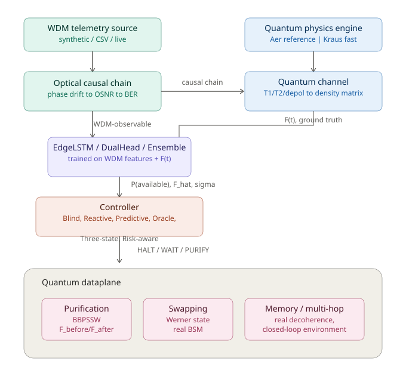

# OrionQ 5.60.0

Esta entrega contém o código atual do OrionQ, incluindo o som original de
desligamento de energia em **Unplug from E.V.A.**. O executável desta versão foi
compilado antes de preparar esta cópia Git. Os critérios e resultados finais da
qualificação são registrados no material de entrega; compilar não constitui
qualificação física ou experimental.

O modo de demonstração permanece identificado como simulado. A atuação física
continua bloqueada e os pacotes externos de modelos ML permanecem opcionais.

## Executar a partir das fontes no Windows

Use Python 3.12 e um ambiente separado:

```powershell
py -3.12 -m venv .venv
.\.venv\Scripts\python.exe -m pip install -e ".[console,desktop,dev,satellite,lab]"
.\.venv\Scripts\python.exe tools/prepare_console_resources.py
.\.venv\Scripts\orionq.exe
```

Os dois recursos fixados em `runtime_assets/native/v1/` são verificados por
SHA-256 e restaurados em `outputs/` pelo preparador. Não substitua seus bytes.
SDKs proprietários, pesos externos opcionais, medições brutas, credenciais e
equipamentos não são incluídos. Para reconstruir e validar o pacote Windows:

```powershell
powershell -ExecutionPolicy Bypass -File tools\build_windows_console.ps1 -SkipInstaller
```

O script executa testes e diagnósticos e pode demorar. A ausência de SDK ou
equipamento não transforma uma demonstração em integração física validada.

Esta cópia inicia um histórico Git independente em `main`; não contém o
histórico do checkout original, seus arquivos locais, executáveis, resultados
completos em `outputs/` ou arquivos retirados em `archives/`. Os links históricos
para esses resultados documentam versões anteriores; os scripts e referências
compactas necessários à reprodução foram preservados. Consulte
[PUBLISH-GITHUB.md](PUBLISH-GITHUB.md) para envio e
[THIRD-PARTY-NOTICES.md](THIRD-PARTY-NOTICES.md) para os avisos dos recursos.

## Documentação preservada do projeto

# OrionQ · Quantum Repeater Digital Twin

Na versão **5.60.0**, **Unplug from E.V.A.** acompanha o desligamento vetorial com um som original de energia diminuindo. A variante local colore o mar da GEO de vermelho e acrescenta uma cruz vetorial semitransparente. O gatilho visual usa **S. Ikari** e a senha exata **thirdpilot**; não autentica essa identidade nem concede permissões. Áudio e aparência preservam órbitas, enlaces e dados do backend. Consulte a [implementação, reprodução e evidências desta rodada](docs/results/orionq_signal_audio_geo_20261008.md) e o [guia da distribuição atual](docs/product/orionq_branding.md).

Na versão 5.57, o programa passa a se chamar **OrionQ**. O Q da marca representa uma esfera de Bloch com satélite, também usada no ícone do executável. A tela inicial identifica o patrocínio **SENAI CIMATEC - LAQCC/QuIIN** e lê a versão dos metadados da distribuição. Os dados, cadastros e a instância única permanecem compatíveis com as versões anteriores. Consulte a [identidade visual e o versionamento](docs/product/orionq_branding.md).

Na versão 5.53, os detalhes dos pontos mostram as observações dos protocolos, com origem, recibos clássicos, métricas por sessão e impedimentos dos enlaces locais. O gráfico de polarização continua disponível para as conexões que publicam essa série. Blocos recebidos sem cliques ou pares úteis são apresentados como resultados de aquisição, sem sugerir uma rota quântica operacional. Consulte o [diagnóstico e a validação](docs/results/orion_q_demo_samples_20261008.md).

Na versão 5.52, os painéis flutuantes apresentam a telemetria em pequenas etapas, reutilizam controles existentes e mantêm os campos longos legíveis com quebra de texto e altura medida. A atualização científica permanece independente da apresentação. Consulte as [correções, medições e limitações](docs/results/orion_q_floating_panels_20261008.md).

Na versão 5.51, a apresentação reutiliza geometria estática, mantém apenas o renderizador GEO ativo e agenda seleções autorizadas no backend. A frequência visual é separada dos eventos científicos. Consulte a [operação e reprodução dos testes de desempenho](docs/product/orion_q_performance.md) e a [comparação medida](docs/results/orion_q_performance_20261007.md).

Na versão 5.50, a [camada comum de segurança](docs/product/orion_q_security.md)
autentica a identidade local, verifica funções e recursos no backend e preserva
essa identidade entre console, API, laboratório e adaptadores. A API exige
autenticação mesmo em loopback. Auditoria HMAC, revogação de certificados e
registros de consumo protegidos complementam os mecanismos existentes de mTLS
e AES-GCM. O laboratório exige cadastro explícito das identidades SAE/KME para
os ensaios de entrega. A qualificação física e de segurança experimental QKD
continua pendente.

As integrações com **IBM Quantum** foram descontinuadas em 07/10/2026.
O produto não oferece acesso a contas, catálogo de QPUs, submissão, recuperação
ou diagnósticos IBM. **Qiskit e Aer continuam disponíveis para simulação local**;
essa execução não acessa serviços IBM. Os registros de versões anteriores
permanecem no [arquivo histórico](archives/retired_ibm_quantum_20261007/ibm_quantum_source.zip),
sem representar funcionalidades atuais.

Na versão 5.48, o **Globo** permite maior aproximação antes de alternar pelo
scroll para o mapa-múndi. O limite passa de 2,85 para 5,8, preservando a região
focalizada e a margem entre os limites de entrada e saída. Consulte
[a operação da GEO](docs/product/orion_q_geo_modes.md).

A [jornada de laboratório](docs/product/orion_q_laboratory.md) executa aquisição de
fótons emulada, replay com origem preservada e QKD com entrega HTTPS/mTLS de chaves
de teste pela API e pelo console nativo. Consulte o [relatório e as evidências](docs/results/orion_q_laboratory_validation_20261007.md)
para resultados, falhas corrigidas e dependências de hardware. Segurança QKD certificada
e integração física dos instrumentos não foram validadas nesta instalação.

[](LICENSE)

Na versão 5.40, **Comunicadores** cadastra sete tipos físicos e suas capacidades,
com validação, persistência e ativação por dois canais. **GEO** destaca apenas
Endpoint/Core; selecionar um satélite abre o globo com órbita e transmissões
publicadas pelo backend. Consulte os [contratos e instruções](docs/product/orion_q_communicators_geo.md)
e o [relatório de validação](docs/results/orion_q_communicators_geo_validation_20261006.md).
As órbitas são aproximações de dois corpos, com parâmetros de cenário identificados.

Na versão 5.39, a demonstração institucional inclui cinco módulos operacionais:
troca de entrelaçamento, TF-QKD, purificação BBPSSW, satélite/Doppler e memórias.
Os 66 nós, 71 enlaces e 12 sessões usam fontes substituíveis e recibos causais;
os controles ficam em **Topology → PROTOCOLOS**. As conexões novas são propostas
para simulação, sem integração física declarada. TF-QKD e QKD satelital expõem
orçamentos condicionais, sem gerar chaves certificadas. Consulte os
[contratos, pesquisa, matriz e execução](docs/product/orion_q_modular_quantum_protocols.md)
a [matriz de conexões](docs/results/orion_q_modular_connection_matrix_20261006.md)
e as [localizações verificadas](docs/results/orion_q_modular_locations_20261006.md).

## Objetivo e resultados (TCC, pré-banca de 22/10/2026)

ORION-Q é um programa de controle para uma rede quântica simulada que admite
modelos de aprendizado de máquina como componentes opcionais, verificados e
reversíveis. Os modelos vêm do qnet_autopilot, incorporado aqui nas suas duas
versões (`src/qnet_network`, `src/qnet_qkd`; scripts, testes e registros de
resultado em `external/`, com o manifesto `external/VENDORED.json`).

Cada controlador roda em **laço fechado sobre a planta em que foi treinado**, sob
contrato, supervisor e protocolo congelado. Antes de pontuar em sementes novas,
cada campanha regenera pela réplica do ORION-Q resultados que o autor publicou ou
exportou; nenhum portão falhou. O detector de ataques, que é um monitor, é avaliado
em sessões novas da mesma planta. Tudo é simulado; nenhuma ação física é executada.

| Modelo | Portão de reprodução | Resultado em sementes novas | Documento |
|---|---|---|---|
| Compensador de polarização | QBER retida declarada (≤ 6×10⁻¹⁷); varredura de atuador do autor (36/36, ≤ 3×10⁻¹⁷) | 3,33× (calibrado) e 4,75× (desenvolvimento) abaixo do alfa-beta ressintonizado, 20/20 sementes; com o atuador do autor, só acima de 120 rad/s (desenv.) e 250 rad/s (calibrado) | [laço](docs/results/orion_q_polarisation_closed_loop_20260929.md) · [atuador](docs/results/orion_q_polarisation_actuator_20260929.md) |
| Compensador em ponto fixo (porte do autor) | varredura de largura de palavra do autor, 20/20 linhas (erro relativo ≤ 3×10⁻¹⁶) | a 16 bits com CORDIC 8 (o RTL), 0,1% (calibrado) a 3,8% (desenvolvimento) do ponto flutuante, vence o alfa-beta 20/20; 12 bits colapsa | [ponto fixo](docs/results/orion_q_polarisation_quantisation_20260930.md) |
| Blocagem de chave (controlador do autor, sem aprendizado) | tabelas de blocagem do autor pelo laço do ORION-Q, 432/432 linhas (≤ 6×10⁻¹⁶), e de estresse, 24/24 (erro 0) | enlace da persistência: 10,9× (calibrado) e 7,9× (desenvolvimento) o melhor temporizador, 20/20 sementes; compensadores aprendidos: 99,8–100,0% do melhor temporizador; alfa-beta: 2% abaixo | [blocagem](docs/results/orion_q_polarisation_blocking_20260930.md) |
| Ator de taxa de chave | episódio exportado bit a bit; tabela publicada 15/15 | +13,6% a +20,8% sobre o comissionamento de 25 a 65 km; 80 km sem diferença | [QKD](docs/results/orion_q_qkd_closed_loop_20260929.md) |
| Sincronizador | tabela publicada 24/24 | melhor que o alfa-beta em 160/160 execuções; margem de 0% a 5,1% | [QKD](docs/results/orion_q_qkd_closed_loop_20260929.md) |
| Alocador híbrido | 4 episódios exportados e ponto da fronteira com chave finita (erro 0) | 2,4–2,6× o tráfego clássico de quântico-primeiro com a mesma chave (±0,5 ponto) | [alocador](docs/results/orion_q_allocation_closed_loop_20260929.md) |
| Agente de roteamento | 2.091 decisões exportadas e 2 tabelas retidas; no SeQUeNCe, as 480 linhas de `runs/sequence` do autor (erro 0) | no gêmeo analítico, empata com a heurística gulosa no prazo longo e fica 3 pontos abaixo no nominal; com o SeQUeNCe no laço, fica abaixo nos dois prazos (19,0% contra 22,9%; 45,4% contra 46,7%), e o gêmeo prevê o SeQUeNCe para as quatro políticas | [roteamento](docs/results/orion_q_routing_closed_loop_20260929.md), [SeQUeNCe](docs/results/orion_q_routing_sequence_20260930.md) |
| Detector de ataques (monitor) | exportação sem *pickle* provada idêntica ao pacote; 7 sessões exportadas byte a byte; 240 métricas de `scores.csv` e demais tabelas do autor (erro 0) | marca 84–89% dos períodos de ataque contra 7–14% do alarme de QBER (110/118 e 111/119 episódios); F1 macro 0,86–0,89; 3–4 alarmes falsos/h; com variáveis de tempo real (sem a diferença central do autor), 0,2 ponto a menos | [detector](docs/results/orion_q_detector_evaluation_20260929.md), [tempo real](docs/results/orion_q_detector_causal_20260930.md) |

O Verilog dos dois pacotes do autor, que nunca tinha passado por um simulador, foi
simulado contra as referências em ponto fixo do autor e sintetizado: exato ao bit no
domínio de uso, com dois defeitos localizados fora dele
([RTL](docs/results/orion_q_author_rtl_20260930.md)). As afirmações acima estão num
registro verificável, conferido contra os resumos das campanhas por 795 checagens
([registro](docs/thesis/orion_q_platform_claim_registry.json),
`tests/test_platform_claims.py`). Repetidas no Windows 11 com os ZIPs originais, as
doze campanhas mantiveram todas as conclusões, e onze cada número
([validação no Windows](docs/results/orion_q_windows_validation_20261001.md)).

Os painéis *shadow* do console também são alimentados pelas plantas do autor
([produtores](docs/product/orion_q_author_plant_producers_20260929.md)). O
compensador pode ser ativado pelo fluxo auditável Q05
([ativação](docs/product/orion_q_polarisation_activation_q05.md)).

Reproduzir tudo no Windows, com os ZIPs fixados, e comparar cada número com os resumos
publicados (tolerância relativa 10⁻⁹; campanhas já concluídas são puladas numa nova
chamada):

```
powershell -ExecutionPolicy Bypass -File tools\run_official_campaigns.ps1 -QnetZip F:\qnet_network.zip -QkdZip "$env:USERPROFILE\Downloads\modelo_qkd_ml.zip" -Workers 4
```

Ou uma campanha por vez:

```
python tools/run_polarisation_closed_loop.py --qnet-zip F:\qnet_network.zip --output outputs\polarisation-closed-loop-v1
python tools/run_polarisation_actuator.py   --qnet-zip F:\qnet_network.zip --output outputs\polarisation-actuator-v1 --workers 4
python tools/run_qkd_closed_loop.py         --qkd-zip modelo_qkd_ml.zip    --output outputs\qkd-closed-loop-v1
python tools/run_allocation_closed_loop.py  --qnet-zip F:\qnet_network.zip --output outputs\allocation-closed-loop-v1
python tools/run_routing_closed_loop.py     --qnet-zip F:\qnet_network.zip --output outputs\routing-closed-loop-v1
python tools/run_routing_sequence.py        --qnet-zip F:\qnet_network.zip --author-zip "Qnet-Network ML.zip" --output outputs\routing-sequence-v1 --workers 2   # exige o SeQUeNCe (SEQUENCE_SRC)
python tools/run_detector_evaluation.py     --qkd-zip modelo_qkd_ml.zip    --output outputs\detector-evaluation-v1
python tools/run_detector_causal.py         --qkd-zip modelo_qkd_ml.zip    --output outputs\detector-causal-v1 --workers 2
python tools/run_polarisation_quantisation.py --qnet-zip F:\qnet_network.zip --output outputs\polarisation-quantisation-v1 --workers 2
python tools/run_polarisation_blocking.py   --qnet-zip F:\qnet_network.zip --output outputs\polarisation-blocking-v1 --workers 3
python tools/verify_author_rtl.py           --qkd-zip modelo_qkd_ml.zip    --output outputs\author-rtl-v1   # exige iverilog e yosys
python tools/build_platform_evidence.py     # reconstrói a tabela de evidências do registro
```

O texto do TCC está em [`docs/thesis/monografia`](docs/thesis/monografia/). O
histórico completo do projeto continua abaixo.

---

Local checkout (2026-09-24): `E:\Codex\2026-08-27\e\work\NISQ-Predictive-Twin`.
See the [relocation and continuation record](docs/product/local_workspace.md).

A research prototype of a quantum repeater digital twin. Synthetic or
recorded **WDM classical telemetry** can drive optical forecasting and
offline quantum simulation for per-round admission-control studies — combining
causal physics simulation (Qiskit Aer), predictive machine learning
(PyTorch), and calibrated decision theory into a single, closed-loop,
an extensively tested platform. Recorded WDM data validates the optical layer;
controlled Toshiba hardware sweeps and the Bristol HCF on/off network release
add measured QBER/secure-key-rate evidence, while Bell-fidelity and controller
targets remain simulated.

**1025 tests passing.** Full development history (137 chronological
addenda — every bug found, every negative result, every honest
limitation) lives in [`docs/history.md`](docs/history.md).

Version 5.38 implements the supplied institutional interface: fixed six-route
rail, Chakra Petch headings, click-only profile/node overlays, GRAPH/GEO/MATRIX
topology modes, shadow-only node provisioning and an aggregate-only Edge
Control surface. GEO requires declared coordinates; MATRIX uses direct links
only. The visual upgrade does not invent hardware, authentication or evidence.

The source now includes a [paired-seed temporal campaign](docs/product/orion_q_temporal_campaign.md)
for the configured two-link path: acquisition, T1/T2 and retention regimes share
one frozen topology, target and deadline. The CLI journals complete trials,
includes timeouts in target-success probability, and reports Wilson intervals
and paired McNemar/Holm comparisons. This is simulated sensitivity analysis,
not measured WDM validation. The [native campaign panel](docs/product/orion_q_temporal_campaign_ui.md)
now supports manifest review, child-process progress/cancellation, verified
comparison and full JSON export. The [Windows build with worker support](docs/product/orion_q_frozen_temporal_worker.md)
has been rebuilt and validated; portable distribution does not require external Python.
The [saved campaign history](docs/product/orion_q_temporal_history.md) now pages
through completed receipts and verifies each one before reopening its comparison.
Historical viewing never reruns trials or changes the current topology.
History also supports explicit, case-sensitive campaign ID prefix search;
pagination preserves the applied filter, and source switching clears it.
The [operational attempt journal](docs/product/orion_q_campaign_attempts.md)
records native-console dispatches and terminal observations separately from
scientific receipts; unresolved attempts never become fabricated quantum outcomes.
Selected attempts can be exported as verified operational JSON snapshots through
EXPORT ATTEMPT, without overwriting files or silently substituting a newer state.
VERIFY FILE checks an external operational snapshot's strict schema and canonical
hash (32 KiB maximum), without importing it or changing the scientific receipt.
Hash consistency is not authorship authentication or scientific validation.
ATTEMPTS also supports literal campaign-ID prefix and operational-state filters,
applied explicitly through Enter / REFRESH and retained during page navigation.
Requested-day UTC bounds (inclusive FROM, exclusive BEFORE) can be combined with
those filters; the ATTEMPTS pane scrolls vertically on smaller windows.
EXPORT PAGE ZIP saves the current operational page (not all search results),
with a manifest and individually verifiable JSON members. Changed records refuse
the entire batch before file creation; existing files are never overwritten.
CHOOSE / VERIFY PAGE ZIP checks the manifest, every member and declared filters
without extraction, import or journal access (2 MiB / 50 attempts maximum).
CRC and hash consistency do not authenticate authorship or establish that the
archive includes every result of the original search.
OPEN LINKED RECEIPT opens a selected attempt's recorded scientific receipt only
after verifying the attempt, request and receipt association in one read-only
SQLite snapshot. It never infers a result for OPEN/failed attempts, changes their
status or reruns trials; replay/recovery is not a new scientific sample.
The native campaign adapter now uses an explicit read-only database connection
for history, receipt readback and operational exports. These reads do not create
missing journals, initialize schemas or optimize SQLite statistics. Authorized
campaign dispatch/finalization retain their separate writable path.
MANIFEST REVIEW now offers EDIT MANIFEST for a complete in-memory JSON draft.
Validation is shared with file loading (64 KiB maximum); valid application clears
the old result and review approval but never launches a worker or writes a file.
Cancel/invalid drafts do not replace the loaded request. Source changes require
reopening the editor; IDs, seeds and topology versions are never auto-adjusted.
SAVE MANIFEST AS writes the applied configuration to a new JSON in a background
task, without overwriting an existing file or executing trials. LOAD MANIFEST
reopens it with fresh source/version validation and review. This is not a result,
topology backup, signed preregistration or automatic draft recovery.
ACCESS & AUDIT now offers a [local command center](docs/product/orion_q_commands_q04.md)
for native inventory writes, with persistent IDs and explicit unknown outcomes.
A read-only reconciliation API/CLI now exports the selected unresolved receipt
and current topology from one SQLite snapshot. It preserves the original outcome;
matching state does not prove execution. CHECK CURRENT STATE and EXPORT EVIDENCE
now expose this in COMMAND CENTER, with background work and source/selection guards.
Q04 is partial. A first [Q05 preparation/review API](docs/product/orion_q_policy_preparation_q05.md)
now binds a proposed repeater-policy threshold to the existing runtime, baseline
and topology. Proposals expire and stale reviews remain invalid; nothing is activated.
EDGE CONTROL → POLICY REVIEW now exposes explicit baseline loading, preparation,
review and captured JSON export in the native console, with background work and
source/selection/expiry guards. A [local approval API](docs/product/orion_q_policy_approval_q05.md)
now records explicit declarations bound to the latest review after fresh context
validation. It does not authenticate the operator or confer activation authority.
Native APPROVE PROPOSAL now opens a separate, initially unchecked confirmation;
RECORD APPROVAL revalidates in the background and EXPORT APPROVAL saves its captured
receipt. A separate [local simulation activation API](docs/product/orion_q_policy_activation_q05.md)
now validates the live approval/context, commits durable evidence and checks active
policy identity before later simulation cycles. It never restores historical activations
automatically after restart. [Approved rollback and explicit recovery](docs/product/orion_q_policy_recovery_q05.md)
now have local APIs: rollback targets the recorded previous policy, while recovery
retains the restored policy and audits commit uncertainty. Native activation now requires
a separate confirmation in POLICY REVIEW; ACTIVE POLICY provides explicit timestamped
readback and captured export. [Validation](docs/results/orion_q_policy_activation_ui_20260928.md).
Native rollback now prepares the recorded previous threshold for fresh review/approval/activation.
Recovery has its own inspection and confirmation, retaining the restored policy object.
[Native rollback/recovery validation](docs/results/orion_q_policy_recovery_ui_20260928.md).
[DECISION AUDIT](docs/product/orion_q_policy_decisions_q05.md) now reads verified simulation
cycles, separating intended action, safety veto and executor outcome. New activated
cycles anchor the complete policy receipt hash; older or missing links are labeled
explicitly. It never recomputes decisions or substitutes the current configuration.
[Declared compatibility criteria](docs/product/orion_q_policy_compatibility_q05.md) are now
available through the local API, explicit JSON export and optional-model catalog.
All eleven optional components show their input/output contracts and Q05 blockers;
a verified ZIP or shared action name cannot grant runtime selection. These reports
do not observe the runtime or validate current telemetry. Q05 remains partial;
[contextual observation](docs/product/orion_q_policy_context_q05.md) now compares an
explicit simulated input with the existing runtime and persisted topology through
a separate read-only local session. Expired/changed contexts are refused; optional
components remain blocked. EDGE CONTROL → CONTEXT INSPECTION now provides explicit background observation,
source/selection invalidation and captured export in a private panel session.
It never fills input predictions/timestamps or enables candidate selection.
Next: define a bounded action translation for an optional routing component;
unsupported actions/resources must be refused before any activation workflow.
[Native approval validation](docs/results/orion_q_policy_approval_ui_20260928.md).
[Native review validation](docs/results/orion_q_policy_review_ui_20260927.md).
The [two-model integration plan](docs/product/orion_q_two_models_integration_plan.md)
now includes the supplied QKD and Quantum Network artifacts/papers. The first
[offline admission increment](docs/product/orion_q_author_model_intake.md) checks
QKD synchronization/key-rate recommendation, two routing checkpoints, four polarisation compensators
and two hybrid allocation configurations
against the supplied examples, with pinned archives and no pickle loading.
The [optional-model catalog/factory](docs/product/orion_q_optional_models.md)
keeps every new model OFF by default, requires explicit selection and preserves
the existing baselines. EDGE CONTROL now offers a read-only native catalog with
11 entries (ten offline adapters and one blocked detector), explicit OFF defaults,
runtime unavailable and weights not checked. Inspecting an entry never loads
weights or changes a policy. VERIFY LOCAL ZIP now checks reviewed package identity
and integrity asynchronously, with explicit refusal and stale-result invalidation.
Verified means a checked snapshot, not installed, active or telemetry-compatible.
The verified QKD synchronizer now has an explicit graphical OFFLINE SESSION:
eight simulated samples, a two-second offset forecast, persistence comparison,
optional future reference excluded from inference, and non-overwriting JSON export.
The QKD key-rate actor also has a separate graphical session: causal previous-period
inputs, explicit PCG64 seed, all nine bounded action previews and a hold-current
parameter baseline. Parameter changes are not performance gains or rate forecasts.
The four [polarisation compensation sessions](docs/results/orion_q_compensation_session_ui_20260922.md)
offer independent Ridge/MLP checkpoints for calibrated/development regimes,
explicit persistence warm-up and optional final-reference angular errors.
The two [routing sessions](docs/results/orion_q_routing_session_ui_20260922.md)
accept named simulator features, ordered candidates and explicit PCG64 seed:
nominal samples actions; long-deadline selects greedily. A declared reference
supports decision agreement only, not performance or counterfactual outcomes.
The [hybrid allocation sessions](docs/results/orion_q_allocation_session_ui_20260923.md)
now compare persistence and Ridge on the same fixed eleven-link snapshot and
committed queue. Warm-up is explicit; no queue is advanced or action executed.
All ten admitted offline configurations now have native sessions. The
[Windows build of 23 September](docs/results/orion_q_optional_models_windows_20260923.md)
packages these sessions and passed local checks with and without external author
weights. Runtime activation and independent-machine acceptance remain pending.
The subsequent source-only [synchronization shadow bridge](docs/product/orion_q_sync_shadow_bridge.md)
accepts explicit typed simulated timing windows alongside sandbox snapshots,
reports prediction versus persistence and never invokes control. Missing timing
features remain unavailable. Its [continuous artificial-source session](docs/results/orion_q_sync_shadow_ui_20260923.md)
is now connected through the same dashboard snapshot plug, with explicit START,
freshness checks and frame export. Physical timing and other bridges remain pending.
The source-only [temporal evaluator](docs/results/orion_q_sync_temporal_20260923.md)
now scores committed forecasts against later exact-target samples, exports paired
MAE/RMSE and reports missing targets. Its artificial replay is not experimental evidence.
The [subsequent multi-seed stress campaign](docs/results/orion_q_sync_campaign_20260923.md)
found non-uniform advantage: only one of six scenarios met the predefined descriptive
filters. The synchronizer remains optional and must not silently replace persistence.
The source-only [polarisation shadow bridge](docs/product/orion_q_compensation_shadow_bridge.md)
now admits explicitly typed simulated SO(3) windows for four checkpoints, with
regime/cadence validation and distinct warm-up status. The artificial provider now
feeds a [native opt-in shadow view](docs/product/orion_q_compensation_shadow_bridge.md#uso-no-dashboard),
with 16-sample batches on independent virtual clocks. No physical source or actuator is connected.
The [angular temporal evaluator](docs/product/orion_q_compensation_temporal.md) now
scores previously committed forecasts on later exact-target samples. The initial
single-seed artificial diagnostic is mixed: Ridge beats persistence, MLP does not;
this is neither generalization evidence nor physical validation.
The completed [SO(3) robustness campaign](docs/results/orion_q_compensation_campaign_20260923.md)
now records 240 runs and all 24 scenario/checkpoint groups. Six groups met the
descriptive filters: Ridge in both regimes under smooth, thermal-reversal and
rotation-step inputs. Noise failed the filters; loss and late results reduced
coverage to 73.333%. MLP lost to both baselines in every seed. The historical
selected regression passed 500 tests; the 2026-09-24 audit verified all 240 report
hashes and recomputed the aggregates. Models remain optional, OFF by default,
offline/shadow only; Q05 and physical actuation remain inactive.
This increment is not included in the previous Windows package.
The [key-rate actor](docs/product/orion_q_optional_keyrate.md) returns bounded,
offline recommendations with explicit RNG, never instrument commands or promised key rates.
The [hybrid allocator](docs/product/orion_q_optional_allocator.md) preserves its
fixed simulated plant, delayed queue and persistence baseline; its internal
asymptotic key forecast is not a finite-key security certificate or delivered key.
The [QKD key-rate shadow bridge](docs/product/orion_q_keyrate_shadow_bridge.md)
now validates explicit decoy-state windows, link/settings/calibration identity and
causal prior periods before loading weights. Calibration bootstrap is explicit at
clock origin. The read-only API/CLI preserve seeded selection and nine bounded
proposals versus holding current settings, without applying parameters or claiming
key-rate outcomes. Eight original-weight checks and 564 selected tests passed;
see [validation](docs/results/orion_q_keyrate_shadow_20260924.md).
The [native QKD actor shadow session](docs/results/orion_q_keyrate_shadow_ui_20260926.md)
now adds independent artificial periods, explicit calibration bootstrap and START,
configuration/calibration invalidation, period-based freshness and captured-frame
export. Six original-weight UI evaluations matched offline results without applying
settings. All ten admitted configurations have offline and artificial shadow views
in source; Q05 remains pending and these increments have not rebuilt the Windows EXE.

The [routing shadow bridge](docs/product/orion_q_routing_shadow_bridge.md)
now admits explicit simulated features, ordered candidates and declared node/link/
memory/pair resources. Invalid candidates refuse the whole window before loading
weights; nominal/long-deadline selection retains offline order and seed. The
read-only runtime method and replay CLI perform no action or resource mutation.
See [validation and limits](docs/results/orion_q_routing_shadow_20260924.md).
The [native routing shadow view](docs/results/orion_q_routing_shadow_ui_20260924.md)
is now available in source, with an independent artificial inventory, explicit
START, freshness/context invalidation and captured-frame export. Twelve native
original-weight evaluations matched offline results. Features are illustrative;
no routing performance or calibrated simulator-domain claim follows. Q05 policy
activation remains pending; no Windows executable was rebuilt for this increment.

The [allocation shadow bridge](docs/product/orion_q_allocation_shadow_bridge.md)
now accepts typed fixed-plant snapshots, checks source/clock/plant identity and
compares persistence/Ridge without updating queues or invoking control. The source
API and explicit replay CLI passed four original-package parity checks and 407
selected tests. The subsequent [native allocation shadow view](docs/results/orion_q_allocation_shadow_ui_20260924.md)
now receives causal artificial history through the common snapshot, with explicit
START, freshness/invalidation and frame export. Its exogenous queue never consumes
recommendations; the 5 s virtual cadence is not a physical control deadline.
Other components and runtime activation
remain pending. The new optional-session Windows build establishes software/export
parity, not experimental validity or operational advantage. Older executables are unchanged.
The native [Windows acceptance diagnostic](docs/product/orion_q_windows_acceptance.md)
checks package hashes, self-test and synthetic stress in isolated state, without
external Python or PowerShell scripts. Independent-machine/manual acceptance remains pending.

**Live network and demonstration mode (2026-10-05).** The native console now shows a
live network computed by a backend engine (`quantum_autopilot.network_engine`): Topology
opens on the **GEO** map of Salvador (to scale, operator-declared coordinates), nodes
without location wait in a queue, a click on a node opens a floating window with the
stability wave of every connection, and disabling a fibre, isolating or recalibrating a
node, placing a node and requesting a pair are backend verbs whose effect — rerouting
included — is read back from the next snapshot. **Demonstration** (`orion-q --demo`, or
the first row of the login screen) is the same service, engine and console provider as
normal operation on its own journal: only the INPUT data are simulated, by the backend;
QBER, fidelity, key rate, attack alarms, routes and calibration reports are produced by the
real processing, including the reviewed attack detector. Learned weights of the other
roles run only when the author's two pinned archives are supplied
(`--qnet-archive`, `--qkd-archive`); otherwise each role names the reference controller
deciding in its place. Honest limits (routing agent outside its reviewed contract on this
topology, detector false alarms that move routes, long detours ending `blocked`) are in the
[guia de demonstração](docs/product/orion_q_demo_guide.md); contract and engine in
[live network design](docs/product/orion_q_live_network_design.md) and
[network engine](docs/product/orion_q_network_engine.md). No physical actuation exists.

Version 5.37 adds **DATA SOURCE**: synthetic demonstration, the existing service
and a read-only measured-telemetry JSON plug use the **same window and screens**.
Switching clears prior data and refuses stale callbacks; device-specific
acquisition still needs an adapter. See the [input contract](docs/product/input_sources.md).

Version 5.36 names the native product **ORION-Q**, adds responsive layouts,
bundled reference fonts, scrollable lists and an isolated artificial injection
laboratory. See the [ORION-Q guide](docs/product/orion_q_console.md) for
profiles, shortcuts, fault coverage and limitations. Physical control remains
blocked; artificial signals are not new scientific evidence.

The [native Windows console](docs/product/native_console.md) integrates
with the existing service: actual simulated topology identifiers, contract-driven
model metrics, published QKD cells, asynchronous operations, persistent console
audit events and hash-verified portable resources. Use `quantum-twin-console`
after installing `.[console]`, or extract the complete Windows portable ZIP and
run `OrionQ.exe`. Physical requests remain refused; the native
interface is not evidence of measured Bell-fidelity prediction or hardware
control. The older browser interface remains available from source with `--ui web`.

Version 5.17 adds the first selectively integrated
[`quantum_autopilot.core`](docs/architecture/quantum_autopilot_core.md)
layer: validated domain-neutral contracts, fail-closed SLO/budget gates,
uncertainty/OOD fallback and auditable decision records. No photonic or IBM
adapter, FPGA predictor, external result bundle or stronger scientific claim
was imported in this phase; `quantum_twin` remains the scientific source of
truth.

Version 5.18 adds a strictly read-only
[`ClaimRegistryAdapter`](docs/product/qkd_claim_assurance_adapter.md). It
validates the formal claim registry and every referenced evidence artifact,
then emits self-contained decision records for a dashboard. All claims remain
displayable; only `C-MEASURED` can provide decision support inside the
validated grid, and physical automation remains blocked for every claim.

Version 5.19 replaces the manually supplied grid-scope flag with a typed,
measured [`QKDOperatingPoint`](docs/product/qkd_claim_assurance_adapter.md) and
an exact-cell IrelandQCI classifier. The 80-cell contract is hash-pinned, does
not interpolate, rejects simulated or untraceable provenance, and keeps
QBER/SKR outcomes out of the membership calculation. New campaigns, devices,
channels and platforms fail closed; this does not upgrade the cross-sectional
evidence into temporal prediction or Bell-fidelity validation.

Version 5.20 packages the defensible evidence boundary as the local
[`WDM·QKD Assurance` dashboard](docs/product/enterprise_assurance_dashboard.md).
Its loopback-only API validates the formal claim registry and source hashes,
loads published QBER/SKR cells server-side, applies the exact-grid guardrail and
exports a complete audited decision record. The dashboard disables evaluation
when evidence integrity is unavailable and exposes no physical executor. This
is an enterprise-facing assurance demonstrator, not a claim that temporal WDM
prediction has been validated.

Version 5.21 adds the non-physical
[`Quantum Network Control Plane Sandbox`](docs/product/quantum_network_control_plane_sandbox.md).
It reuses the original HALT/WAIT/PURIFY/SWAP policy, places an independent
fail-closed supervisor in front of dry-run and Qiskit-backed simulated
executors, enforces request idempotency, and journals complete hash-addressed
cycles in SQLite. The dashboard exposes simulation, shadow and assurance modes;
physical mode and physical execution do not exist. Fidelity and uncertainty in
this first slice are explicit manual simulation inputs, not measured WDM model
outputs.

Version 5.22 adds a persistent three-node simulated topology and a versioned
scenario runner to the control-plane sandbox. The shipped resilience scenario
executes nominal operation, an uncertainty-triggered fail-closed HALT and
recovery against state retained in SQLite across process restarts. Pair
injection is explicitly synthetic, every topology transition and scenario is
hash-addressed, and optimistic versions reject stale updates. This is still a
simulator product increment: it adds no live inventory, measured WDM predictor
or physical device control.

Version 5.23 connects the existing WDM fidelity models to the sandbox through a
typed, hash-bound inference adapter. Ordered simulated WDM windows are scaled
with recorded training-only bounds, evaluated by point, probabilistic or
fidelity-DualHead output contracts, and converted into fidelity, uncertainty
and OOD state before the unchanged policy and safety supervisor run. The
included EdgeLSTM/EdgeGRU/EdgeTCN shadow campaign preserves model, dataset,
configuration and window hashes and never actuates hardware. This is a product
integration result on simulated data, not measured validation of the central
WDM hypothesis. The [exploratory shadow replay](docs/results/wdm_control_plane_shadow.md)
records the resulting fail-closed behavior. The
[product roadmap](docs/product/roadmap.md) records the current product gates.
The IBM processor-validation branch described in earlier versions was discontinued;
local BBPSSW and quantum-network simulation remain part of the project.

Version 5.24 adds a strict
[`three-lane evidence architecture`](docs/product/evidence_lanes.md). The real
65,733-row Sant'Anna recording is now exposed as hash-bound optical-health
telemetry together with its honest negative forecasting result (`0/16`
positive tests). Measured QBER/SKR remains in QKD Assurance, while the original
WDM-to-Bell model remains explicitly simulated. Cross-metric conversion is
forbidden, and optical, QKD, measured or undeclared evidence fails closed before
`PURIFY`/`SWAP`. API v1.2 and the dashboard display these boundaries; no lane
can perform a physical action.

Version 5.25 adds a predeclared, paired ten-seed
[`controller comparison`](docs/results/wdm_controller_comparison_v525.md) on
identical held-out simulated traces. Point, probabilistic and DualHead
EdgeLSTMs produced 0/3 positive registered improvements over persistence:
calibrated uncertainty exceeded the fixed safety ceiling and all candidates
abstained. A separate audit found the unchanged four-action policy saturated on
`SWAP` in 60/60 in-distribution controller-seed cases at the fixed two-pair
state. These negative results block premature product promotion and motivate a
fresh-seed policy-semantics/abstention remediation before dashboard model
replay; they do not validate measured WDM-to-quantum prediction.

Version 5.26 repairs the action semantics through a calibrated
[`task-constrained policy`](docs/results/wdm_policy_remediation_v526.md).
Link preparation can only HALT/WAIT/PURIFY; path extension can only
HALT/WAIT/SWAP and uses two explicit stored-link fidelities rather than the WDM
candidate prediction. The BBPSSW output target is now analytically inverted
(0.65 output requires 0.625 input). All 60/60 fresh-seed sensitivity audits
passed; 23/60 controller-seed rows were still single-action on held-out data,
while the earlier, non-comparable fixed-state audit was 60/60. None of the
three neural comparisons beat persistence after Holm correction. The policy
bug is fixed; a neural operational-gain or measured-data claim is still not
supported.

Version 5.27 adds a safe, frozen
[`WDM model bundle and dashboard replay`](docs/product/wdm_model_bundle_and_replay.md).
The NPZ artifact contains only JSON/`uint8` data and finite `float32` tensors;
loading uses `allow_pickle=False`, reconstructs a whitelisted local architecture
and validates exact tensor shapes, feature order, preprocessing lineage, trace,
model, bundle and frozen-policy hashes. API v1.3 exposes server-configured model
status and bounded shadow replay, while the dashboard plots prediction,
uncertainty, OOD and intended/effective actions. It prominently retains the
v5.25/v5.26 `0/3` results and cannot label the model as approved or perform a
physical action.

Historical versions 5.28–5.33 developed an IBM processor-validation branch:
local circuit preparation and Bell controls, bounded execution contracts, a
durable operator ledger, read-only recovery and metadata diagnostics. Validation
used fake backends and local doubles; no IBM hardware job was run. This branch
was **discontinued on 2026-10-07**. Its previous runbooks, adapters, commands and
optional Runtime dependency are no longer part of the active product. The
[development history](docs/history.md) preserves the record of those versions.
Qiskit/Aer simulation used by the quantum-network backend remains available.

Version 5.34 turns the assurance surface into a distributable Windows
[`Quantum Network Control Plane`](docs/product/desktop_quantum_network_control_plane.md).
The Nocturne-inspired dashboard, loopback API, validated evidence bundle,
frozen WDM DualHead model, SQLite journal and Qiskit/Aer simulator ship in a
single one-folder package headed by `NISQPredictiveTwin.exe`. The executable
can operate the persistent simulated topology and exercise
HALT/WAIT/PURIFY/SWAP under the independent supervisor; it cannot bind to the
LAN or issue a physical command. Hardware control remains a future adapter and
homologation milestone, not a renamed sandbox capability.

---

## 1. Problem

Quantum repeaters purify and swap entangled pairs to extend quantum
networks beyond direct transmission range. Every purification attempt
consumes real QPU resources; every swap only helps if the underlying
pairs are good enough. A repeater that always attempts (**Blind**)
wastes resources on doomed pairs. A repeater that only reacts to a
pair's *already-measured* fidelity (**Reactive**) can't anticipate
degradation before it happens. Can classical, WDM-observable optical
telemetry — signals a repeater can read *without* touching the quantum
state itself — predict future fidelity well enough to make **better**
admission-control decisions than either extreme?

## 2. Scientific hypothesis

```
WDM telemetry (t)  ->  optical degradation  ->  quantum degradation  ->  F(t + Delta t)
```

If phase drift, optical power, OSNR, BER, loss, and latency — all
classically observable without measuring the quantum state — are
causally upstream of the same physical processes (T1/T2 decoherence,
depolarization) that determine a stored pair's fidelity, then a
classical predictor watching only WDM telemetry should carry real
information about a pair's future quality, enough to justify skipping
doomed purification attempts *before* they're attempted. The central
hypothesis under test is not simply `MAE_ML < MAE_baseline`, but the
full causal chain: **does WDM telemetry contain sufficient predictive
information to produce better quantum-resource-allocation decisions**,
measured end to end (fidelity, yield, QPU cost, energy — see Results).

This was tested rigorously, not assumed: mutual information, Granger
causality, transfer entropy, temporal ablation, and real do()-calculus
interventions (Sections 4 and 12) all point the same direction, while
being honest about where they disagree.

## 3. Physical model

The causal chain is implemented as real, executable physics, not a
black-box approximation — see [`docs/physics.md`](docs/physics.md) for
the full equations and every approximation's stated validity range.

- **`ReferenceEngine`** (Qiskit Aer density-matrix simulation) vs.
  **`AnalyticalEngine`** (closed-form Kraus algebra; renamed from
  `FastEngine` — a name should describe what a method *is*, not an
  untested speed claim — `FastEngine` kept as a backward-compatible
  alias) — validated to agree to floating-point precision on every
  regime tested. Speed is **regime-dependent, not assumed**:
  `AnalyticalEngine` shows *no* measured advantage when an engine object
  is reused across calls (matching how this project's dataset generator
  actually uses it), but a genuine ~6x speedup when a fresh engine must
  be constructed per call — traced directly to Aer's ~26ms
  circuit-construction overhead, not the simulation itself.
- **Purification** (BBPSSW): closed-form analytical formula, cross
  -validated against a real density-matrix simulation (agreement to
  <1e-8 across the full useful range), connected to real telemetry
  -derived F_before values (mean gain +0.032 fidelity on 1625 real
  admitted pairs).
- **Swapping** (Werner-state / real BSM density-matrix simulation) —
  validated against the analytical formula `F1*F2 + (1-F1)(1-F2)/3`.
- **WAIT is a real physical action** — genuine multi-tick decoherence
  (`begin_wait_hold()` / `wait_tick_and_reobserve()`), verified
  monotonically decreasing fidelity from a valid starting pair (a real
  pitfall — starting from an *unavailable* round's F=0 showed fidelity
  rising toward the maximally-mixed equilibrium instead — is guarded
  against explicitly).
- **Real do()-calculus interventions** (not mere conditioning) reveal a
  sharp, non-obvious sensitivity structure: at this project's baseline
  high-OSNR operating point, loss/OSNR/optical-power perturbations show
  **zero measurable effect** on fidelity even at 5-20dB magnitudes — the
  BER-vs-OSNR "waterfall" curve is deeply saturated there. Only a direct
  BER intervention, or phase_drift pushed near a π/2 interference
  singularity, shows real sensitivity. A formal LOCAL sensitivity ranking
  (S_X ≈ ΔF/ΔX) confirms this quantitatively: **BER is the only variable
  with non-zero local sensitivity** (S_X=-12.38) at the baseline — every
  other WDM variable's local sensitivity is exactly zero there. A genuine
  quantitative finding about this simulation's specific regime, not a
  general physical claim.

## 4. WDM telemetry

12 WDM-observable features (`WDM_FEATURE_COLUMNS`) are formally
separated from 3 quantum-privileged features (`T1`, `T2`,
`Depolarization_Level`) throughout — see
[`docs/telemetry.md`](docs/telemetry.md) for the full data contract, and
[`telemetry_interface.py`](telemetry_interface.py) for a formal
`read()`/`schema()`/`validate()` interface (Synthetic/CSV/Parquet/Live
sources, all interchangeable, with real leakage-safe normalization,
outlier detection, and irregular-sampling resampling).

- **Causal sensitivity ≠ predictive value — demonstrated concretely, not
  just stated as principle**: `BER` has by far the largest causal
  sensitivity to conditional fidelity (S_X=-12.38, do()-intervention
  evidence) yet is the LEAST useful WDM feature for actual prediction —
  removing it from DualHead's inputs *improves* MAE and R², because BER
  sits saturated near zero across nearly the entire natural data
  distribution and carries almost no discriminative variance to learn
  from. Conversely, `Loss_Db` is the single MOST predictively valuable
  WDM component, despite having zero measured conditional-fidelity
  sensitivity — it matters through the availability head, not the
  fidelity head. Three connected addenda (causal intervention,
  sensitivity ranking, feature ablation) triangulate this into a single,
  coherent, quantitative story that a single method alone would have missed.
- **Three independent causal-inference methods** (Granger causality,
  transfer entropy, temporal ablation) converge on WDM telemetry
  carrying genuine, structurally-exploited predictive information —
  while honestly disagreeing on specifics (e.g. `Latency` shows the
  strongest transfer-entropy signal but isn't Granger-significant at
  p<0.05; removing WDM features entirely collapses R-squared from +0.18
  to -3.66, the single cleanest piece of evidence). These are classified
  by evidence STRENGTH (`temporal_precedence` < `predictive_causality` <
  `information_transfer` < `physical_causal_hypothesis` <
  `experimental_causal_validation`, see `causal_intervention.py`'s
  `CausalEvidenceLevel`) — never treated as interchangeable proof of
  physical causation.
- **Mutual information MI(X_t, F(t+Δt)) decays smoothly with horizon,
  then shows a real, verified non-monotonic bump** — MI drops from
  100% (Δt=1) to 23.7% (Δt=10, matching the physical mean-reversion
  timescale), then genuinely RISES again through Δt=50 (28.7%) before
  declining further. Checked directly before reporting: not a
  sample-size artifact (effective N barely changes across these
  horizons) and not estimator noise (MI(50) > MI(10) held across 5
  independent estimator seeds, by a consistent margin every time). The
  underlying physical mechanism is stated as an open hypothesis, not
  resolved — a secondary, longer-timescale process is plausible but
  unconfirmed.
- **Format-agnosticism is tested on synthetic records**: the
  same EdgeLSTM model, given the same underlying synthetic data read via
  `SyntheticWDMSource`, `CSVTelemetrySource`, and `ParquetTelemetrySource`,
  produces byte-identical predictions regardless of which source
  supplied the DataFrame — verified directly (`torch.allclose`), not
  assumed from the shared interface's design. Real timestamp validation
  (monotonicity, duplicates) and sampling-rate validation (actual vs.
  expected period, within a stated 10% tolerance) were added to close a
  gap between the schema's declared capability and what `validate()`
  actually checked.

The recorded-data campaign is executable and deliberately harder than a
single random holdout:

```bash
python experiments/run_santanna_optical_campaign.py \
  --csv /path/to/HardFailure_dataset.csv \
  --output-dir outputs/santanna_hard_failure
```

It evaluates persistence, EWMA, a local-level Kalman filter, ridge regression
and histogram gradient boosting at several horizons. Features are causal and
device-local; every fold uses an expanding temporal origin, a conservative
embargo of at least `max_lag + horizon`, and train-only preprocessing. A
chronological leave-one-device-out test measures transfer. The automatic
winner remains persistence unless a paired moving-block-bootstrap confidence
interval, Bonferroni-corrected across candidate models, excludes zero
improvement. Outputs include tidy per-device/fold metrics, paired comparisons,
the TCC-ready result table, plots, predictions, dataset hash and a checksummed
artifact manifest. Negative results are first-class results.

Cross-campaign confirmation is frozen separately from discovery:

```bash
python experiments/run_santanna_cross_campaign_validation.py \
  --hard-csv /path/to/HardFailure_dataset.csv \
  --soft-csv /path/to/SoftFailure_dataset.csv \
  --output-dir outputs/santanna_hard_to_soft_confirmation
```

The versioned protocol fixes dataset hashes, features, horizons, seeds and the
eight HardFailure selections before SoftFailure is read. Fitting, filter tuning
and interval calibration use HardFailure only. On the real SoftFailure
campaign, **none of the six preregistered ML-superiority hypotheses was
confirmed**: persistence adapted much better to the smoother sinusoidal regime.
This negative external result is preserved in
[`docs/results/santanna_hard_to_soft.md`](docs/results/santanna_hard_to_soft.md)
and prevents the strong within-HardFailure gains from being misreported as
general cross-regime performance.

The central optical premise is now tested directly rather than inferred from
generic forecast accuracy:

```bash
python experiments/run_santanna_wdm_information_campaign.py \
  --csv /path/to/HardFailure_dataset.csv \
  --output-dir outputs/santanna_wdm_information_reference \
  --targets osnr_db pre_fec_ber --horizons 3 10 \
  --models ridge edge_lstm edge_gru edge_tcn
```

This campaign conditions on the target's own history, then asks whether
causally aligned transponder/amplifier telemetry adds predictive value. It
also requires the aligned model to beat a within-device temporally permuted
WDM control. The repository's original EdgeLSTM, EdgeGRU and EdgeTCN
backbones are reused with only the fidelity-specific sigmoid replaced by a
real-valued optical regression head. In the exploratory HardFailure reference
run, **0/16 model-target-horizon tests passed both corrected criteria**; the
dataset therefore does not yet support the central incremental-information
premise. Protocol, all negative comparisons and interpretation are preserved
in [`docs/results/santanna_wdm_information.md`](docs/results/santanna_wdm_information.md).

The quantum-focused extension now separates measured evidence from replay:

```bash
python experiments/run_qkd_coexistence_campaign.py \
  --dataset-dir /path/to/zenodo-21132088 \
  --output-dir outputs/qkd_coexistence_measured

python experiments/run_qkd_multihead_campaign.py \
  --dataset-dir /path/to/zenodo-21132088 \
  --output-dir outputs/qkd_multihead_measured

python experiments/run_bristol_hcf_coexistence_campaign.py \
  --dataset-dir /path/to/61193flfovbn2puknndsr3qm5 \
  --output-dir outputs/bristol_hcf_coexistence_measured

python experiments/run_bristol_hcf_robustness_campaign.py \
  --dataset-dir /path/to/61193flfovbn2puknndsr3qm5 \
  --output-dir outputs/bristol-hcf-robustness

python experiments/build_qc_peb.py --output-dir outputs/qc-peb

python experiments/run_cross_platform_qkd_replication_campaign.py \
  --ireland-campaign-dir outputs/qkd_coexistence_measured \
  --bristol-campaign-dir outputs/bristol_hcf_coexistence_measured \
  --output-dir outputs/cross-platform-qkd-replication

python experiments/run_classical_quantum_pareto_campaign.py \
  --qkd-multihead-dir outputs/qkd_multihead_measured \
  --output-dir outputs/classical-quantum-pareto

python experiments/run_qkd_pareto_falsification_campaign.py \
  --qkd-multihead-dir outputs/qkd_multihead_measured \
  --output-dir outputs/qkd-pareto-falsification

python experiments/run_qkd_dose_order_falsification_campaign.py \
  --qkd-multihead-dir outputs/qkd_multihead_measured \
  --output-dir outputs/qkd-dose-order-falsification

python experiments/run_qkd_hierarchical_robustness_campaign.py \
  --dataset-dir /path/to/zenodo-21132088 \
  --output-dir outputs/qkd-hierarchical-robustness

python experiments/validate_tcc_claims.py \
  --registry docs/thesis/tcc_claim_registry.json \
  --output-dir outputs/tcc-claim-validation

python experiments/run_bristol_quantum_replay.py \
  --dataset-dir "/path/to/OTN Monitoring Data_one_month" \
  --output-dir outputs/bristol_quantum_replay \
  --models ridge edge_lstm edge_gru edge_tcn
```

In the IrelandQCI/Toshiba controlled hardware sweeps, external classical
optical injection produced corrected-significant degradation in both measured
QBER (`p=0.00150`) and secure key rate (`p=0.01147`) across 16 matched
fibre/VOA strata. This supports a real QKD coexistence effect, but not Bell
fidelity or temporal forecasting. The publisher's QBER scale is ambiguous
(`ratio (or %)`), so the adapter preserves the reported scalar without
conversion.

The public Bristol HCF release adds an ordered four-user on/off experiment.
Using each complete adjacent switch pair as the unit and `BC/BD/CD` as
contemporaneous unexposed controls, classical coexistence degraded the three
exposed Alice links by a mean DiD of `0.015266` QBER proportion (corrected
97.5% CI `[0.013462, 0.017049]`) and `0.106588` on the `log1p(SKR)` scale
(`[0.068682, 0.141179]`). Both outcomes remain positive after Bonferroni
correction. This is real temporal-order/measured-QKD evidence for a localized
coexistence effect, not a future forecast: the release lacks timestamps,
per-chunk BER/OSNR/power and Bell fidelity. See the
[data contract](docs/data/bristol_hcf_coexistence.md) and
[result](docs/results/bristol_hcf_coexistence.md).

The QC-PEB robustness audit keeps both Bristol directions positive within
every sequence segment and after removing any segment, physical link or switch
pair. `AB/AC/AD` ranks first among all 20 spatial three-link assignments. This
strengthens the localized coexistence interpretation but does not create a
randomized experiment; perfect On/Off alternation also makes a shifted-label
temporal placebo invalid. See the [phase-1 report](docs/results/qc_peb_phase1.md).

The independent Dryad STIKE release offers 168 hourly real-hardware QBER and
communication-rate observations. A strict adapter and purged temporal baseline
are implemented, without calling communication rate SKR or inventing WDM
features. Dryad's public file endpoint denied anonymous download during the
reference phase, so no numeric real-data result is claimed. See its
[data card](docs/data/dryad_stike.md).

At the study-effect level, IrelandQCI and Bristol now show cross-platform
directional replication for both measured outcomes: Holm-adjusted
partial-conjunction `p=0.001495` for QBER and `p=0.005737` for `log1p(SKR)`.
Magnitude does not transport cleanly (`I²=95.4%` and `79.9%`), so the result is
reported as a repeatable direction with platform-dependent strength—not a
common effect size and not a temporal WDM forecast. See the
[replication report](docs/results/cross_platform_qkd_replication.md).

The complementary DualHead/TriHead run preserves the original model idea
without inventing time: DualHead separates secure-key availability from
conditional log-SKR, and TriHead adds measured QBER, using a small shared MLP
over controlled optical conditions. All five coexistence conditions for a
fibre/VOA stratum are held out together. This is a tabular transfer test, not
an LSTM forecast and not Bell-fidelity validation.
In the three-seed reference run, the shared models beat capacity-matched
independent MLPs for secure-key availability, but aligned coexistence features
did not beat the within-stratum permutation control on any marginal target.
The version-2 campaign also adds a Pareto-aware TriHead whose fixed loss uses
only positive-key dominance pairs from each training fold, plus an identical
permuted-condition control. Its result is an exploratory test of joint
condition ordering, not the central temporal WDM claim; numeric results are in
[`docs/results/qkd_multihead.md`](docs/results/qkd_multihead.md).

The follow-on Pareto audit evaluates QBER and SKR jointly rather than trusting
separate marginal losses. On 14 positive-key IrelandQCI strata, aligned
TriHead Pareto Jaccard is `0.2123`, versus `0.2159` for the condition-permuted
control. The Pareto-aware variant raises dominance-pair accuracy to `0.5625`
and beats its own permuted-WDM control by `+0.1750`, with a six-comparison
Bonferroni interval `[0.0168, 0.3111]`. Pareto Jaccard remains low (`0.2298`),
and superiority over the conventional TriHead is inconclusive. On the
external Gavignet aggregate, all three WDM-power conditions are non-dominated
across classical BER/OSNR and quantum QBER/SKR; a scalar weighted score misses
the middle compromise entirely. This supports aligned condition-ordering
information and a transparent Pareto decision layer, not temporal predictive
superiority. See the
[Pareto report](docs/results/classical_quantum_pareto.md).

The frozen-model falsification audit then performs 20,000 joint QBER/SKR
condition-label randomizations at the physical-stratum level. Dominance
accuracy remains above the null for the conventional TriHead
(`p_adj=0.0226`) and Pareto-aware TriHead (`p_adj=0.0118`), whereas Pareto
Jaccard does not. A leave-one-condition-out test supplies the counterweight:
neither model beats the within-stratum target-mean baseline, and both are
corrected-worse for conditional log-SKR. The result is therefore evidence for
ordering within the measured grid, not transport to unseen WDM power. See the
[falsification report](docs/results/qkd_pareto_falsification.md).

A stricter post-discovery audit tests whether that ordering exceeds the simple
physical prior that increasing injected WDM power is adverse to QKD. It does
not: fixed monotonic power order reaches dominance accuracy `0.6784`, versus
`0.5625` for the Pareto-aware TriHead; the model-minus-baseline corrected
interval is `[-0.1966, -0.0329]`. The measured coexistence effect remains, but
learned ordering structure beyond dose is refuted for the evaluated models.
See the [dose-order falsification report](docs/results/qkd_dose_order_falsification.md).

The raw-reading robustness audit then returns to all 3,893 IrelandQCI
observations without treating them as independent experiments. Stratified
VOA-level resampling plus within-cell circular blocks of 1, 5 and 10 readings
keeps both mean degradation intervals positive; for the most conservative
block length, QBER is `[0.000966, 0.036818]` and `log1p(SKR)` is
`[0.075857, 0.733341]`. The design audit simultaneously finds only one sweep
session per distance/condition, so condition and session effects cannot be
separated. This is conditional measurement robustness, not campaign-clustered
confirmation. See the
[hierarchical robustness report](docs/results/qkd_hierarchical_robustness.md).

The final thesis wording is frozen in a machine-readable
[claim registry](docs/thesis/tcc_claim_registry.json) and a
[formal claim chapter](docs/thesis/formal_claims.md). Fourteen evidence items
are bound to compact aggregate CSVs by selectors, expected values and SHA-256;
`validate_tcc_claims.py` currently passes all 69 checks. The eight compact
tables, their provenance and licence boundaries are tracked in the
[portable evidence bundle](docs/thesis/evidence_bundle.md), so validation works
in a fresh clone without local `outputs/` or raw third-party data. The future
dashboard will consume the same registry for evidence badges and out-of-grid
blocks, so its product language cannot silently exceed the thesis evidence.

The Bristol field replay uses the repository's original Qiskit/Aer channel and
EdgeLSTM/EdgeGRU/EdgeTCN models. Its direct BER-to-simulated-fidelity
correlation is imposed by the original phenomenological equation and is not
evidence. In the non-circular cross-channel test, **0/8** model/horizon cases
beat both the target-history baseline and a temporally permuted-WDM control.
The full claim boundary and numeric results are in
[`docs/results/quantum_wdm_evidence.md`](docs/results/quantum_wdm_evidence.md).

The direct temporal experiment is now executable behind a stronger data
contract, but intentionally has no result until a genuinely paired dataset is
collected:

```bash
python experiments/create_paired_quantum_acquisition_template.py \
  --output-dir acquisition/paired-qkd-001 --formats csv parquet

python experiments/run_measured_quantum_prediction_campaign.py \
  --data acquisition/paired-qkd-001/paired_quantum_telemetry.csv \
  --output-dir outputs/paired-qkd-001 \
  --models edge_lstm edge_gru edge_tcn
```

`PairedQuantumTelemetrySource` requires explicit UTC timestamps, stable
campaign/device/channel identities, BER/OSNR/power and measured QBER/SKR.
Experimental campaigns reject simulated fidelity automatically. The temporal
campaign adds persistence, own-target history, temporally permuted WDM,
purged rolling folds, campaign/device transfer and family-wise correction.
The current timestamp-free QKD release fails this contract by design. See the
[acquisition protocol](docs/data/paired_quantum_telemetry.md) and the
[product path](docs/product/qkd_predictive_assurance.md).

## 5. Digital Twin architecture



<details>
<summary>ASCII fallback (for terminals / plain-text viewers)</summary>

```
   WDM Telemetry Source          Quantum Physics Engine
  (synthetic / recorded CSV)    (Aer reference | analytical fast)
          |                              |
          v                              v
   +-------------+              +------------------+
   |  Optical     |--causal---->|  Quantum Channel   |
   |  Chain       |   chain     |  T1/T2/depol        |
   | (dphi_c->OSNR|             |  -> density matrix   |
   |  ->BER)      |             +---------+------------+
   +------+-------+                       |
          | WDM-observable                |
          | features                      | F(t) (ground truth,
          v                                | privileged)
   +-----------------+                     |
   |  EdgeLSTM /      |                    |
   |  DualHead /      |<-------(train)-----+
   |  Ensemble        |
   +--------+---------+
            | P(available), F_hat(t+dt), sigma
            v
   +-----------------------------+
   |  Controller                  |
   |  Blind|Reactive|Predictive|  |
   |  Oracle|Three-state|Risk-aware|
   +--------+---------------------+
            | HALT / WAIT / PURIFY
            v
   +-----------------------------------+
   |  Quantum Dataplane                 |
   |  Purification (BBPSSW)             |
   |  Swapping (Werner/BSM)             |
   |  Memory (real decoherence)         |
   |  Multi-hop closed loop             |
   +-------------------------------------+
```

</details>

`quantum_twin/` provides this architecture as an importable package
(`core`, `optical`, `quantum`, `ml`, `control`, `simulation`,
`evaluation`) — currently a compatibility layer re-exporting the
already-tested flat modules at the repository root, by deliberate
design (see `quantum_twin/__init__.py`'s docstring): migrating ~54
files' actual contents was judged higher-risk than benefit for this
project's current maturity, and the package boundary is the part that
matters for consumers. This wasn't left untested: a real migration of
one low-risk module was attempted and hit a genuine circular-import bug
(`quantum_twin/__init__.py` eagerly imported every subpackage, so
migrating any module reachable from a shim that imports back to that
same module cycled) — reverted cleanly, with the exact structural cause
identified in `docs/history.md`'s sixty-third addendum. **That fix was
then implemented and verified**: `quantum_twin/__init__.py` now lazily
loads each subpackage (PEP 562) only when actually accessed, and the
EXACT reverted migration (`QuantumMemory`) was re-attempted and now
succeeds cleanly — both import paths resolve to the identical class,
the original cycle-triggering consumer (`environment.py`) imports
without error, and all dependent tests pass unchanged (eighty-fifth
addendum). A second module (`reproducibility.py`) was migrated next,
uncovering a genuinely DIFFERENT circular-import cycle (a sibling shim,
`quantum_twin/evaluation/statistics.py`, still pointing at the old root
location) — fixed the same way, verified the same way: both import
paths resolve to the identical function, both real consumers work,
all dependent tests pass (eighty-sixth addendum). A third module
(`quantum_channel.py`) was migrated next — this time the sibling-shim
check (applying the eighty-sixth addendum's lesson proactively) found
and fixed a second file (`physics_engine.py`) pointing at the old
location BEFORE attempting the migration, and it succeeded on the first
try with no circular-import bug at all (eighty-seventh addendum). A
fourth module (`telemetry_source.py`) followed the same pattern —
succeeding immediately, while also catching a real naming discrepancy
(`RealWDMTelemetrySource` turned out to be a plain alias for
`CSVTelemetrySource`, not a separate class) preserved exactly through
the migration (eighty-eighth addendum). A fifth module
(`three_state_controller.py`) migrated with nothing to fix at all —
reported honestly as what happened, not as license to skip
verification on future ones (eighty-ninth addendum). A sixth module
(`simple_baselines.py`) was merged into the SAME target file as the
fifth — this proved riskier: a real class-definition-time `NameError`
(a type annotation evaluated before its import) was caught immediately
and fixed (ninetieth addendum). A seventh module
(`network_topology.py`) hit a genuinely more complex, multi-hop cycle
spanning five files, revealing that OTHER subpackage `__init__.py`
files (not just the top-level one) share the same eager-import
pattern — `quantum_twin/simulation/__init__.py` was fixed the same way
(PEP 562), and six more subpackages were confirmed (by direct
inspection) to still carry the same latent pattern (ninety-first
addendum's find; fixed in the very next addendum below). All six
remaining subpackage `__init__.py` files (`quantum`, `evaluation`,
`optical`, `ml`, `control`, `core`) were then fixed PROACTIVELY in one
pass — before any future migration could hit the same cycle reactively
a third time — verified via six new subprocess-based tests confirming
each is genuinely lazy, and all seven prior migrations still work
(ninety-second addendum). Seven modules migrated so far, out of ~22
remaining shim files — deliberately incremental throughout, but the
entire class of circular-import bug these two addenda kept finding
should no longer recur for any future migration, regardless of which
subpackage it touches. An eighth module (`entanglement_swapping.py`)
then revealed a THIRD, genuinely distinct kind of cycle — two co
-located root-level re-export sources depending on each other directly
(`causal_chain.py` importing back from `entanglement_swapping`), which
neither prior fix prevents — resolved by decoupling the two re-exports
into separate lazy mappings rather than merging them into one file's
top-level imports (ninety-third addendum). A ninth module
(`quantum_channel_v3.py`) completed the same target file the eighty
-seventh addendum had started, hitting the SAME kind of declaration
-order bug as the sixth module's torch ordering (this time a
`numpy`-before-class-definition `NameError`) — caught by direct testing
and fixed, with the migrated class verified to reproduce this project's
documented golden fidelity value to better than 1e-9 (ninety-fourth
addendum). Nine modules migrated so far, out of ~20 remaining shim
files. A tenth module (`purification.py`) followed, using a quoted
heredoc delimiter to permanently avoid the shell-escaping bug from
before, and correctly preserving a transitive private-name re-export
(`werner_state`/`_IDEAL_BELL`) a real consumer
(`quantum_runtime_profiler.py`) genuinely depends on — verified to
reproduce this project's exact documented golden purification value
(ninety-fifth addendum). An eleventh module (`evaluation.py`) followed
with the smoothest run in the whole series — no bugs, no gaps, no
cycles (ninety-sixth addendum). A twelfth module (`energy_model.py`,
the last large-consumer-count candidate) migrated cleanly on the code
side, but surfaced a genuinely new risk category: two existing tests
checked the ROOT module's own `__doc__` for required terminology
disclosures, which broke when the substantive docstring moved to the
new real location — fixed by pointing those self-audit tests at the
correct file (ninety-seventh addendum). A thirteenth module
(`telemetry.py`) followed cleanly, proactively checking for the
docstring-self-audit risk the prior addendum surfaced (none found)
(ninety-eighth addendum). A fourteenth module — `environment.py`,
the EXACT module whose import chain originally triggered the circular
-import bug the sixty-third addendum found — was migrated cleanly on
the first attempt, its three internal dependencies (QuantumChannel,
QuantumMemory, DensityMatrixBBPSSW) all already-migrated modules,
proving the structural fix holds against its own origin (ninety-ninth
addendum). A fifteenth module (`models_robust_training.py`) followed,
verifying a genuinely new case: a FUNCTION-LEVEL (not module-level)
import in `models_probabilistic.py` referencing this module — checked
directly and confirmed it could never have caused a cycle regardless of
migration order, since it only executes when its enclosing function is
called (one-hundredth addendum). A sixteenth module
(`models_probabilistic.py`) required a genuinely new structural
decision — its content was referenced by THREE separate sibling shims,
so a NEW dedicated file (`quantum_twin/ml/probabilistic.py`) was
created rather than cramming it into an already-crowded one; a real
copy-paste typo was caught and fixed immediately while updating the
sibling shims (one-hundred-first addendum). A seventeenth module
(`models_dual_head.py`, 16 consumers) followed the same
new-dedicated-file pattern — another real editing slip (a no-op
old_str/new_str pair) was caught by re-reading the file rather than
trusting the tool's success response (one-hundred-second addendum). An
eighteenth module (`orchestrator.py`) followed — the EXACT
`run_intelligent()`/`run_blind_baseline()` logic this project's
controller comparisons have reused throughout its history, migrated
cleanly; a second sibling shim under a different namespace
(`quantum_twin.simulation.orchestrator`) was found proactively and
updated too (one-hundred-third addendum). A nineteenth module
(`repeater.py`, 26 consumers — the largest in this entire series) then
created a genuinely new structural situation: a BIDIRECTIONAL
cross-subpackage dependency (`quantum_twin.control.admission` now
needs `quantum_twin.simulation.network`, while
`quantum_twin.simulation.orchestrator` already needed
`quantum_twin.control.admission`) — verified to work cleanly in both
directions, relying entirely on the lazy-loading fixes to both
subpackages' `__init__.py` files (one-hundred-fourth addendum).
Nineteen modules migrated so far, out of ~10 remaining shim files —
the three largest remaining candidates (`physics_config.py`: 69
consumers, `dataset_v3.py`: 50, `models.py`: 44) remain deliberately
unmigrated, each used so pervasively that migrating them would touch
dozens of files across the entire codebase — a fundamentally different
scale of undertaking than anything completed in this series so far. A
twentieth module — `models.py` itself, the largest of the three,
44 consumers — was then migrated cleanly, surfacing a genuinely
interesting historical finding along the way: a comment in
`baselines.py` warning of a circular-import risk that, verified
directly, turned out to be a stale artifact (`models.py`'s own imports
are limited to `torch`/`torch.nn`, with zero project-internal
dependencies) rather than a live risk — documented rather than
silently resolved either way (one-hundred-fifth addendum). A twenty
-first module — `dataset_v3.py`, 50 consumers, the second-largest in
this series — followed, reproducing this project's exact documented
golden dataset hash via both import paths; running the full test suite
surfaced one real failure that turned out to require updating the TEST
itself, not the code — a genuine, correct module-level dependency
between two related submodules that a stricter "zero eager loading"
check had not anticipated (one-hundred-sixth addendum). The twenty
-second and FINAL module — `physics_config.py` itself, 69 consumers,
the single largest in the entire project, with the widest sibling
-shim footprint of the whole series (eight shims across four
subpackages) — was then migrated cleanly on the first attempt: the
ultimate, cumulative validation of every structural fix this series
built, since nearly every other migrated module transitively depends
on this one. All twenty-one prior migrations were re-verified to still
work afterward (one-hundred-seventh addendum). **Twenty-two modules
migrated in total**, closing out this project's incremental TCC item 6
migration series — every `quantum_twin/` subpackage `__init__.py` now
uses lazy loading, every migrated file's content lives in exactly one
real location with the root file as a thin, backward-compatible
re-export, and zero consumers anywhere in this project needed to
change a single import line. ~6 small-consumer-count shim files remain
unmigrated. **The `src/quantum_twin/` layout itself was then
implemented** (one-hundred-eighth addendum): a `pyproject.toml` plus
`pip install -e .` (an editable install, the standard professional
mechanism for exactly this) made `import quantum_twin` resolve
correctly regardless of physical location — verified directly from
outside the project directory entirely, not just assumed — with ZERO
consumer files modified (not one of the 64 `run_*.py` scripts, ~68
test files, or 22 migrated shims needed a single line changed); the
full 620-test suite passed unchanged after the move. Moving the 64
`run_*.py` scripts into a dedicated `experiments/`/`scripts/`
directory (the remaining half of the TCC item's fuller request) was
investigated but not attempted in the same pass: 26 test files import
these scripts directly, and the scripts themselves depend on 43 other
root-level files for their own imports — a genuinely different, more
consumer-dense kind of change than the clean `src/` package move,
requiring its own careful path-resolution design, stated honestly as
remaining work rather than rushed through without matching care. **That
remaining half was completed next** (one-hundred-ninth addendum): all
64 scripts moved into `experiments/`, each given a small,
mechanically-generated `sys.path` bootstrap (not hand-edited
individually) so their own imports of the 43 root-level files continue
resolving; `tests/conftest.py` gained one new line adding
`experiments/` to the test-collection path, so all 26 dependent test
files kept working with zero content changes. Verifying the CI
workflow for this move surfaced something more serious: the PRIOR
addendum's own `src/quantum_twin/` move had already silently broken
CI (no job installed the package via `pip install -e .`, so every
`import quantum_twin` would fail on a fresh checkout) — caught by
direct reproduction (`pip uninstall` then `import quantum_twin`) before
it could ship, not assumed safe. Fixed in the same pass, alongside
updating the CI's one direct script import and the README's two
quick-start commands. The full 620-test suite passed unchanged
throughout. **This closes the TCC item 6 "reestruturação completa"
request** — `src/quantum_twin/` (the real package), `experiments/` (64
scripts), `tests/`, `docs/`, and now `configs/` are all properly
separated (one-hundred-tenth addendum: `config.yaml` moved into
`configs/`, with all 53 scripts' own default arguments updated
programmatically, plus a formal audit resolving a real, previously
-unaudited TCC item 6 rule violation — `paired_analysis`'s real
implementation had been living inside a `run_*.py`-named file, depended
on directly by a genuine production module inside `quantum_twin` itself;
migrated into the package, closing the gap). **Total project test suite: 624 tests, all passing.**

A user question ("qual o motivo de ainda ter tanto arquivo .py na raiz
do repositorio?") prompted a formal audit distinguishing the 22
deliberate backward-compatibility shims from 21 root files containing
REAL content that never had a corresponding `quantum_twin/` location
to invert in the first place — this second group was never in scope
for the original migration series, which was specifically about
inverting EXISTING shims. A second migration wave began
(one-hundred-eleventh addendum), migrating four of these 21 files
using the same discipline but creating NEW package locations:
`temporal_leakage_audit.py`, `telemetry_interface.py` (which surfaced
a real, pre-existing naming collision — two genuinely different
`TelemetrySource` classes already coexisting in this project —
resolved without silently overwriting the existing package-level
mapping), `risk_aware_controller.py` (12 consumers, the largest in
this wave), and `policy_engine.py` (which depends on
`risk_aware_controller.py`, migrated in the same pass, verifying a
within-addendum dependency chain). A real, independently-found gap —
`c_nisq.py`'s entities had never been added to the evaluation
subpackage's lazy mapping since the eighty-first addendum — was fixed
along the way. **Total project test suite: 634 tests, all passing.**

Seven more Group 2 modules followed (one-hundred-twelfth addendum):
`validation_taxonomy.py`, `equivalence_testing.py`,
`device_management.py`, `master_experiment_db.py`,
`temporal_conformal.py`, `quantum_runtime_profiler.py` (whose migrated
profiler's output initially appeared to mismatch a documented golden
value — investigated directly rather than assumed broken, correctly
identifying it as the density-matrix-simulation result rather than the
closed-form analytical one, a distinct but closely related
computation with its own separately-documented golden value), and
`controller_robustness.py` (depending on `RiskAwareController`,
verifying a dependency chain spanning two consecutive addenda).
**Total project test suite: 646 tests, all passing.**

Five more Group 2 modules followed (one-hundred-thirteenth addendum):
`models_architectures.py`, `uncertainty_methods.py`,
`multiple_comparisons.py`, `seed_registry.py`, and
`model_selection_protocol.py` — all confirmed circular-dependency-free
during audit, migrated cleanly with functional verification for each
(a real `ModelSelectionProtocol` correctly enforcing its
freeze-before-test-access rule; a real `holm_bonferroni()` call
producing correctly monotonic adjusted p-values, among others).
**Total project test suite: 654 tests, all passing.**

The final five Group 2 modules followed (one-hundred-fourteenth
addendum), closing out this second migration wave entirely:
`causal_intervention.py` (a real gap — a private helper omitted from
the root re-export — caught immediately when its test failed, fixed in
the same step), `repeater_chain.py`, `closed_loop_multihop_environment.py`,
`causal_chain.py` (the OTHER side of the ninety-third addendum's
reverse-dependency cycle discovery — verified to depend on six
already-migrated modules with zero remaining circular-import risk, and
migrated successfully on the first attempt), and `baselines.py` (whose
historical "avoid circular import" comment, already verified stale in
the one-hundred-fifth addendum, was resolved consistently rather than
re-investigated from scratch). **All twenty-one Group 2 modules are
now migrated.** Combined with the twenty-two modules from the original
migration series, every root-level file identified by either audit as
containing real content now has its implementation inside
`src/quantum_twin/`, with the root file remaining as a thin,
backward-compatible re-export. **Total project test suite: 662 tests, all passing.**

Following an explicit request for a genuinely professional repository
layout, all 43 root-level shims were then eliminated entirely
(one-hundred-fifteenth addendum): a complete name → real-path mapping
was built via Python's `ast` module, applied mechanically to rewrite
374 import statements across 107 consumer files, then the shims were
deleted. Two test files that specifically verified shim-vs-package
identity (137 tests total) were replaced with a curated 21-test
successor preserving only genuinely still-relevant coverage — package
lazy-loading guarantees, real technical findings, and golden-value
reproduction — with the full historical narrative remaining intact in
this history document rather than duplicated in test form. Deleting
the shims immediately surfaced four real residual dependencies the
shims had been silently masking (`quantum_twin/quantum/__init__.py`'s
own lazy mapping, `quantum_twin/quantum/swapping.py`'s own import, and
two imports inside `legacy/dataset.py`) — found via a systematic `ast`
-based sweep of the entire package tree, not just the two that
surfaced reactively, and all fixed. **The project root now contains
zero `.py` files** — every line of production code lives in exactly
one place, `src/quantum_twin/`. **The current suite contains 938 tests,
all passing**; source-contract, physical-purification and recorded-data
integration tests replaced obsolete coexistence assumptions.

## 6. ML models

- **EdgeLSTM** (point estimate), **EdgeGRU**, **EdgeTCN** — compared
  head-to-head on real inference latency (batch=1, CPU, forward-only
  timing): counter-intuitively, `EdgeGRU` has *fewer* parameters than
  `EdgeLSTM` but runs **~3.5x slower** — parameter count does not
  predict latency; only measurement does. The same holds for memory:
  `FlattenMLP` has by far the MOST parameters (11361, ~5x any other
  architecture) but the LEAST activation memory (128 bytes, ~10x
  smaller than the recurrent/convolutional models' 1280 bytes) — the
  recurrent architectures must hold hidden states across the full
  window (20 timesteps), while FlattenMLP's largest activation is a
  single hidden-layer vector, independent of window size. A real
  10-seed accuracy campaign (mean MAE, Holm-Bonferroni/Benjamini
  -Hochberg corrected) confirms EdgeLSTM's real advantage over EdgeGRU/
  EdgeTCN survives multiple-comparisons correction — and directly
  strengthens an earlier hypothesis with statistical evidence:
  EdgeTCN's `seed=2024` result is a genuine, confirmed outlier (2.82
  std devs from its other 9 seeds' mean; excluding it collapses
  EdgeTCN's std nearly 7x), consistent with the forty-third addendum's
  speculation that EdgeTCN's poor showing is a training
  -hyperparameter artifact rather than a fundamental architectural limitation.
- **DualHead** (`P(available|X) x E[F|available,X]`) — the single
  biggest architectural fix in this project. A single point-estimate
  head, trained on the blended target (mixing near-irreducible
  photon-loss zeros with genuinely learnable conditional fidelity),
  plateaus at a hard MAE ceiling *regardless of which features it
  receives* — confirmed independently in three different experiments
  (controller comparison, WDM-vs-privileged ablation, prediction-horizon
  study). Splitting availability from conditional fidelity breaks that
  ceiling every time it was tested.

## 7. Uncertainty

- **Probabilistic ensemble** (deep ensemble + bootstrap + temperature
  calibration) — raw ensemble disagreement is *not* calibrated
  uncertainty (1-sigma coverage measured at 4%, not the ~68% a correct
  Gaussian should give); temperature scaling fixes the calibration
  exactly, but reveals the point-estimate model's true uncertainty is
  too wide for confident per-pair decisions — an honest, load-bearing
  finding, not swept under the rug.
- **Uncertainty method comparison** (Deep Ensemble vs. MC Dropout vs.
  Quantile Regression vs. Conformal Prediction) — all four have similar
  MAE (0.254-0.303), but coverage reveals dramatic differences invisible
  to accuracy alone: Conformal Prediction achieves near-exact 90% target
  coverage (89.07%, matching its theoretical guarantee), Deep Ensemble
  is reasonably calibrated (85.80%), while MC Dropout catastrophically
  under-covers (0.38% — intervals far too narrow) and Quantile
  Regression substantially under-covers (59.67%) on this synthetic test split.
- **Conformal Prediction's classical coverage guarantee does not hold
  perfectly under this project's temporally-correlated data** —
  Standard Conformal's windowed coverage drifts across the test period
  (83.0%-88.7%, a 5.66pp range around the 90% target); Adaptive Conformal
  (online self-correcting quantile) shows a narrower, more accurate range
  (86.2%-89.9%). A real sign-error bug in the adaptive method's update
  rule was caught by dedicated regression tests before any result was
  trusted — the buggy version had reported an implausible 97% coverage.
  The drift traces to a specific, verified mechanism (not just abstract
  non-exchangeability): miscoverage concentrates on `F_t=0`
  (channel-unavailable) rounds, whose frequency genuinely varies across
  the test period (34%-45%) — tying back to the project's central
  single-head "blended target" theme.

## 8. Predictive control

Five controllers compared on equal footing throughout: **Blind**
(always attempt), **Reactive** (threshold on current F(t)),
**Predictive** (single-head EdgeLSTM), **Oracle** (upper bound),
**DualHead** (the strongest predictive controller found), plus a
**Three-state** (HALT/WAIT/PURIFY, calibrated-uncertainty-aware) and a
**Risk-aware** controller (`a* = argmin E[C_QPU + C_latency + C_energy +
C_fidelity + C_failure]`) built on real energy and purification-success
cost models. A `PolicyEngine` formalizes this as the mathematically
equivalent `a* = argmax E[U(a|s)]` over an explicit state (telemetry,
predicted fidelity, uncertainty, memory state, repeater state) and
action space — adding **SWAP** as a genuine fourth action beyond
HALT/WAIT/PURIFY, connected to real two-hop swap physics: verified to
win with positive utility when both pairs are genuinely good, and to
correctly vanish from the action space entirely when no partner pair exists.

- **The risk-aware controller's robustness is dramatically asymmetric**
  — extremely stable against perturbations pushing further toward
  purification (already saturated there under honestly-calibrated
  sigma, echoing the risk-aware controller's own documented always
  -PURIFY-collapse), but catastrophically unstable against perturbations
  pushing the other way: a negative bias or OOD shift of moderate
  magnitude collapses `decision_robustness` to exactly 0.0 and flips the
  controller to missing ~50% of genuinely good pairs. Even tiny
  prediction noise produces a 51% missed-opportunity rate under raw
  (uncalibrated) sigma — the controller sits at a fragile decision
  boundary, not a robust one.
- **Only 2 of the risk-aware controller's 5 named cost weights actually
  matter** (10-seed sweep, 0.1x-10x range): `C_QPU` and `C_fidelity` act
  as opposing sharp thresholds that can flip the controller entirely
  between PURIFY and WAIT; `C_latency`, `C_energy`, and `C_failure` show
  essentially zero effect across the full range tested — their absolute
  magnitudes are too small relative to the QPU/fidelity terms to matter
  in this cost model. The precise mechanism: measuring each cost
  sub-term's real distribution across 492 data points shows `c_qpu_J`/
  `c_inference_J`/`c_latency_wait_J`/`c_energy_memory_wait_J` are
  LITERALLY constant (zero variance — they depend only on fixed
  architectural constants, never on the model's own prediction), so
  their weight can only shift the global level of one action relative
  to another, never discriminate BETWEEN pairs; only the `p_good`
  -derived terms genuinely vary per-sample, and are the only thing
  letting this controller behave adaptively at all.
- **Energy is decomposed into six genuinely separate line items** —
  `E_QPU`, `E_inference`, `E_memory`, `E_communication`, `E_optical`,
  and `E_control` (the admission-decision logic itself, distinct from
  the model's forward pass, added to connect the real measured
  decision-stage latency of 3.863μs from the E2E latency benchmark —
  see [`docs/benchmarks.md`](docs/benchmarks.md)) — never collapsed
  into one number, so a reader can see exactly which cost dominates in
  a given regime.
- **No single number crowns a "best" controller** — a formal multi
  -metric scorecard (fidelity/yield, QPU cost, false purification,
  missed opportunity, latency, energy, all reported separately) shows
  genuine trade-offs: DualHead has the best yield among real controllers
  (45.09%) but also the highest error counts and energy/latency among
  them; Reactive purifies far less than Blind at similar yield, at the
  cost of real missed opportunities. `Predictive`'s row came out
  numerically *identical* to `Blind`'s in this run — an independent
  reconfirmation, via an entirely different code path, of this project's
  long-documented single-head-model collapse failure mode.
- **A formal C_NISQ metric (quantum resources consumed per useful pair)
  reveals a genuinely surprising, non-obvious ranking**: DualHead wins
  clearly on operations-based efficiency (2.22 vs. ~3.2 purification
  attempts per useful pair among real controllers) but is *not*
  automatically best on energy-based efficiency, where Blind/RiskAware/
  Predictive rank marginally ahead — traced to a real, previously
  -implicit assumption (every controller, including Blind, is charged a
  uniform per-round inference cost, even though Blind by definition
  needs no model at all). Exactly the kind of result that confirms a
  metric wasn't gerrymandered to favor any one controller.
- **Energy accounting is honest, not force-fit**: under this project's
  documented default estimates, predictive control's classical
  inference cost is *not quite* energy-justified even at DualHead's
  real ~68-85% halt rate — though the gap narrows from 250x to 6-8x as
  halt rate increases, a genuine, monotonic, sensitivity-analyzed
  relationship, not a single cherry-picked number. A full break-even
  MAP (not just one point) confirms this directly: the required
  QPU-energy threshold moves from ~53x the actual default at 10% halt
  down to ~6x at 85-90% halt — cross-checked against the original
  finding with a dedicated regression test, not just re-asserted.

## 9. Multi-hop

- **Closed-loop environment** — a genuinely incremental, stateful
  simulator (`reset()` / `observe()` / `step(action)`), not dataset
  replay; extended to a real `ClosedLoopMultiHopEnvironment` for N-hop
  networks. Naive sequential swapping collapses to 0% success beyond 1
  hop (Werner-state fidelity degrades geometrically) — the same finding
  this project's gated, retry-capable multi-hop chain (`causal_chain.py`)
  was built to fix, now demonstrated concretely from a different angle.
  The closed-loop multi-hop environment's 0% multi-hop success rate is a
  property of its simple sequential-swap design (no retry/gating), not a
  claim that multi-hop repeaters are infeasible.
- **Extended to 1-5 hops with false-purification/missed-opportunity
  tracking**: a non-predictive "reactive risk-aware" variant (current
  F_t as mu, fixed sigma — no trained forecaster in this raw-physics
  environment) behaves nearly identically to Blind (215 vs. 219 total
  false purifications across all 5 hop counts) — the same `p_good`
  -saturation dynamic documented for the single-link risk-aware
  controller reproducing itself here, a genuine limitation of this
  specific non-predictive adapter, not evidence risk-aware control
  never helps. Reactive is structurally false-purification-proof by
  construction (0 across every hop count, verified on a real
  environment run, not just argued from its rule) — its threshold rule
  makes purifying an already-bad pair impossible by definition.
- **`QuantumRuntimeProfiler` breaks the quantum dataplane into 6 real
  sub-stages** (setup, circuit build, simulation, measurement, state
  conversion, control update), separating cold-start from warm-runtime
  P50/P95/P99. `state_conversion` (Qiskit's `partial_trace()` +
  `state_fidelity()`) dominates warm-runtime cost (~72% of the total)
  — *not* the unitary simulation itself, which a naive intuition might
  expect to be the expensive step; a real 164x cold-start penalty for
  that same stage means the first purification after a cold start costs
  dramatically more than every subsequent one.

## 10. Experimental methodology

- **Enforced train/validation/calibration/test protocol**
  (`model_selection_protocol.py`) — "don't tune on the test set" is a
  runtime-ENFORCED rule, not just a documented convention:
  `get_test_data()` raises `ProtocolViolationError` if called before
  `freeze()`. Demonstrated end to end: an admission threshold selected
  on VALIDATION only (MAE=0.01730), frozen, then evaluated on TEST
  exactly once (MAE=0.01615) — close but not suspiciously identical,
  the healthy signature of no leakage.
- **Automated temporal leakage audit** (`temporal_leakage_audit.py`) —
  checks for future leakage, overlapping-target leakage, normalization
  leakage, and split leakage, applied to the REAL production pipeline.
  Several tests deliberately introduce a broken/leaky variant to verify
  the checks have genuine detection power, not just always passing. A
  real false positive was found and fixed during development: an
  `F_t=0.0` value collision at the split boundary, expected given
  `F_t=0.0`'s ~36% base rate in this dataset, not an actual bug. Extended
  to the four-way train/validation/calibration/test split — a real
  tautology bug was found and fixed while building THIS check itself
  (an early version checked only post-`reset_index` block lengths, which
  could never fail regardless of whether the source data was genuinely
  ordered; fixed to check actual value relationships, verified to
  correctly catch a deliberately shuffled source DataFrame).
- **Cost weights and Conformal Prediction calibration are also blocked
  from touching TEST data**, demonstrated concretely: attempting to
  re-tune `RiskAwareController`'s cost weights or Conformal Prediction's
  `alpha` after `freeze()` raises the same `AssertionError` that blocks
  threshold retuning, and a real `ConformalPredictor.calibrate()` call
  is shown using only the CALIBRATION split, with `get_test_data()`
  verified to still be locked at that point.
- **Domain shift / OOD generalization is tested, not assumed** — this
  project has **not established clean physical generalization**.
  Zero-shot domain-shift testing (train in-distribution, evaluate
  out-of-distribution with no retraining) shows the model's behavior
  under distribution shift is complex and regime-specific: excluding
  privileged T1/T2 features makes generalization WORSE on T1/T2-shifted
  regimes (Delta MAE 0.231 vs. 0.180 with T1/T2 included) but BETTER on
  a distance-shifted regime (Delta MAE 0.042 vs. 0.138). A methodological
  confound (MinMaxScaler producing out-of-range inputs under T1/T2 shift)
  was found and explicitly disentangled before drawing any conclusion.
- **Domain shift was also tested for the underlying Ornstein-Uhlenbeck
  process's own parameters** — doubling drift amplitude, doubling
  correlation time, and quadrupling the sampling interval, each in
  isolation. All three degrade zero-shot MAE, with an interpretable,
  ordered ranking: drift amplitude matters most (+7.8% relative MAE),
  correlation time least (+2.8%), sampling interval in between (+5.8%).
  A real methodological bug (re-fitting the normalization scaler on OOD
  data, which would have silently defeated the zero-shot evaluation) was
  caught by comparing against this project's own established
  domain-shift methodology before running the experiment, not after.
- **Reverse-direction generalization asymmetry is real — but a specific
  single-seed claim about it was retracted after 10-seed validation**:
  an initial single-seed run suggested training on the higher-drift
  -amplitude regime and testing on the default regime *beats* the
  default regime's own diagonal — that specific claim did **not** hold
  up (95% CI [-0.019, +0.014] crosses zero, p=0.716) and is retracted
  explicitly. What DOES survive at 10 seeds: genuine, statistically
  significant directional asymmetry exists for both the drift-amplitude
  shift (p=0.003, Cohen's d=1.29) and the correlation-time shift
  (p=0.031, d=0.81) — domain generalization performance really does
  depend on which direction you train/test in, though not in the
  specific direction or relative magnitude the single-seed run implied.

## 11. Statistical validation

- **DualHead beats every other controller, with statistical rigor now
  matching a 10-seed campaign**: mean yield 50.47% (95% CI [46.50,
  54.45]) vs. Blind's 42.65%, Reactive's 43.06%, and single-head
  Predictive's 43.02%. DualHead wins in **10 out of 10 seeds** against
  every other real controller — both paired t-test and Wilcoxon
  signed-rank test agree (all p < 0.001), every 95% CI for the mean
  difference excludes zero, and Cohen's d exceeds 1.7 (conventionally
  "huge") for all three pairwise comparisons. **This finding survives
  multiple-comparisons correction** — verified with both Holm-Bonferroni
  (family-wise error rate) and Benjamini-Hochberg (false discovery rate),
  each cross-checked against `statsmodels`' reference implementation
  before use: all three adjusted p-values remain < 0.001, confirming the
  original significance was not an artifact of running 3 related tests
  without correction.
- **RiskAwareController's real 10-seed yield campaign confirms — for the
  fourth independent time, via a genuinely rigorous multi-seed
  statistical comparison — that it collapses to Blind-equivalent
  behavior** under honestly-calibrated uncertainty (mean=42.65%, matching
  Blind's own 42.65% almost to the decimal; loses to DualHead in 10/10
  seeds, p=0.00013). This result was NOT the first one computed: an
  initial draft found a misleadingly favorable "+16.18pp beats DualHead"
  result that was investigated (precisely *because* it contradicted three
  prior addenda's findings) and traced to three real implementation bugs
  — a wrong yield denominator, a simplified "useful" check bypassing real
  purification simulation, and pre-filtering out the ~36% of
  guaranteed-failure unavailable rounds before computing yield. The
  corrected, honest, *less* favorable-looking result is the valid one.
- **WDM-only telemetry significantly outperforms privileged-only
  (T1+T2) access** for conditional fidelity prediction: paired t-test
  across 10 independent seeds, **p=0.0083**, Cohen's d=1.07 (large
  effect) — and is formally **statistically EQUIVALENT** to full-oracle
  access (TOST equivalence test, p=0.0017 < 0.05, within a pre-specified
  ±0.005 MAE margin — a genuine equivalence claim, not merely the
  absence of significance in the standard two-sided test, which alone
  gave only "indistinguishable," p=0.59). Combining WDM+privileged beats
  either alone, suggesting the two carry complementary, not redundant, information.

## 12. Results

The findings above (Sections 3-11) ARE this project's results — this
section exists to state, in one place, what kind of claim each is.
Every headline finding traces to a specific script and a specific run
(see [`docs/history.md`](docs/history.md) for the full, unabridged
account); [`outputs/master_report/`](outputs/master_report) (built by
`run_master_report.py`) consolidates the underlying CSVs, figures, and a
full reproducibility manifest into one place, so the main conclusions
can be reconstructed without re-running dozens of scripts by hand.
`outputs/experiments/master_results.csv` (`master_experiment_db.py`)
records every headline result as one row with a consistent schema —
`experiment_id`, `seed`, `config_hash`, `dataset_hash`, `model`,
`controller`, `MAE`/`RMSE`/`R2`, `coverage`/`interval_width`,
`fidelity`, `useful_pairs`, `QPU_operations`, `latency`/`memory`/`energy`
— populated from real consolidated output files, never typed in by hand.

`run_master_experiment.py` consolidates the real, already-verified
10-seed results into the first table in this project showing all six
controllers side by side:

```
Controller    N    Mean    Std  Median  CI95_low  CI95_high    Min     Max
     Blind   10  42.650  5.876  43.090    38.446     46.854  31.03   49.620
  Reactive   10  43.061  5.773  43.660    38.931     47.191  31.62   50.190
Predictive   10  43.019  5.890  43.435    38.805     47.233  31.19   50.870
  DualHead   10  50.472  5.558  50.270    46.496     54.448  42.13   61.330
    Oracle   10 100.000  0.000 100.000   100.000    100.000 100.00  100.000
 RiskAware   10  42.651  5.877  43.090    38.447     46.855  31.03   49.623
```

Every section (Prediction/Uncertainty/Quantum/Control/Performance/
Energy/Statistics) states its own coverage explicitly — this is a
consolidation of real, independently-verified campaigns, not one fresh
mega-run, and it says so plainly rather than implying uniform coverage
that doesn't exist.

## 13. Limitations (stated explicitly, not hidden)

- **This project has not established clean physical generalization** —
  see Section 10.
- Most headline comparisons use 1 seed by default; the WDM-vs-privileged
  and DualHead-vs-others findings above are the exceptions, validated
  across 10 seeds specifically because they were flagged as needing it.
- Every energy and risk-cost constant is an explicitly-labeled
  order-of-magnitude *estimate*, not a hardware measurement — see
  `energy_model.py` and `risk_aware_controller.py`'s own docstrings for
  the full disclosure, including the significant omission of cryogenic
  cooling overhead for superconducting-style QPU cost estimates.
- `src/quantum_twin/` contains the production implementation; historical
  root modules, where retained, are compatibility re-exports.
- See [`docs/limitations.md`](docs/limitations.md) and
  [`docs/validation_levels.md`](docs/validation_levels.md) for the
  complete list, including this project's own formal audit of its
  documentation for unqualified claims (`real-time`, `hardware-ready`,
  etc.) — one real violation was found and fixed in this very README.

## 14. Reproducibility

- **`reproducibility.py`**: utilities for full experiment manifests
  (`config.yaml`, `environment.json`, `git_commit.txt`,
  `dataset_hash.txt` with a real verifiable SHA-256, `random_seeds.json`,
  `hardware.json`, `requirements.lock`, `command.txt`, `stdout.log`,
  `plots/`, `tables/`).
- **`tests/test_physics_regression.py`**: golden-value regression tests
  (exact numeric snapshots, explicit absolute/relative tolerances) for
  channel, memory, purification, swapping, and multi-hop physics —
  designed to catch silent drift from future refactoring.
- **CI**: `.github/workflows/ci.yml` — lint -> typecheck -> unit tests ->
  {physics regression, integration tests, statistical tests in parallel}
  -> small benchmark. Run locally: `pytest -m unit`, `pytest -m physics`,
  `pytest -m integration`, `pytest -m statistical`, `pytest -m benchmark`,
  `pytest -m slow`, `pytest -m experimental`.

```bash
pip install -r requirements.txt
pip install -e .          # editable install of the quantum_twin package (src/ layout, one-hundred-eighth addendum)
pytest                    # full suite, 938 tests
pytest -m unit -q         # fast subset only
python experiments/run_closed_loop_demo.py --config configs/config.yaml
python experiments/run_master_report.py --config configs/config.yaml   # consolidates outputs/*.csv into outputs/master_report/
python experiments/run_santanna_optical_baseline.py --csv /path/to/HardFailure_dataset.csv --target osnr_db
python experiments/run_santanna_wdm_information_campaign.py --csv /path/to/HardFailure_dataset.csv --output-dir outputs/santanna_wdm_information
```

## 15. Future experimental validation

Quantum-fidelity and controller results remain **simulation results**.
The Sant'Anna adapter and optical benchmark add a separate category:
**recorded classical optical telemetry with recorded optical labels**. This
supports external validation of OSNR/BER/failure forecasting, but it does not
provide measured Bell fidelity, T1/T2, pair arrival or purification output.
Using recorded WDM telemetry to drive the quantum simulator is described as
`offline real-telemetry replay` or `hybrid simulation`, not
hardware-in-the-loop. See [`docs/telemetry.md`](docs/telemetry.md) for the
three-axis provenance/target/integration terminology and
[`docs/validation_levels.md`](docs/validation_levels.md) for the legacy
realism taxonomy.

The IrelandQCI/Toshiba adapter adds a distinct measured-quantum category:
controlled classical-signal injection with measured QBER and secure key rate.
Because it has no timestamps or Bell-state fidelity, it validates neither the
temporal forecast nor the original Bell-fidelity mapping.

QC-PEB records these sources as complementary evidence roles rather than
joining incompatible rows. No currently usable public source in the matrix
contains both ordered real WDM telemetry and a measured future quantum target;
the central incremental predictive claim therefore remains open.

A structured public-data search now adds a third physical QKD/DWDM platform
from Gavignet et al. at the correct evidence level. Its published means show
the same QBER/SKR degradation direction and a real classical/quantum tradeoff,
but no public measurement log or independent-unit metadata was found. It is
therefore retained as descriptive external corroboration, never as a third
inferential replication or a temporal forecasting dataset. Rebuild the search
registry and aggregate audit with
`python experiments/build_public_qkd_evidence_search.py --output-dir outputs/public-qkd-evidence-search`.

The resulting Pareto Guard product design keeps classical and quantum
objectives separate, exposes non-dominated operating points and applies
explicit QBER/SKR safety constraints before operator-weighted ranking. Its
current role is shadow-mode decision support: dominance ordering now passes
its aligned-versus-permuted control, but complete frontier recovery and
superiority over the conventional TriHead remain below the validation gate.
Powers outside the calibrated grid must be marked out-of-distribution because
the leave-one-condition-out transport gate also failed.

## License

Apache License 2.0 — see [`LICENSE`](LICENSE).

## Topics

`quantum-computing` `quantum-networks` `quantum-repeater` `digital-twin`
`edge-ai` `machine-learning` `qiskit` `quantum-memory` `wdm`
`predictive-control` `uncertainty-quantification` `causal-inference`

---

**For the complete, unabridged development history** — every one of the
129 addenda, every bug found and fixed with its full investigation, every
honestly-reported negative result — see [`docs/history.md`](docs/history.md).
