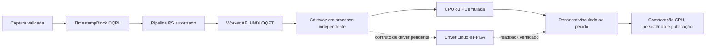

# Transporte externo PS/PL no Linux

Data: 2026-10-11 (UTC). Contrato: `OQPT` 1.0. Implementação: `src/quantum_autopilot/lab/pl_transport.py`. O formato de entrada `OQPL` 1.0 e a matemática da correlação permanecem os mesmos.

O pipeline anterior delegava a correlação a callbacks no próprio processo e representava DMA por `EmulatedDMARing`. Ele não transferia registros a outro processo, não autenticava um produtor Linux e não identificava uma imagem/geração externa. O transporte acrescenta essa fronteira sem equiparar comunicação local com DMA físico ou FPGA qualificada.



Timestamps não fornecem preparação, bases, bits, fidelidade ou chaves QKD. Nenhuma dessas saídas é criada pelo transporte. A origem física/simulada permanece no bloco; ela não escolhe outro algoritmo.

## ABI externa

`OQPT` é um envelope de aplicação, **não** um descritor AMD AXI DMA. O cabeçalho little-endian tem 64 bytes, definido por `<4sHHIIIIQ32s`:

| Offset | Tipo | Campo |
| --- | --- | --- |
| 0 | 4 bytes | Magic `OQPT` |
| 4, 6 | uint16 | Major 1, minor 0; versões desconhecidas são rejeitadas |
| 8 | uint32 | Tipo: probe=1, correlate=2, probed=3, result=4, rejected=5 |
| 12 | uint32 | Flags reservadas, obrigatoriamente zero |
| 16, 20 | uint32 | Bytes de metadados e payload |
| 24 | uint64 | Sequência do transporte na conexão, começando em zero |
| 32 | 32 bytes | SHA-256 do prefixo de 32 bytes e do corpo |

Seguem JSON UTF-8 canônico e payload binário. Metadados: até 16 KiB, sem campos duplicados, NaN ou representação não canônica. Payload: até `MAX_WIRE_BYTES` do contrato `OQPL`. O pedido conserva o bloco `OQPL` completo. A resposta contém até 65.537 contadores uint64 little-endian, sem conversão dos tempos para float. Comprimento exato, soma dos bins, limite de pares e geometria são validados antes da publicação.

O pedido vincula `request_id` UUID, sessão, configuração, relógio, sequência do bloco, SHA-256 do bloco, parâmetros/hash da correlação e identidade esperada do produtor. A resposta deve ecoar exatamente esses campos, acrescentando somente quantidade de bins e pares. Alterações de tipo, sessão, configuração, sequência, geração, imagem ou hash são recusadas. O worker reconstrói o dicionário `orion.lab.pspl-correlation.v1` existente; `execute_correlation` conserva a comparação integral com CPU. A soma correta sozinha não demonstra a matemática correta.

`BackendIdentity` identifica `backend_id`, modo, geração uint64, digest da imagem/implementação e capacidade máxima. Modos: `cpu-external`, `emulated-pl-external`, `linux-pl-driver`. Nos dois primeiros, o digest identifica código/configuração emulados e **não** um bitstream. No terceiro, o driver precisa fornecer readback consistente antes e depois de cada operação. Uma troca de imagem/geração interrompe a admissão; a identidade declarada não prova atestação de hardware.

## Autorização local e propriedades dos recursos

O perfil implementado usa a **mesma UID de serviço nas duas pontas**, diretório privado 0700 e socket 0600. `SO_PEERCRED` valida a UID nas duas pontas e registra PID/GID observados pelo kernel. Caminhos relativos, pais simbólicos, sockets com permissões abertas e substituição de um caminho existente são recusados. Contas distintas/grupo compartilhado não são suportados por este perfil.

Essa autenticação local complementa a autorização de recursos feita pelo serviço. Ela não identifica o usuário humano original e não substitui mTLS/OIDC, auditoria ou permissões da API. Código confiável da implantação escolhe o worker/driver; o pacote não aceita imports, bibliotecas, endereços de registradores ou comandos de atuação enviados no wire. Processos comprometidos sob a mesma UID permanecem na mesma fronteira de confiança. SHA-256 detecta adulteração do envelope, mas não é assinatura do produtor.

Há um único pedido ativo no cliente, sem fila ilimitada. Um deadline monotônico limita conexão, envio e recebimento; no primeiro bloco, probe e correlação compartilham o mesmo prazo total. Resposta parcial, fora da ordem, adulterada, tardia, cancelada ou recusada deixa o cliente em `uncertain`. Não existe retry automático. `cancel()` interrompe a espera de socket; não afirma terminar uma operação de DMA ou um algoritmo que já está executando no produtor. A saída tardia não restaura `ready`. Recuperação usa um novo worker, readback e sessão coordenados pelo PS.

O broker mantém propriedade exclusiva com `flock` sobre um ledger privado por `backend_id`, em `state_directory` persistente, separado do diretório do socket. O perfil de implantação usa `/var/lib/orionq-pl` (0700) para estado e `/run/orionq-pl` (0700) para o socket. `RuntimeDirectory` pode ser removido por shutdown/reboot; ele não conserva autoridade de geração. A CLI exige o diretório de estado explícito; o default de `PLBackendServer` para o diretório do socket existe somente para compatibilidade das fixtures e não representa durabilidade operacional.

O broker consome a geração mediante append uint64, `fsync` do arquivo e do diretório **antes** de expor o socket. O ledger não é removido no shutdown. Outra instância concorrente é recusada; reiniciar com geração igual ou inferior também é recusado, inclusive após recriar somente o diretório do socket. A geração seguinte exige configuração deliberada. Hashes de sessões vinculados à geração são persistidos antes da correlação: a geração nova não pode reutilizar uma sessão PS antiga. Backup/recuperação do estado deve preservar os tombstones e impedir rollback; os testes locais não qualificam perda física de energia ou recuperação de armazenamento da placa.

Dentro da geração, sessão conserva configuração/relógio, sequência consecutiva e intervalos de tempo sem regressão. O slot é reservado antes de executar; uma resposta perdida nunca torna esse bloco disponível novamente. Ledgers de gerações, sessões e IDs de pedidos têm limites explícitos de 4.096 entradas. Saturação bloqueia nova admissão; não há expurgo automático que permita replay. Gestão/arquivamento desses registros exige procedimento autorizado, com a impossibilidade de reativar uma geração ou sessão anterior preservada.

## Interfaces e integração

```python
identity = BackendIdentity(
    backend_id="correlator-01", mode="emulated-pl-external",
    generation=1, image_sha256=implementation_digest,
)
worker = UnixPLCorrelationWorker(
    "/run/orionq-pl/worker.sock", identity,
    peer_uid=service_uid, timeout_s=5.0,
)
worker.probe()  # readback do produtor esperado
result = worker.correlate(block.to_wire(), correlation_request)
state = worker.snapshot()
```

`PLBackendServer(path, identity, worker, allowed_uid=..., timeout_s=..., state_directory=...)` recebe um worker confiável e executa `serve(stop_event)` no processo produtor. O snapshot do cliente conserva peer, identidade/geração, estado, contadores e última troca. `hardware_validated=False` e `physical_actuation_locked=True` permanecem explícitos. Registro no serviço, CLI, autorização experimental e receipts pertencem à integração do núcleo; um socket acessível sozinho não autoriza aquisição.

O teste `probe_linux_character_device(path)` verifica apenas presença/tipo/permissões via metadata, sem abrir o dispositivo. Sem um driver documentado, responde indisponível. `linux-pl-driver` exige uma composição local com `probe()` e `correlate()`; não há driver genérico de `/dev/mem`, registradores presumidos, ioctl inventado ou associação automática a qualquer arquivo de `/dev`.

## Fontes primárias e condições de uma implementação física

Consultadas em 2026-10-11 (UTC):

| Fonte | Aplicação e limite |
| --- | --- |
| [Linux DMAengine — Client API](https://docs.kernel.org/driver-api/dmaengine/client.html) | Canal exclusivo associado ao dispositivo; propriedade dos descritores após submit; conclusão e sincronização após termination. São responsabilidades do driver de kernel, não do socket Python. |
| [Linux — Dynamic DMA mapping](https://docs.kernel.org/core-api/dma-api-howto.html) | Mapeamento, direção, coerência, barreiras e tratamento de erros. Um recebimento completo no socket não comprova cache flush, fence ARM ou IRQ física. |
| [Linux dma-buf — CPU access](https://docs.kernel.org/driver-api/dma-buf.html) | Sincronização de acesso CPU e cache é distinta de conclusão/posse. Nenhum mmap/dma-buf é usado pelo transporte implementado. |
| [Linux man-pages — unix(7)](https://man7.org/linux/man-pages/man7/unix.7.html) | Credenciais do peer e permissões de pathname sockets. API específica de Linux; o código recusa plataformas sem `SO_PEERCRED`. |
| [AMD AXI DMA PG021 — Scatter/Gather Descriptor](https://docs.amd.com/r/en-US/pg021_axi_dma/Scatter-Gather-Descriptor) | Versão 7.1, 2025-06-24. Layout AMD depende do IP/configuração; os headers `OQPL`/`OQPT` não programam esses descritores. |

Qualificação de PetaLinux/FPGA continua exigindo placa, BSP/XSA, device tree, driver/UAPI, clocks, DMA/cache/IRQ, readback da imagem real, interlocks e medições de throughput/perdas/jitter. Não foi conectado hardware, compilado kernel ou carregado bitstream. Equivalência CPU em processos Linux não demonstra aceleração ou tempo real rígido.

## Verificação reproduzível

```text
python -m pytest tests/test_lab_pl_transport.py -q
```

Os casos Linux executam processos independentes e sockets reais: CPU/emulação PL versus referência, credenciais de kernel, permissões, adulteração/replay, respostas parciais, deadlines, cancelamento, deduplicação, segunda instância e reinício com geração consumida. Casos incompatíveis com Windows são explicitamente ignorados nessa plataforma; a execução Linux deve passar sem esses skips. Logs/JUnit e hashes das fontes devem acompanhar o gate do wheel instalado. Esses testes não qualificam hardware nem substituem a comparação científica existente.
