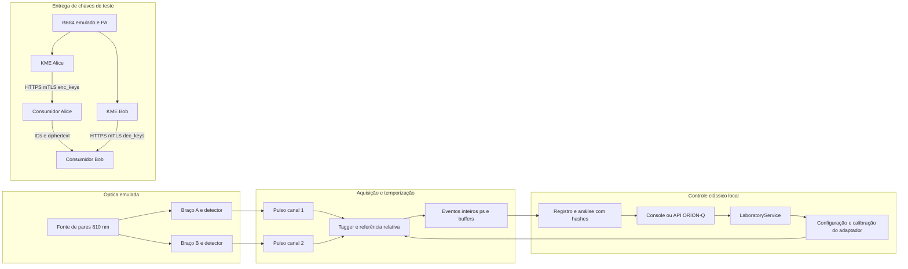

# Jornadas de laboratório do ORION-Q

O console nativo apresenta uma bancada de aquisição e uma sessão QKD com aplicações na tela **Key management**. Os botões **AQUISIÇÃO DE FÓTONS**, **QKD + APLICAÇÕES** e **BANCADA COMPLETA** executam o serviço do backend e exibem seus recibos persistidos. O estado e os resultados pertencem ao workspace da fonte selecionada. Fontes de telemetria medidas e fixtures de interface não recebem essa capacidade de execução.

O incremento usa emulação identificada, replay dos eventos simulados e reprodução de agregados experimentais Bristol. HTTPS/mTLS e AES-GCM executam comunicações e criptografia reais em loopback. Equipamentos físicos, segurança QKD certificada, SDK/licença de replay Swabian e interoperabilidade entre appliances permanecem sem validação efetiva nesta instalação.

## Reprodução no checkout

Python 3.12 ou posterior, dependências principais e extras `lab,console,dev`:

```powershell
python -m pip install -e ".[lab,console,dev]"
python -m quantum_autopilot.lab.cli --experiment all --output outputs/lab_reproduction
python -m quantum_autopilot.console.app --state-root outputs/lab_workspace --skip-auth
```

`--skip-auth` pula somente a tela de entrada local para diagnóstico; a autenticação mútua das KMEs continua obrigatória. Na auditoria inicial, o ambiente movido não encontrava o pacote instalado. O lançador local agora resolve `src` e restaura o ambiente ao sair:

```powershell
powershell -ExecutionPolicy Bypass -File tools/run_local_orion.ps1 -Mode lab --experiment all --output outputs/lab_reproduction
powershell -ExecutionPolicy Bypass -File tools/run_local_orion.ps1 -Mode console --state-root outputs/lab_workspace --skip-auth
$env:PYTHONPATH = Join-Path (Get-Location) 'src' # ferramentas/testes do checkout
.audit-winvenv/Scripts/python.exe tools/inventory_lab.py --output outputs/lab_reproduction/inventory.json
.audit-winvenv/Scripts/python.exe tools/run_lab_validation.py --output outputs/lab_integration_reproduction
.audit-winvenv/Scripts/python.exe -m pytest tests/test_lab_service.py tests/test_lab_photon.py tests/test_lab_qkd.py --basetemp=outputs/lab_test_tmp_new -q
```

Use um diretório novo para cada execução do validador integrado e de `--basetemp`. O CLI cria um UUID por execução e preserva os recibos anteriores. `orion-q-lab` é o entrypoint instalado equivalente. As configurações persistidas usam `PhotonConfig` e `QkdConfig`. **CONFIGURAR BANCADA** aceita parâmetros locais com unidades e limites e seleciona emulação, referência ou replay ORION registrado. Os dataclasses e a API validam a configuração inteira antes da gravação. A API não aceita caminhos arbitrários nem seleciona hardware.

O extra `lab` aceita `cryptography>=43,<51`. A bateria principal e o executável Windows usam **46.0.7**, com NumPy 2.5.2. Duas instalações adicionais do mesmo wheel exercitaram o fluxo QKD com **46.0.7** e **50.0.1**, ambas com NumPy 2.3.5 e SciPy 1.18.1: quatro processos, 12 verificações de entrega e 14 de falhas aprovadas em cada instalação. A ampliação do limite anterior `<47` permite o runtime base 50.0.1 efetivamente testado. As APIs AES-GCM/X.509 estão documentadas pelo [projeto PyCA](https://cryptography.io/en/stable/changelog/). Versões, caminhos e hashes acompanham as evidências; não se declara teste de cada versão intermediária nem de um sistema operacional limpo.

## API do serviço de aplicação

| Operação | Contrato | Resultado |
| --- | --- | --- |
| `GET /api/v1/laboratory` | Sem corpo | Capacidades, dependências locais e os últimos 20 recibos; leitura não cria journal |
| `POST /api/v1/laboratory/runs` | JSON exato `{"experiment":"photon"}`, `qkd` ou `all` | Executa a bancada local e retorna recibo sem material secreto |
| `POST /api/v1/laboratory/configuration` | `expected_revision` opcional, `photon` e/ou `qkd` | Valida todos os campos, persiste revisão/hash e devolve releitura |

As rotas pertencem à API HTTP do ORION-Q, restrita a loopback. Elas não são comandos REST de SPDC, SNSPD, Time Tagger ou satélite. A interface ETSI 014 usa outros servidores, temporários e HTTPS/mTLS, em duas portas loopback aleatórias. Nenhum material de chave passa pela API do dashboard.

Exemplo de configuração parcial (usar a revisão devolvida pelo GET):

```json
{"expected_revision":0,"photon":{"adapter_id":"emulated-reference","parameters":{"seed":19}},"qkd":{"parameters":{"seed":19}}}
```

Campos desconhecidos, valores não finitos, tipos errados, intervalos inválidos e revisão divergente recusam a alteração inteira. A configuração completa recebe hash/revisão, vinculados ao recibo de execução. A disponibilidade é por experimento: aquisição emulada usa biblioteca padrão; QKD e bancada completa exigem `numpy`, `scipy` e `cryptography`. SDK Swabian e VISA-sim são opcionais e não impedem a bancada emulada. Dependências ausentes bloqueiam a operação antes de criar registros de execução. A falta de SciPy foi reproduzida na instalação isolada e passou a ser detectada pelo preflight, inclusive antes da amplificação Toeplitz.

Replay usa `adapter_id="orion-replay"` e `replay_run_id` de uma aquisição concluída no mesmo laboratório. O formulário oferece esses UUIDs, conserva os parâmetros originais como somente leitura e restaura o rascunho ao voltar à emulação. Manifesto, eventos, configuração e limites são relidos/verificados; a API não importa caminhos externos. O recibo externo continua identificado como bancada local emulada; o resultado de aquisição distingue `mode="replay"` e conserva a origem original. Replay nunca converte eventos emulados em medição física.

Campos do recibo `orion.lab.run.v1`: `run_id`, `request`, `mode`, `physical_action_performed`, `status`, `started_at_utc`, `ended_at_utc`, `results` e `receipt_sha256`. Estados finais são `completed`, `failed` e `interrupted`. Após adquirir a exclusão do workspace, o reinício resolve operações abandonadas em `running` como `interrupted`; não repete a aquisição. Falhas guardam somente o tipo da exceção, sem copiar payloads potencialmente secretos. Uma verificação de aceitação negativa impede marcar a execução como concluída. A leitura valida vinculação de UUID e hash; o hash não autentica autoria.

`laboratory.sqlite` e os subdiretórios por execução ficam ao lado do journal do workspace, dentro de `laboratory/`. Reconexão/reinício reabre recibos concluídos sem readquirir dados. Operações concorrentes no mesmo workspace são recusadas com `laboratory_busy`, inclusive entre processos locais. SQLite guarda eventos e outbox na mesma transação; arquivos são projeções atômicas reconciliadas, com conflitos preservados para inspeção. A exclusão local não qualifica sistemas de arquivos distribuídos ou falhas elétricas. As KMEs usam bancos separados e reservas persistentes; reinício não devolve material consumido ou entrega incerta ao buffer.

## Contratos de aquisição

`PhotonAdapter` possui `identify`, `connect`, `configure`, `calibrate`, `acquire` e `disconnect`. `EmulatedPhotonAdapter`, `ReplayPhotonAdapter` e a ponte experimental `SwabianSDKAdapter` implementam esse contrato. A ponte nativa exige SDK instalado, identificação/configuração e tipos de eventos da versão instalada; sua indisponibilidade gera `AdapterUnavailable`, sem conversão silenciosa para emulação.

`TimeTag` conserva `timestamp_ps` inteiro assinado de 64 bits, canal, tipo, eventos perdidos e vínculo a `experiment_id`, `device_id`, `configuration_id`, `clock_domain`, `origin` e `source_id`. O manifesto `orion-q.photon-acquisition.v1` inclui configuração aplicada, domínio de relógio, duração, estado de sincronização, origem e hashes do manifesto/eventos JSONL. O replay preserva o experimento e a identidade originais; a execução de replay recebe identificador separado. Timestamps relativos não são reinterpretados como UTC.

`InstrumentCapabilities` separa limites/canais do equipamento dos parâmetros experimentais. A configuração Swabian valida todos os canais, delays, triggers, relógio e métodos antes do primeiro setter. Qualquer falha de aplicação limpa a configuração publicada e deixa `configuration_unverified`; aquisição é recusada. `reverify_configuration` sincroniza e relê os valores, verifica a configuração esperada e exige nova calibração. Uma configuração mista só pode ser aceita se explicitamente revisada e verificada. O SDK é exercitado por uma interface emulada documentada; isso não qualifica níveis elétricos reais.

`CaptureJournal` conserva blocos, hashes e perdas com drenagem/finalização/cancelamento e recuperação sem duplicação de blocos confirmados. Uma perda em voo não quantificável é explicitamente desconhecida. O importador FileReader usa o SDK oficial e exige lista completa de segmentos FileWriter e configuração; as fixtures testam o diálogo e a normalização, sem implementar um decodificador binário presumido. [Contratos e unidades](orion_lab_acquisition_contracts.md).

`QkdSession` separa resumo público de `delivery_material`, que não integra recibos. O modelo BB84 emulado produz bytes previsíveis apenas para testar aplicações. A taxa condicional do modelo é distinta de `certified_secret_bits=0`; o orçamento `key_pool_bits` antigo do motor não contém bytes e não abastece as KMEs.

O protocolo recebe `ObservationBlock` com relógio, preparação, base/bit de análise e vínculo ao evento. Timestamps isolados são insuficientes. Para origem física, alinhamento de relógio medido é obrigatório; não se presume alinhamento perfeito. As observações identificadas alimentam sifting, amostragem X/Z, limite de fase Serfling, reconciliação com vazamento contado, verificação e amplificação Toeplitz. A reprodução usa os mesmos registros. A fonte é centralizada e emulada, com RNG público e hipóteses ideais de fóton único; não é prova para pulsos coerentes/decoy nem certificação de implementação. [Processamento e entrega](orion_q_lab_key_delivery.md).

O ensaio atual usa quatro processos: KME Alice, KME Bob e duas aplicações. As KMEs conservam estados próprios em SQLite; as aplicações trocam ciphertext/AAD por TCP/TLS mTLS. Reserva é irreversível, consumo precede a resposta e entrega incerta invalida o material. O token de entrega permite consultar estado sem repetir material. Atraso, partição, cortes de HTTP, morte/reinício e falhas locais são exercitados. A política impede reatribuição de IDs dentro do ledger; fixtures com a mesma semente deliberadamente reproduzem os mesmos bytes entre ensaios. PKI e credencial de wrapping são efêmeras e não substituem um cofre de produção.

## Diagnóstico distribuído

```powershell
ORION-Q.exe --lab-test C:\temp\orion-lab-validation-new
```

O diretório deve ser novo. O relatório valida 12 condições: aquisição, captura contínua, QKD em processos independentes, entrega incerta, replay, configuração, recibos após reinício e ausência de atuação/certificação. O executável congelado roda seus subprocessos sem Python externo. Para o checkout, `tools/run_lab_validation.py` acrescenta interação na tela e conferência API/recibos.

O timeout do renderizador de evidências foi reproduzido com `QTest.qWait`, que atrasava o worker Python. O diagnóstico agora espera pelo event loop do Qt. Essa correção não é uma promessa de desempenho universal nem altera as validações do serviço. [Experimento de inicialização](../results/orion_lab_console_startup_20261007.md).

## Caminhos da bancada



As quatro fronteiras são independentes. Conectar um Time Tagger não valida fonte/detectores ou entrelaçamento; executar uma API de entrega não valida o canal óptico. Os agregados Bristol vêm de outra bancada, com Photon Spot SNSPD e Time Tagger Ultra, e não estabelecem compatibilidade com uma bancada 810 nm/Single Quantum.

## Substituição e dependências

Trocar canais, delays, triggers ou perdas dentro do mesmo contrato exige configuração e recalibração. Trocar uma origem emulada por JSONL replay exige selecionar outro adaptador e preservar sua configuração original. SDK nativo, USB, serial e APIs proprietárias precisam adaptadores/documentação próprios. Uma tecnologia nova fora da lista fechada de `quantum_protocols` ainda exige versionar contratos do núcleo; a bancada de laboratório foi adicionada ao serviço sem forçar uma família existente a aceitar eventos incompatíveis.

PyVISA-sim oferece diálogos com `ResourceManager('@sim')` e arquivo YAML; deve ser usado para um instrumento VISA documentado. Nenhum instrumento VISA da bancada foi identificado, portanto não foram inventados diálogos SCPI para fontes ou detectores. Simular VISA não substitui o modelo óptico. [Manual oficial PyVISA-sim](https://pyvisa.readthedocs.io/projects/pyvisa-sim/en/latest/), [configuração de comunicação](https://pyvisa.readthedocs.io/en/latest/introduction/communication.html).

Referências e resultados: [instrumentos](../research/orion_lab_instruments_20261007.md), [QKD e ETSI](../research/orion_lab_qkd_20261007.md), [auditoria histórica de satélites e IBM — integração IBM descontinuada](../research/orion_lab_satellite_ibm_20261007.md), [auditoria anterior](../results/orion_q_laboratory_validation_20261007.md), [matriz das correções 5.47](../results/orion_q_lab_hardening_20261007.md), [recuperação](../results/orion_lab_recovery_20261007.md) e [fontes orbitais públicas](orion_q_public_ephemeris.md).
