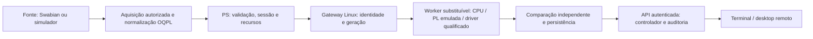

# OrionQ 5.64: controle Linux e fronteira PS/PL

O controlador permanece no PS/Linux, sem dependência de Qt, sessão Windows ou login humano. O operador acompanha a [mesma API autenticada no terminal](orionq_terminal_operator.md); login identifica e autoriza alterações. A identidade do serviço mantém o processamento autônomo. Modelos são opcionais e atuação física continua bloqueada.

## Componentes e limites

| Camada | Implementação | Evidência necessária para operação física |
|---|---|---|
| PS | Serviço Python: roteamento, reserva, validação, protocolos, persistência, autenticação e auditoria | Qualificação do sistema operacional e carga no alvo |
| Aquisição | Adaptadores existentes normalizam eventos para OQPL; aquisição física mantém autoridade, configuração, calibração e relógio próprios | SDK, unidade Swabian, níveis elétricos e sincronismo qualificados |
| Gateway | `orion-pl-gateway`, processo Linux separado, AF_UNIX/SO_PEERCRED, deadline e framing limitados | Integração do driver e orçamento de execução no alvo |
| Worker externo | `cpu-external` ou `emulated-pl-external`, recebendo o mesmo bloco independente de sua origem | Ambos usam CPU; não representam uma FPGA conectada |
| PL de referência | Verilog `orionq_correlation`, QCOR 1.0, eventos/binários inteiros; portas `orionq_fast_gate` | IP wrapper, bitstream, driver DMAengine, CDC, reset, ILA e timing closure |
| Plataforma | Layer Yocto Scarthgap para PetaLinux 2025.2, fontes reproduzíveis e preflight | BSP/XSA ou SDT, provedores de dependências, build ARM e boot |



O anel de propriedade no pipeline continua **emulado**. Transportar dados em outro processo não executa AXI DMA, cache flush ARM ou uma IRQ. O contrato OQPL é um payload; não é um descritor AMD. [DMAengine Linux](https://docs.kernel.org/driver-api/dmaengine/client.html) e [DMA mapping](https://docs.kernel.org/core-api/dma-api-howto.html) fundamentam a fronteira do futuro driver.

## Instalação e gateway

Construa/instale o [wheel headless](orionq_linux_service.md), ou prepare o [layer PetaLinux](orionq_petalinux.md). Não use wheel Windows/x86 para extensões nativas em ARM. Os serviços da receita ficam desabilitados até o provisionamento explícito.

Execute com a conta não privilegiada do serviço:

```bash
orion-pl-gateway describe
orion-pl-gateway --config /etc/orionq/pl-gateway.json check
orion-pl-gateway --config /etc/orionq/pl-gateway.json serve
```

`describe` fornece o digest dos módulos **instalados** e o UID para a configuração. O JSON exige `schema`, `socket_path`, `state_directory`, `backend`, `allowed_uid` e `request_timeout_s`. Exemplo de estrutura:

```json
{
  "schema": "orion.pl-gateway.v1",
  "socket_path": "/run/orionq-pl/worker.sock",
  "state_directory": "/var/lib/orionq-pl",
  "backend": {
    "backend_id": "pspl-worker",
    "mode": "emulated-pl-external",
    "generation": 1,
    "image_sha256": "PREENCHER_COM_DESCRIBE_DO_ALVO",
    "max_events": 4096
  },
  "allowed_uid": 10001,
  "request_timeout_s": 5
}
```

O exemplo deliberadamente não ativa o serviço. Preencha hash e UID observados; mantenha configurações sob root/serviço sem escrita de grupo/outros. Diretórios socket/estado são privados 0700; socket e ledgers são 0600. O perfil inicial exige **mesmo UID** para core e gateway: há isolamento de processos, não uma fronteira entre contas distintas. A API do core continua exigindo mTLS/RBAC.

Os diretórios precisam ser previamente provisionados para a conta do serviço. As unidades fornecidas usam `RuntimeDirectory`/`StateDirectory` para criá-los; a execução direta não os cria. `check` verifica sua existência, propriedade e permissões antes de informar PASS.

`state_directory` deve ser persistente e separado de `/run`. Gerações e sessões utilizadas são registradas com flush/fsync antes do processamento. Uma segunda instância, reinício na mesma geração ou reutilização de sessão são recusados. Tombstones não são apagados nem automaticamente expulsos; os limites atuais são 4.096 entradas por ledger. Backup/rollback desse estado precisa preservar todos os tombstones utilizados, sem restaurar uma autoridade antiga.

## Composição do processamento

Código confiável do serviço registra o worker; o evento de uma fonte não pode selecionar implementação, modo ou módulo Python:

```python
from pathlib import Path
from quantum_autopilot.service.pl_gateway_cli import load_config, registry_for_gateway
from quantum_autopilot.lab.processing_node import NodeProcessingPipeline, ProcessingNodeConfig
from quantum_autopilot.lab.pspl import CorrelationRequest, DMAConfig

gateway = load_config(Path('/etc/orionq/pl-gateway.json'))
registry = registry_for_gateway(gateway)
config = ProcessingNodeConfig(
    node_id, block.session_id, block.clock_domain, block.configuration_id,
    CorrelationRequest(channel_a=1, channel_b=2), worker_id='external-pl',
    dma=DMAConfig(max_events_per_block=gateway.backend.max_events),
)
pipeline = NodeProcessingPipeline(config, registry=registry, on_record=durable_record_sink)
receipt = pipeline.process(block, now_ps=operational_clock_ps)
```

`block`, relógio e sink vêm das camadas existentes de aquisição/persistência, não de estados preenchidos para demonstração. Os eventos, clocks, perdas e qualidade são validados antes do worker; o resultado deve coincidir exatamente com a CPU de referência. Timestamps isolados não fornecem bases, bits, fidelidade ou chaves QKD.

Em sobrecarga, um bloco não submetido recebe backpressure explícito. Após resposta perdida, alteração de geração, erro, cancelamento ou timeout, não há retry automático nem publicação tardia. Recuperação exige worker novamente verificado, geração superior e nova sessão, além de readback/drain do anel. A cadência da interface não altera eventos científicos.

## RTL e portas rápidas

`fpga/orionq_pl/` contém lógica e testbenches próprios, sem IP proprietário. QCOR mantém o perfil limitado de 256 eventos/257 bins por bloco, enquanto OQPL ingress admite blocos maiores. Dados de qualidade/perda e qualquer resultado parcial são rejeitados. IDs e status retornados devem ser validados no PS por `lab/pl_accelerator.py`.

`GateCycleConfig.from_picoseconds` traduz períodos/larguras/watchdog exatamente para ciclos inteiros do relógio declarado: duração × frequência precisa ser divisível por 10¹². Tempos não representáveis são rejeitados, sem arredondar e sem prometer resolução física de 1 ps. O RTL das oito portas exige configuração, sessão, relógio, interlock e heartbeat; falhas desarmam e ficam latched. `PHYSICAL_ENABLE=0` é o default. A configuração Python não é um comando de arm, e a CLI não oferece atuação física.

O broker aceita composição confiável de um worker `linux-pl-driver` com readback antes/depois do trabalho. A CLI padrão recusa esse modo: ainda não existe driver/bitstream qualificado de placa. Não há `/dev/mem`, ioctl adivinhado, endereço físico universal ou arming recebido em JSON.

## Reprodução

```bash
python tools/run_core_linux_validation.py --repository /caminho/OrionQ --evidence /var/tmp/qa-linux-nova
python tools/run_pspl_rtl_validation.py --help
python tools/run_pspl_linux_campaign.py --repository /caminho/OrionQ --native /caminho/evidencia-sequence --evidence /var/tmp/qa-pspl-nova
```

A campanha usa eventos SeQUeNCe previamente identificados e uma bancada N01 explicitamente emulada; testa onze nós, comparação CPU, recibos, integração mTLS e impedimentos reais do ensaio. Não fabrica uma ponte para N01. Icarus/Yosys verificam comportamento e tradução lógica do RTL; não medem throughput de FPGA. As comparações de tempo incluem transporte e comparação CPU completa, portanto não demonstram ganho por offload. Consulte o [relatório desta implementação](../results/orionq_pspl_linux_20261011.md).
