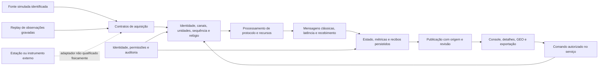

# OrionQ — desenho do elemento SOFT-ALPHA para TRL 4

O elemento avaliado é o protótipo de software integrado executado a partir das
fontes no Windows. A identidade exata pertence ao manifesto de qualificação,
não apenas ao texto de versão 5.60.1. O último executável foi construído antes
das correções recentes de persistência; esta qualificação não o reaproveita como
evidência de execução das fontes atuais.

## Arquitetura e responsabilidades

O desenho combina caminhos existentes, sem afirmar que todos os módulos usam
um único armazenamento ou o mesmo adaptador. `network_engine.channel_io`
processa enlaces estatísticos associados; `quantum_protocols.runtime` executa
as cinco famílias; `lab` mantém captura, observações BB84 e KMEs locais.
`qkd.dashboard_api`, `security` e o provider nativo impõem fronteiras de serviço.
As ligações entre esses subsistemas precisam de evidência própria na matriz.

O fluxograma resume responsabilidades, não uma sequência exclusivamente linear.
Sincronismo, comandos e heralding clássicos também antecedem e se intercalam
com aquisição e processamento; a conclusão depende de seus recebimentos.

## Contratos observáveis

| Fronteira | Contrato e responsabilidade | Evidência exigida |
| --- | --- | --- |
| Fonte → ingresso | Origem, sessão/dispositivo, canais associados, unidades, sequência, tempos e observações brutas | Ausência, replay, associação incorreta e dados inválidos recusados; replay equivalente identificado |
| Ingresso → protocolo | Validação e sincronização anteriores ao cálculo; recursos e capacidades compatíveis | Ordem causal, consumo de recursos, falha explícita e ausência de resultados finais injetados |
| Protocolo → canal clássico | Mensagens de controle e heralding associados à operação quântica | Recebimento após transmissão/latência; dependências não satisfeitas impedem conclusão |
| Serviço → persistência | Revisão, estado e recibos confirmados nos limites da transação do subsistema | Queda antes/depois do commit, replay e recuperação sem duplicação |
| Serviço → UI | Snapshot recebido, origem, revisão, seleção e capacidades | Conteúdo corresponde ao backend; telas não inventam comunicação ausente |
| UI/API → serviço | Identidade e permissão por operação/recurso, revalidadas no trabalho assíncrono | Anonimato, revogação e escopo indevido recusados; auditoria sem segredos |
| KME → aplicação | Reserva/entrega/consumo persistidos e transporte local autenticado | Entrega incerta não retorna ao pool; correspondência e não reutilização após falhas cobertas |

Transações são locais a cada banco. A qualificação não presume atomicidade
distribuída entre todos os bancos ou recuperação de uma falha elétrica.
Um estado `available` sem tráfego é distinto de comunicação demonstrada.

## Domínio científico e capacidades incompletas

As referências verificam elementos reduzidos: transmissão em dB, propagação,
Werner/BBPSSW, composição Bell-diagonal, decoerência isotrópica e geometria
orbital ideal. Tempos de coerência, eficiências e perdas configuradas continuam
hipóteses quando não existem medições admitidas. Em TF-QKD, o orçamento é
condicional: o erro X não constitui uma prova do erro de fase Z; não há chaves
certificadas. A execução funcional das cinco famílias não comprova fidelidade
experimental de todas elas.

Demodulação RF, telescópio, TDC e hardware externos permanecem fora desta
qualificação física. Efemérides não são housekeeping medido nem payload óptico.
Detecções destrutivas não estabelecem relay quântico orbital coerente; uma
rota sem memórias/BSM compatíveis deve continuar recusada. FPGA físico e replay
Swabian nativo exigem seus recursos externos e validação específica.

O controle automático ML permanece opcional. Admitir um arquivo/modelo não
comprova benefício, generalização ou previsão experimental WDM→Bell. Nenhuma
ação física ou chave emulada operacional é autorizada por uma aprovação local.

## Especificações de implementação

Os contratos detalhados permanecem em [canais associados](orion_q_paired_channels.md),
[protocolos modulares](orion_q_modular_quantum_protocols.md),
[rede global](orion_q_global_network.md), [OGS](orion_q_satellite_ogs_v2.md),
[laboratório](orion_q_laboratory.md), [entrega de chaves](orion_q_lab_key_delivery.md),
[segurança](orion_q_security.md) e [GEO](orion_q_geo_modes.md).
Este desenho delimita o elemento avaliado; não reescreve esses contratos.
