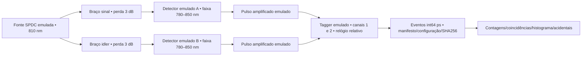

# Referências instrumentais e contrato da bancada ORION-Q

Consulta: **2026-10-07**. As páginas abaixo são fontes primárias. Este registro diferencia contratos documentados, implementação local e validação executada. Nenhum dos fabricantes foi contatado e nenhum equipamento foi comandado durante esta campanha.

## Swabian Instruments Time Tagger

O manual público consultado identifica a versão **2.22.6.0 do software/documentação**, não a versão de firmware de um dispositivo conectado. As três fábricas têm funções distintas:

| Caminho | Contrato nativo | Requisito |
| --- | --- | --- |
| Hardware local | `createTimeTagger(serial="", resolution=Resolution.Standard)` | SDK oficial; USB; identificar serial/licença/canais reais |
| Hardware remoto | `createTimeTaggerNetwork(["host:port"])` | Servidor `startServer(access_mode, ..., port=41101)`; autorização de controle |
| Replay nativo | `createTimeTaggerVirtual(filename, begin, duration)`, `run()`, `waitUntilFinished()` | Arquivo de `FileWriter`; licença por computador |
| Simulação nativa | `createTimeTaggerVirtual("")` | Cria fonte simulada com 18 canais; não comprova replay experimental |

[Contrato das fábricas](https://www.swabianinstruments.com/static/documentation/TimeTagger/api/TimeTaggerLibrary.html). O servidor oferece modos de escuta e controle; não se deve atribuir REST ao Time Tagger. Para múltiplos servidores, a documentação exige sincronização externa; o mapa de canais deve ser obtido do SDK. [Classes e servidor](https://www.swabianinstruments.com/static/documentation/TimeTagger/api/TimeTagger.html).

A licença gratuita de `TimeTaggerVirtual` fica vinculada ao PC. A aquisição automática depende de Time Tagger conectado e internet. Sem essa combinação, o fabricante documenta `LicenseRequestGenerator` e entrega do pedido ao suporte. A instalação do SDK sozinha não comprova licença válida. [Licenciamento oficial](https://www.swabianinstruments.com/knowledge/base/time-tagger-setup/resolving-license-acquisition-errors/).

O formato nativo conserva **int64 em picosegundos desde a inicialização**, canal int32, tipo de evento e contagem de eventos perdidos. `FileWriter` registra configuração em cada arquivo. `TimeTagStreamBuffer.hasOverflows` indica overflow do fluxo; a saturação do buffer local é independente e exige observar `size >= n_max_events`. `getData()` esvazia o buffer. Arquivos `Dump` não são arquivos de replay `FileWriter`. [Fluxo e arquivos nativos](https://www.swabianinstruments.com/static/documentation/TimeTagger/api/measurements/time_tag_streaming.html).

Para a referência **Time Tagger Ultra**, o manual informa SMA, terminação 50 ohms, faixa recomendada -3 a +3 V, trigger -2.5 a +2.5 V, amplitude mínima 100 mV e largura mínima 500 ps. Isso permite verificar um pulso amplificado antes da conexão; a menção a TTL não autoriza qualquer amplitude. Modelos 20 e X têm limites diferentes. [Contrato elétrico e relógio](https://www.swabianinstruments.com/static/documentation/TimeTagger/sections/hardware.html).

A implementação opcional `SwabianSDKAdapter` bloqueia explicitamente quando o SDK está ausente. A ponte usa somente fábricas e métodos públicos. A normalização do fluxo exige um mapa de tipos obtido da versão instalada, sem assumir códigos numéricos. A conexão virtual tem caminho implementado, mas a importação de metadados originais para aquisição normalizada fica pendente. A demonstração não utiliza esse caminho. O `autoCalibration()` nativo é diagnóstico do tagger; não calibra atrasos da bancada óptica.

## Thorlabs SPDC810 e SPDC810N

A página oficial distingue **SPDC810: RS232** e **SPDC810N: USB Type B**. Ambas produzem pares próximos de **810 nm**, bombeados em 405 nm, com saídas ópticas FC/PC de chave estreita. SPDC810 tem largura aproximada de 10 nm; SPDC810N tem largura abaixo de 0.25 nm e controle de temperatura do cristal. O pacote de GUI listado é SPDC810 Software 2.0.0. [Página oficial da família](https://punchout.thorlabs.com/newgrouppage9.cfm?ad=SPDC810N&objectgroup_id=13675), [página atual](https://www.thorlabs.com/correlated-photon-pair-sources), [software oficial](https://www.thorlabs.com/software-pages/SPDC810).

Nesta consulta, a página nova depende de renderização e não disponibilizou texto de manual/SDK ao extrator; a página oficial anterior disponibilizou especificações. Não foram confirmados comandos seriais, identificadores USB, DLL pública, baud rate ou firmware. A dependência para controle efetivo é obter o manual e o SDK oficiais da unidade/versão. A emulação não inventa comandos. A troca SPDC810N → SPDC810 exige trocar o transporte declarado e revalidar largura espectral; a existência de HTTP no ORION-Q não altera RS232/USB.

## Single Quantum SNSPD

O fabricante mostra a separação entre **LAN/software de controle**, driver eletrônico/criostato e **cabos SMA dos pulsos**. Seu documento de princípio mostra um pulso amplificado ilustrativo de 750 mV; isso não constitui especificação elétrica garantida para todas as configurações. O sistema trabalha em criostato e a resposta deve ser obtida para cada detector. [Documento oficial de princípio](https://www.singlequantum.com/wp-content/uploads/2024/12/Single-Quantum-Operation-Principle-print.pdf).

O **TTL Converter é um módulo adicional** para converter a saída SNSPD; a página não publica tensão, impedância, largura de pulso e conectores suficientes para certificar combinação direta com qualquer tagger. Deve-se medir/verificar esses parâmetros. [Complementos oficiais](https://www.singlequantum.com/technology/add-ons/).

As opções de acoplamento e fibra dependem de comprimento de onda e configuração; o fabricante oferece soluções personalizadas. Não foi encontrado contrato público de API de bias/temperatura/telemetria ou firmware. Controle remoto genérico descrito no catálogo não autoriza inventar endpoints. [Acoplamento óptico](https://www.singlequantum.com/technology/optical-coupling/), [Eos e controles disponíveis](https://www.singlequantum.com/solutions/excellence-line/).

## Bancada executada e limites

Modelo local identificado: `orion-q.spdc-poisson-loss-jitter-deadtime.v1`, seed 810. A fonte, as perdas nos dois braços, os detectores, seus pulsos e a temporização são **emulados**. Faixa detectora 780–850 nm, eficiência 0.70, pulse 0.75 V/2 ns, 50 ohms e jitter sigma 60 ps são **premissas de configuração**, não certificados de um detector comprado.



O caminho clássico é `register → connect → configure → calibrate → acquire → store → analyze`. A calibração emulada alinha os offsets conhecidos do modelo: atraso físico +125 ps no segundo braço e correção -125 ps. O relógio é relativo, sem época UTC. A janela de coincidência de **500 ps é largura total**: intervalo [-250, +250) ps.

O replay utilizado é o formato **ORION JSONL + manifesto**, gerado pela própria emulação. Ele preserva origem `simulated`, identidade original, configuração, domínio de relógio, experiment_id e timestamps; o novo replay_run_id fica separado. Ele **não é .ttbin, aquisição física nem replay experimental**. Ambos arquivo de eventos e manifesto têm SHA256; isso verifica integridade de registro, não autenticidade criptográfica do autor.

A substituição usa o mesmo contrato para emulação → replay e troca para outro adaptador emulado/canais 3–4/fonte de referência RS232. Essa execução comprova desacoplamento local dos contratos; não comprova substituição física de fabricantes.

Falhas exercitadas: overflow, desbloqueio de relógio, deriva de 50 ppm, desconexão, detector indisponível, perda adicional e regressão temporal. Dados com regressão são rejeitados e conservados como evidência forense fora do schema aceito. Os demais casos geram flags e impedem a conclusão de aquisição completa. A recuperação reconecta, reconfigura e recalibra.

Coincidências isoladas não demonstram entrelaçamento. O resultado marca `entanglement_claim=false` e exige preparação de estados, analisadores e tomografia ou testemunha definida.

## Contratos e repetição

Implementação: `src/quantum_autopilot/lab/photon.py`, `adapters.py`. Testes independentes: `tests/test_lab_photon.py`; incluem limites das janelas, integridade, inteiros acima de 2^53, proveniência, estados, concorrência, perda e recuperação.

```powershell
$env:PYTHONPATH = Join-Path (Get-Location) 'src'
.audit-winvenv/Scripts/python.exe -m pytest tests/test_lab_photon.py --basetemp=outputs/orion_lab_20261007/tmp_photon_reproduction -q
.audit-winvenv/Scripts/python.exe -c "from quantum_autopilot.lab.photon import run_photon_demo; run_photon_demo('outputs/orion_lab_20261007/photon_reproduction')"
```

A execução específica da campanha produziu 1445 e 1409 eventos nos dois canais em 0.1 s, **517 coincidências**; esses números são resultados do modelo seed 810. O relatório executável fica em `photon_summary.json`, com ligação aos manifestos e ao modelo. O wrapper real permanece **não validado em hardware**, e o replay nativo/licenciado permanece **não validado**.


## Registro experimental existente: Bristol HCF/DWDM

O inventário encontrou o depósito **10.5523/bris.61193flfovbn2puknndsr3qm5** no diretório `data/raw/bristol-hcf-coex`. O README do depósito declara aquisição original com **Photon Spot SNSPDs e Swabian Time Tagger Ultra**. Isso não corresponde a um detector Single Quantum conectado nesta estação.

O arquivo `3U_CoEx_180mins_20220627_1236.ttbin` tem 13936 bytes, SHA1 `ece849bc5130d44768e3b599949afbbd484ed47f` e SHA256 `0d5ea48de6dcc3b2b2adfc42a5342ddb4704223ee7ee4a74bb3cd96b4b40ee7e`. Tamanho e SHA1 coincidem com `.info.json`. O próprio README o identifica como **arquivo de cabeçalho**; a aquisição bruta, se armazenada, ocuparia 21.6 GB. Não foram depositados os blocos de cliques. Portanto a integridade do cabeçalho não demonstra disponibilidade de replay nativo da aquisição.

`replay_experimental_aggregates()` reproduz separadamente os CSV do depósito: 12 linhas do resumo e três histogramas. Mantém `origin=physical`, `mode=replay`, nível **experimental_aggregate**; preserva taxas, unidades e referências temporais. Verifica SHA1 e tamanho de cada fonte contra metadados originais, e grava SHA256 com caminhos no artefato.

Embora o nome contenha `180mins`, o resumo fornecido contém somente offsets 0–6600 s em 12 linhas. O README denomina `Chunk Time` como duração, mas seus valores formam offsets cumulativos; essa divergência é registrada sem reescrever os dados nem atribuir uma época UTC desconhecida. Os histogramas têm coordenadas inteiras em ps e taxas por bin de 10 ps, com picos AB=0 ps, AC=0 ps e BC=-10 ps.

Os campos SKR, QBER e Coin reproduzidos são valores publicados no CSV; Coin já foi selecionado por bases. Nenhum raw bit, click ou chave é reconstruído a partir deles. `certified_secret_bits=0` e `secret_material_generated=false`. Esse replay comprova a passagem de registros experimentais agregados pelo backend e a proveniência; não valida overflow individual, calibração original, segurança independente ou SDK Swabian.

O resumo da jornada contém `experimental_aggregate_replay_validated=true` quando esses arquivos são verificados. O campo `experimental_replay_validated=false` se refere ao replay **bruto** de clicks e permanece explícito. Doubles sintéticos dos métodos SDK nos testes são validados somente no nível de **interface**; não alteram os indicadores de validação em hardware.

