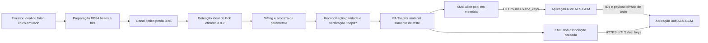

# ORION-Q: referências e jornada QKD reproduzível — 07/10/2026

A jornada executa uma sessão BB84 identificada, duas KMEs e duas aplicações consumidoras. O protocolo óptico é emulado; a comunicação HTTPS/mTLS e a cifra AES-GCM são executadas pelo sistema operacional e pela biblioteca criptográfica. Nenhum Clavis XGR ou Toshiba MU foi conectado nesta validação. `certified_secret_bits=0` acompanha todas as métricas.

## Inventário e obstáculos comprovados

O ORION-Q existente calcula taxas e acumula um orçamento numérico `key_pool_bits` em `network_engine/links.py`. Esse orçamento não contém bytes de chaves. A tela `console/screens/keys.py` informa que medições não fornecem material de chave, e `docs/product/native_console.md` declara ausência de armazenamento/KMS. O processador `quantum_protocols/satellite_processing.py` já executava reconciliação e operações Toeplitz em demonstrações BBM92, sem disponibilizar chaves.

O incremento `lab/qkd.py` produz material exclusivamente emulado e o entrega a `lab/kms.py`. O pool antigo não é usado nem convertido em chaves. A dependência opcional é `pip install -e ".[lab]"`. A auditoria usou Python 3.12.14, NumPy 2.5.2, OpenSSL 3.5.8 e cryptography 46.0.7.

## Referências de appliances e fronteiras dos contratos

| Referência | Contrato público efetivamente encontrado | Dependências para integração física |
|---|---|---|
| ID Quantique Clavis XGR | Plataforma de pesquisa baseada no Clavis XG/BB84; parâmetros modificáveis, acesso a dados internos e opções de detectores externos. A lista atual inclui ID281 CO, ID281 Pro, ID230 e ID Qube NIR Free-Running. | Identificação, número de série, versão instalada, manual e validação elétrica/óptica do detector escolhido. A opção externa não comprova compatibilidade com qualquer SNSPD. |
| Toshiba MU | T12: BB84 eficiente com chamarizes e codificação de fase; canal quântico 1310 nm, coexistência opcional com dados C-band, detectores semicondutores proprietários. Gerenciamento/monitoramento por GUI, CLI e SNMP v2/v3; entrega pelo KMS com ETSI 014. | Modelo/configuração instalados, comandos CLI e MIB, autenticação, certificados, documentação de firmware, interfaces ópticas. Não há contrato público de controle dos componentes ópticos individuais nesta fonte. |

Fontes: [Clavis XGR — fabricante](https://www.idquantique.com/quantum-safe-security/products/clavis-xgr-qkd-system/), [Toshiba MU — fabricante](https://www.toshiba.eu/solutions/quantum/products/quantum-key-distribution/multiplexed-qkd-system-mu/).

O [brochure XGR Series da IDQ](https://marketing.idquantique.com/acton/attachment/11868/f-5f50c28e-bac2-40a7-bc5a-30971c980753/1/-/-/-/XGR%20Series_Brochure.pdf), especificações de dezembro de 2023, separa QNET REST WebAPI de configuração/monitoramento, GUI QMS, IDQ4P proprietário de streaming/gerenciamento e entrega de chaves por API ETSI ou interfaces proprietárias. Descreve amostras brutas e chaves selecionadas, BB84 de quatro estados com chamarizes e operação automatizada. Portanto REST de controle existe nessa família, mas suas rotas, esquemas e permissões não são inferidos do HTTP do ORION-Q. O brochure não substitui o manual de integração. Não foi obtida lista pública de firmware, SDK de controle ou esquema QNET completo.

A bancada SPDC810 de ~810 nm não deve ser ligada diretamente a aparelhos telecom dessas referências. Fibra, conectores, codificação, comprimentos de onda, eletrônica e sincronização precisam ser aprovados para o modelo específico.

## Entrega ETSI 014 e interoperabilidade ETSI 020

A [ETSI GS QKD 014 V1.1.1 (2019-02)](https://www.etsi.org/deliver/etsi_gs/QKD/001_099/014/01.01.01_60/gs_qkd014v010101p.pdf), cláusulas 5–6, exige HTTPS com TLS >=1.2, certificados mútuos, verificação das identidades SAE/KME e JSON UTF-8. As operações executadas são:

```text
GET  /api/v1/keys/{slave_SAE_ID}/status
POST /api/v1/keys/{slave_SAE_ID}/enc_keys  {"number":1,"size":256}
POST /api/v1/keys/{master_SAE_ID}/dec_keys {"key_IDs":[{"key_ID":"<UUID>"}]}
```

O retorno contém `keys`, cada item com `key_ID` UUID e `key` em base64. As chaves entregues são removidas do pool local. A aplicação iniciadora transmite os identificadores à remota, que recupera o mesmo material em sua KME. Chave inexistente gera 400; SAE sem associação gera 401. A geração quântica e a notificação entre aplicações ficam fora do escopo. O laboratório implementa um subconjunto fixo de 256 bits, sem multicast ou extensões.

A [ETSI GS QKD 020 V1.1.1 (2026-06)](https://www.etsi.org/deliver/etsi_gs/QKD/001_099/020/01.01.01_60/gs_qkd020v010101p.pdf) padroniza transferência horizontal entre KMS no mesmo nó confiável/local seguro, não o enlace quântico remoto. Define HTTPS/TLS >=1.3 e mTLS, transferência `POST /kmapi/v1/ext_keys`, confirmação `/ack` e invalidação `/void`. O modo assíncrono é obrigatório; o síncrono é opcional. Timeout exige considerar possíveis associações já criadas: repetir/invalidar segundo o contrato, sem recolocar material no pool por inferência. Esta auditoria avalia a aplicabilidade da 020; não implementa nem declara conformidade KMS–KMS.

## Bancada e separação dos caminhos



O caminho óptico é um modelo de Bernoulli com estados/bases ideais e erro de bit. A aquisição usa índices inteiros de pulsos e duração declarada; esta sessão não afirma ter adquirido timestamps de um time tagger. Controle clássico/sincronização/autenticação do protocolo são emulados centralmente. Entrega usa sockets reais em loopback, certificados com SAN URI identificando a SAE/KME, CA e verificação de endereço IP. Certificados e suas chaves privadas são temporários e removidos ao encerrar. O material de teste nunca é incluído no relatório ou nos logs HTTP.

## Configuração, critérios e reprodução

`QkdConfig` registra semente 20261007, 80000 pulsos, 1 s, 3 dB, eficiência 0.7, erro 0.01, amostra de parâmetros 25%, erros estatísticos 1e-10 e tag de verificação 64 bits. O modelo é `orion.lab.bb84.ideal-single-photon.pcg64.v1`; o experimento é `orion-lab-qkd-001`. A semente pública PCG64 torna os bytes previsíveis: servem apenas para a aplicação de teste. Nenhuma segurança operacional é atribuída a eles.

A amostra pública é descartada; o restante passa por paridades embaralhadas com contabilização conservadora de vazamento, verificação universal e amplificação Toeplitz. O limite de parâmetros usa Hoeffding; a admissão exige limite de erro <0.11 e orçamento condicional positivo, arredondado para blocos completos de 256 bits. Esse corte só vale para as hipóteses declaradas da demonstração de fóton único, não para todos os equipamentos QKD. Amostra insuficiente, detector sem contagens ou erros elevados abortam a admissão. Não há análise composável completa ou prova de autenticação física.

```powershell
$env:PYTHONPATH = Join-Path (Get-Location) 'src'
.\.audit-winvenv\Scripts\python.exe -c "from quantum_autopilot.lab.qkd import run_qkd_demo; run_qkd_demo('outputs/orion_lab_20261007/qkd')"
.\.audit-winvenv\Scripts\python.exe -m pytest tests/test_lab_qkd.py --basetemp=outputs/orion_lab_20261007/tmp_qkd_fresh -q
```

Use um diretório `--basetemp` novo por execução neste host. A função pública recebe um diretório e grava `qkd_report.json`. `QkdSession.delivery_material` é privado ao processo de demonstração e omitido do `repr`; os relatórios preservam configuração, origem, taxas e decisões. A [API oficial AESGCM](https://cryptography.io/en/latest/hazmat/primitives/aead/#cryptography.hazmat.primitives.ciphers.aead.AESGCM) executa chave de 256 bits, nonce aleatório de 96 bits e autenticação do payload/AAD. Alteração do ciphertext resulta em `InvalidTag` no teste.

## Evidências e falhas exercitadas

O relatório em `outputs/orion_lab_20261007/qkd/qkd_report.json` contém 16 verificações aprovadas. A bateria `tests/test_lab_qkd.py` passou 10/10 após as correções, em 2.15 s. O primeiro relatório foi preservado em `qkd_initial_report.json`; a comparação de latência está em `qkd_corrected_report.json`. A execução final com usos de chave X.509 explícitos repetiu os 16 resultados e mediu média 13.40 ms.

| Resultado | Valor | Nível validado |
|---|---:|---|
| Bits detectados / selecionados / amostra | 27960 / 13857 / 3464 | Modelo identificado |
| QBER da amostra / limite de erro | 0.0101039261 / 0.0677545358 | Protocolo emulado |
| Bits corrigidos / vazamento contabilizado | 98 / 2254 | Reconciliação executada |
| Orçamento condicional / saída PA de teste | 4293 / 4096 bits | PA executada, sem certificação |
| Taxas bruta / selecionada / condicional | 27960 / 13857 / 4096 bit/s | Duração do modelo = 1 s |
| Taxa certificada | 0 bit/s | Hardware/prova de segurança ausentes |
| Material entregue | 10 chaves Alice, 1 chave Bob; buffer Alice 0 | HTTPS mTLS e consumo |
| Aplicação inicial | 2/2 requisições válidas, payload 35 bytes recuperado | TLSv1.3, AES-GCM |
| Concorrência | 9 sucessos únicos + 3 recusas por esgotamento / 12 | Pool atômico |
| Latência média de entregas bem sucedidas | 2053.62 ms antes; 16.13 ms depois | Observação local, não benchmark de hardware |

A latência inicial era reproduzida ao conectar `localhost` a um servidor restrito a IPv4. `socket.getaddrinfo` retornou `::1` antes de `127.0.0.1`. O cliente passou a usar o endereço IPv4 da escuta e o certificado ganhou IP SAN correspondente; CA, endereço e identidade continuam verificados. Repetir o mesmo experimento reduziu a latência média, mantendo os 16 resultados aprovados. Outra correção aborta parâmetros já rejeitados antes de iniciar reconciliação.

Foram recusados certificados expirados, ausentes, assinados por CA desconhecida, confiança de servidor incorreta, SAE autenticada com identidade indevida, KME com identidade inesperada, ID consumido, UUID inexistente, IDs duplicados e JSON com campo duplicado. Uma solicitação `dec_keys` parcialmente inválida não consome as chaves válidas restantes. Reiniciar o serviço de transporte preserva a condição esgotada; reiniciar com um pool novo inicia vazio e exige nova sessão. Não há persistência segura de chaves, recuperação de serviço de produção ou retry automático de resultado incerto.

## Próxima integração física

Para substituir a emulação, a KME deverá receber bytes de uma sessão/appliance efetivamente autorizada, com vínculo ao recibo de aquisição e à análise de segurança. O adaptador deverá usar o contrato do fabricante, SDK/manual e firmware instalado. Rotas QNET, comandos IDQ4P, comandos SNMP/CLI Toshiba ou detectores externos permanecem dependências documentais e de bancada; não são inventados neste incremento.
