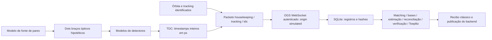

# ORION-Q: satélites e adaptador IBM — laboratório de 07/10/2026

Nota de atualização (5.49): a integração IBM Quantum foi descontinuada em
07/10/2026. Este relatório preserva a auditoria anterior; seus comandos IBM
não fazem parte do produto atual. Os arquivos correspondentes estão no
[arquivo histórico](../../archives/retired_ibm_quantum_20261007/ibm_quantum_source.zip).
As verificações satelitais continuam aplicáveis ao seu escopo registrado.

## Resultado e fronteira de evidência

Foi executado o pipeline existente de aquisição satelital, socket OGS autenticado,
validação de registros, temporização, processamento BBM92, persistência e publicação
do backend, utilizando **emulação com modelo físico identificado**. Os 21 checks
do validador passaram. Foram reproduzidos e corrigidos três defeitos de execução
e uma lacuna de proveniência; a suíte passou em 177 testes, incluindo recovery e
CLI IBM, mais 73 testes satélite/replay após a extensão final de proveniência.
Dez verificações Qt e regressões também passaram. O benchmark Bell
executou em Aer local. Nenhum satélite, estação óptica ou QPU IBM foi operado.

A evidência está em [satellite_ibm](../../outputs/orion_lab_20261007/satellite_ibm).
O [manifesto](../../outputs/orion_lab_20261007/satellite_ibm/scenario_manifest.json)
registra configuração integral, versões, seed e modelo. Caminhos relativos neste
relatório partem de `docs/research`.

| Item | Modo efetivamente executado | Limite |
| --- | --- | --- |
| Fonte satelital e detectores | Emulação: `SimulatedAcquisitionSource`, seed 42 | Fonte Poisson, bases, perdas por braço, ruído, jitter, pós-pulsos e dead time modelados; dispositivos hipotéticos |
| OGS | Emulação de interface: `OGSStore(origin='simulated')`, WebSocket local | Mensagens clássicas normalizadas; não há controle de telescópio, terminal ou estação |
| Replay por arquivo | Replay de **fixture simulada**, jornada satelital e testes ISL | `measurement_file` descreve transporte; `parameter_provenance.origin='simulated'` preserva origem científica; nenhum registro físico autenticado foi identificado |
| Órbita | Modelo circular/SGP4/vetores, conforme configuração | Cadastro ou propagação não comprova enlace nem operacionalidade da missão |
| IBM | Aer ideal/ruidoso e jobs falsos nos testes | Interface/protocolo software; `qiskit-ibm-runtime` ausente no runtime principal; nenhum job externo submetido |

O diagnóstico IBM local registra `MISSING_OPTIONAL_RUNTIME_DEPENDENCY`, sem ler
contas salvas ou tentar rede. Python 3.12.14; Qiskit 2.5.2; Aer 0.17.2; NumPy
2.5.2; SciPy 1.18.1; SGP4 2.27; websockets 17.2; pytest 9.1.1. A versão do
pacote reportada pelo diagnóstico não substitui a configuração de fonte do
checkout; os testes utilizaram `PYTHONPATH=src`.

## Inventário e contratos existentes

Os módulos `quantum_protocols/satellite_simulation.py`, `satellite_contracts.py`,
`satellite_processing.py`, `satellite_ingress.py` e `satellite_validation.py`
implementam geração, normalização, análise, ingestão e jornada de aceitação.
`InterSatelliteAdapter` usa a mesma análise temporal sob contrato ISL distinto.
`network_engine/engine.py` conecta o source ao motor, journal e publicação viva.

O envelope comum `Acquisition` vincula comando, sessão, operação, source ID,
origem, sequência e IDs dos canais quânticos/clássicos. O contrato OGS exige três
streams `housekeeping`, `tracking`, `tdc`, associados ao mesmo bloco e canais.
`orion.ogs-packet.v2` transporta observações; `orion.satellite-observation.v2`
descreve o bloco reunido. Resultados pré-calculados e chaves são recusados.

| Contrato | Campos físicos relevantes |
| --- | --- |
| Housekeeping | Posição ECEF em km, velocidade em km/s, fonte da efeméride, época e validade; posição externa à Terra |
| Tracking | ID da estação, lock explícito, intervalos abertos, observação temporal e excesso de perda com referência |
| TDC | UTC em segundos inteiros + fração inteira em ps; timestamps relativos int64 em ps, canal/detector, offset/relógio/incerteza e correção de propagação |
| Limites | 100.000 tags por lote, mensagens até 8 MiB, quatro clientes, buffer e quota persistente; `lost_tags > 0` aborta sem truncar |

O WebSocket suporta `/ogs/v2/{housekeeping,tracking,tdc,status}`, restringe bind
a loopback e exige bearer token via referência `env:`. `status` anuncia janelas
de observação sem comando de atuação. Operação remota requer infraestrutura TLS
autenticada externa; não foi testada. Esse transporte é uma interface do gateway
ORION-Q, não um protocolo nativo presumido do Micius.



O adaptador IBM está separado em catálogo `providers.py`, preparação, plano
Bell, executor/coletor `qpu.py`, ledger e CLIs. O catálogo resolve backend e jobs
existentes; não submete. O executor real usa SamplerV2 de forma lazy, com plano,
limites e autorização vinculados por hash. O ledger impede repetição automática
após submissão incerta. Os testes cobrem essas etapas com `FakeSampler/FakeJob`;
seus artefatos não constituem contagens adquiridas numa QPU.

## Referências técnicas verificadas

### Micius

O experimento histórico emprega LEO heliossíncrona próxima de 500 km, downlink
BB84 com estados chamariz e polarização, fonte a 848,6 nm/100 MHz e Xinglong
(40°23′45,12″N, 117°34′38,85″E; 890 m). A aquisição de 19/12/2016 durou 273 s,
com distância oblíqua 645–1.200 km: 3.551.136 eventos, 1.671.072 bits selecionados,
300.939 finais e QBER médio 1,1%. O experimento era noturno; tracking desde 5°,
aquisição desde aproximadamente 15° até 10° na saída. Jitter de sincronização
0,529 ns, janela 2 ns; telescópios de 300 mm e 1 m. Esses parâmetros históricos
não determinam uma passagem atual nem substituem segurança específica de missão.
[Artigo primário](https://arxiv.org/pdf/1707.00542),
[publicação final](https://doi.org/10.1038/nature23655).

Não se confirmou operacionalidade física em 07/10/2026. O projeto documenta
Nanshan, Delingha, Xinglong e Lijiang, e plataforma de teletransporte Ali.
[USTC — Micius](https://quantum.ustc.edu.cn/web/index.php/en/node/351).
O artigo final disponibiliza dados mediante solicitação ao autor; não foi obtido
dump físico de timestamps. Gerar tags a partir de métricas publicadas é simulação
parametrizada, e não replay experimental.
[Artigo final espelhado](https://home.agh.edu.pl/~kozlow/fizyka/kwantowa%20kryptografia/Satellite-to-ground%20quantum%20key%20_Nature%202017.pdf).

A jornada Rio executada usa **BBM92 com pares**, não o BB84 chamariz do artigo
Micius. A estação, hardware e efeméride do cenário Rio são hipóteses do modelo.
Enlaces ISL implementados têm suporte de software e física simplificada; as
referências Micius consultadas não demonstram capacidades satélite–satélite.

### IBM

O contrato REST atual documenta base `https://quantum.cloud.ibm.com/api`,
`POST /v1/jobs`, `GET /v1/jobs/{id}`, `GET /v1/jobs/{id}/results`, métricas e
cancelamento. Requer bearer IAM, `Service-CRN` e `IBM-API-Version`; a documentação
marca 2026-04-15 como latest. Submissão fornece ID externo; estados REST incluem
Queued/Running/Completed/Cancelled/Failed. O exemplo atual inclui
`usage.qpu_charge_time_seconds`, `circuits_execution_time_ns` e timestamps.
[IBM — jobs](https://quantum.cloud.ibm.com/docs/en/api/qiskit-runtime-rest/tags/jobs).

A ferramenta web recuperou JSON de `/api/v1/versions`, com 2026-04-15 em estado
live; isso valida o conteúdo externo consultado, não uma chamada do adaptador
ORION-Q. Alguns exemplos de documentação usam versão antiga: a integração deve
fixar versão suportada explicitamente.
[Resposta de versões](https://quantum.cloud.ibm.com/api/v1/versions),
[contrato](https://quantum.cloud.ibm.com/docs/en/api/qiskit-runtime-rest/tags/versions).
No SDK, `job_id()/status()/result()` e `service.job(id)` permitem recuperação;
`result()` bloqueia. Tempo em RUNNING pode incluir processamento clássico e não
equivale a tempo de execução na QPU.
[IBM — monitoramento](https://quantum.cloud.ibm.com/docs/en/guides/monitor-job).

Executar circuitos remotamente comprova somente computação remota. Uma conexão
óptica entre processadores necessita interface fotônica e caracterização própria;
o benchmark Bell local não comprova distribuição de entrelaçamento entre locais.

## Defeitos comprovados e repetição

| Defeito | Reprodução antes | Correção | Evidência depois |
| --- | --- | --- | --- |
| Coincidência falsa após descartar ambiguidades | Tags A `[100,110,120,1000]`, B `[110,120,130,1000]` ps; gate ±10 ps: retornava 2 coincidências, só a última isolada é única | Verificar também vizinhos anteriores; hits rejeitados continuam alternativas físicas | 1 coincidência, 3 gates ambíguos rejeitados; regressão passa |
| Métricas IBM atuais perdidas | FakeJob com `qpu_charge_time_seconds=20` e execução 20.000.000 ns: coletor omitia ambos | Preservar separadamente cobrança em s, execução em ns e timestamps UTC selecionados; manter `quantum_seconds` legado independente | Campos e unidades preservados; nenhum campo privado copiado; regressão passa |
| Emulação OGS marcada física | Engine recebia `origin='simulated'` mas construía store com `origin='physical'`; validador também fabricava packets físicos | Engine respeita origin explícito; validador usa simulated em listener, packets, snapshot e export | Regressão passa e jornada 21/21; origem simulated presente nos registros |
| Modelo/origem científicos ausentes no replay satelital | Arquivo lido com origin measurement_file perdia a indicação estruturada de que os tags foram simulados (`KeyError: origin` no teste) | Gerador inclui `parameter_provenance.origin='simulated'` e `model_id='orion.satellite-poisson-events.v1'` no raw | Clock/tags inteiros e métricas idênticos; modelo e origem preservados; quatro checks de replay passam |

Logs: [baseline 163 testes](../../outputs/orion_lab_20261007/satellite_ibm/tests_before.txt),
[duas regressões antes](../../outputs/orion_lab_20261007/satellite_ibm/regressions_before.txt),
[origem antes](../../outputs/orion_lab_20261007/satellite_ibm/provenance_before.txt),
[177 testes depois](../../outputs/orion_lab_20261007/satellite_ibm/tests_after.txt).
[Replay antes](../../outputs/orion_lab_20261007/satellite_ibm/model_origin_before.txt),
[73 testes satélite/replay depois](../../outputs/orion_lab_20261007/satellite_ibm/provenance_replay_after.txt),
[10 verificações Qt/regressões](../../outputs/orion_lab_20261007/satellite_ibm/ui_regressions_after.txt).
Ruff para F/E4/E9 passou. O lint integral ainda acusa o estilo E701/E702 já usado
extensivamente nesses módulos satelitais; não houve reformatação abrangente.
O ajuste no engine restringiu-se à construção de OGSStore com origem declarada;
o padrão físico permanece para gateways de aquisição efetiva, sem qualificação
automática de hardware.

## Métricas executadas

Todas as linhas satelitais abaixo derivam do modelo e configuração congelados,
com seed 42, e têm `certified_secret_bits=0`. Contagens não provam entrelaçamento.
O cenário ampliado usa hipótese de abertura receptora 6 m/100 kpair/s/6 s para
exercitar processamento finito; 398 bits são estimativa **condicional**, não
chave segura certificada, entregue ou instalada em pool.

| Cenário | Coincidências | Bits selecionados | QBER | Estimativa condicional |
| --- | ---: | ---: | ---: | ---: |
| Nominal, 2 s | 136 | 65 | 1,5385% | 0 |
| Perda adicional 100 dB | 0 | 0 | indefinido | 0 |
| Jitter 1.000.000 ps | 2 | 2 | 50% | 0 |
| Background aumentado | 161 | 84 | 5,9524% | 0 |
| Laboratório hipotético ampliado, 6 s | 5.919 | 2.902 | 0,2412% | 398 |

O [pipeline final](../../outputs/orion_lab_20261007/satellite_ibm/pipeline_final/report.json)
preserva receipts, raw TDC, packets com hashes e SQLite. A troca efetiva da fonte
direta pelo adaptador OGS simulado mantém o processador e contratos do core.
O [replay executado](../../outputs/orion_lab_20261007/satellite_ibm/simulated_replay_report.json)
preserva origem/modelo, clock e tags inteiros e reproduz exatamente as 136
coincidências do nominal. Arquivo original e envelope de leitura por arquivo têm
hashes separados; essa evidência continua sendo emulação, sem aquisição física.
Desconexão/reconexão, duplicata, freshness, backpressure, quota, overflow,
sincronização, perda e fim da janela foram exercitados pelos testes existentes.

No [Bell offline](../../outputs/orion_lab_20261007/satellite_ibm/ibm_offline_bell.json),
duas disposições, 256 shots/base: fidelidade ideal 1,0 em ambas; modelo Aer ruidoso
0,982422 e 0,992188. Seeds transpiler 2718/simulator 528. Não há interconexão óptica.
[Diagnóstico local IBM](../../outputs/orion_lab_20261007/satellite_ibm/ibm_readiness.json).

## Reprodução e lacunas

Use `.audit-winvenv/Scripts/python.exe` e `PYTHONPATH=src`. Cada execução abaixo
deve usar um diretório novo para preservar evidência anterior:

```powershell
$env:PYTHONPATH=(Join-Path (Get-Location) 'src')
& .audit-winvenv/Scripts/python.exe tools/validate_satellite_pipeline.py --output-dir outputs/orion_lab_repeat_satellite --seed 42
& .audit-winvenv/Scripts/python.exe experiments/run_ibm_bell_offline_benchmark.py --experiment-id orion-lab-repeat --shots-per-basis 256 --physical-layouts '0,1;1,2' --seed-transpiler 2718 --seed-simulator 528 --confirm-operator --output outputs/orion_lab_repeat_ibm.json
& .audit-winvenv/Scripts/python.exe experiments/run_ibm_readiness_diagnostic.py --output outputs/orion_lab_repeat_ibm_readiness.json
```

Para hardware faltam SDK IBM opcional/conta/backend qualificados, autorização do
job, adaptador de missão/estação e registros físicos confiáveis. Para replay
Micius faltam arquivos experimentais originais com configurações e relógio.
Efeméride/TLE deve trazer fonte/época/hash e preservar geometria/janela; o cadastro
não implica acesso à estação. Não foram criados comandos proprietários, missão
fictícia em estado operacional ou afirmação de fidelidade de equipamento.
