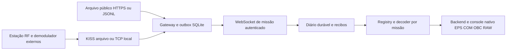

# ORION-Q — recepção operacional de quadros satelitais, 8 de outubro de 2026

O ORION-Q passou a oferecer uma cadeia própria de telemetria clássica: quadros de missão provenientes de arquivo público, gravação KISS ou demodulador externo local entram em uma outbox durável, seguem ao receptor WebSocket autenticado, são preservados no diário de missão e chegam ao backend e à interface nativa como engenharia EPS/COM/OBC RAW. O decoder registrado usa os mesmos bytes para entradas físicas, arquivos e simulação, mantendo a origem explícita.

A cadeia de software foi demonstrada com **dois quadros públicos reais de Suomi100**, preservados e transportados por uma estação TCP local emulada. **Os 17 casos de missão, 26 verificações da CLI em processos separados e os dez gates da distribuição passaram no executável reconstruído `5.54.0-native-20261008-133607`.** Esta evidência não qualifica recepção RF local, unidades físicas, relógio de bordo, hardware óptico ou QKD. O produto não é um receptor universal de qualquer missão.

**Distribuição de software aprovada:** [executável 5.54.0](E:/Codex/2026-08-27/e/work/NISQ-Predictive-Twin/release/windows/5.54.0-native-20261008-133607/ORION-Q/ORION-Q.exe), SHA-256 `3f9e7030fd3eee9866c61a5d53af708e329940ef789f87455d7bfe3571cc6083`; [ZIP portátil](E:/Codex/2026-08-27/e/work/NISQ-Predictive-Twin/release/windows/5.54.0-native-20261008-133607/ORION-Q-5.54.0-native-windows-x64.zip), SHA-256 `7f99ee719630069ef00a2575aaf6d97928d8e63421d64242d3f66034c32b96fe`, 299.648.829 bytes. A verificação do ZIP aprovou os CRCs de 3.961 arquivos. [Qualificação final](E:/Codex/2026-08-27/e/work/NISQ-Predictive-Twin/outputs/satellite_operational_20261008/final-qualification.json), [manifesto do pacote](E:/Codex/2026-08-27/e/work/NISQ-Predictive-Twin/release/windows/5.54.0-native-20261008-133607/portable-package.json). O candidato anterior `5.54.0-native-20261008-125632` permanece como evidência histórica e está marcado como não liberável. Os gates atuais de missão e CLI estão vinculados ao novo binário, sem reaproveitar sua aprovação anterior.

## Cadeia implementada e fronteiras



O trecho RF, SDR/SDK, demodulação e FEC precede a entrada do ORION-Q. gr-satellites é uma opção de demodulador externo: oferece `--kiss_out` e `--kiss_server`, inclusive extensão de horário KISS `0x09` com UNIX em milissegundos, uint64 big-endian. Esses processos e equipamentos exigem configuração própria da missão e não foram incorporados ao gateway. [Documentação primária de gr-satellites 5.9](https://gr-satellites.readthedocs.io/en/v5.9.0/command_line.html#kiss-output).

O parser recompõe fragmentos e escapes KISS, limita entrada e preserva contadores de término e descarte. O protocolo KISS delimita quadros; não acrescenta, por si, CRC ou autenticação da carga útil. [Especificação KISS de Chepponis/Karn](https://www.ka9q.net/papers/kiss.html).

Os endpoints novos são `/satellite/v1/frames` e `/satellite/v1/status`. O envelope `orion.satellite-frame.v1` identifica fonte, origem, ID cadastrado do satélite, missão, sequência por fonte, recepção, estação, UTC, bytes, perfil e proveniência. O receptor vincula explicitamente **ID do cadastro ↔ missão ↔ NORAD ↔ perfil**. O perfil não é inferido pelo tamanho nem ajustado removendo bytes. Resultados derivados QKD e credenciais não são admitidos no envelope.

As origens `physical`, `measurement_file` e `simulated` permanecem separadas e coerentes com a integração cadastrada. Um socket local ou a escolha de `physical` não atesta que antena, SDR, demodulador ou relógio estejam qualificados. Os endpoints ópticos `/ogs/v2/housekeeping`, `/ogs/v2/tracking` e `/ogs/v2/tdc` mantêm seus contratos próprios. Telemetria CSP não fabrica HK óptico, ECEF medido, lock APT, tags TDC, coincidências, QBER ou chaves. [Guia operacional atual](E:/Codex/2026-08-27/e/work/NISQ-Predictive-Twin/docs/product/orion_q_satellite_reception.md), [contrato OGS v2](E:/Codex/2026-08-27/e/work/NISQ-Predictive-Twin/docs/product/orion_q_satellite_ogs_v2.md).

O receptor persiste bytes e envelope antes do processamento. `received`, `decoded`, `quarantined` e `unavailable` distinguem admissão, interpretação e falhas. Um recibo durável também pode corresponder a quarentena ou decoder indisponível; `acknowledged` na outbox não significa dado físico qualificado. O ACK precisa corresponder ao hash do envelope enviado. Perda de ACK conserva a pendência original; reenviar o mesmo envelope retorna `duplicate`, sem duplicar a recepção. Conflitos de sequência ou identidade não substituem o registro preservado.

Após reinício, pendências `received` são recuperadas e o histórico permanece disponível; o listener fica parado até abertura manual autorizada. Quarentena ou indisponibilidade exigem revisão e retry explícito de decode por `MissionFrameStore.retry_decode(journal_id)`. Não há comando CLI de retry-decode anunciado. Quotas preservam registros existentes: defaults de 16 MiB lógicos na outbox, 64 MiB/100 mil registros no diário e 32 quadros/8 MiB pendentes de decode. Quota atingida exige exportação/planejamento de estado e nova fonte quando aplicável, sem reinicializar a sequência da mesma fonte para contornar o diário. [Implementação do ingresso](E:/Codex/2026-08-27/e/work/NISQ-Predictive-Twin/src/quantum_autopilot/quantum_protocols/mission_ingress.py), [gateway](E:/Codex/2026-08-27/e/work/NISQ-Predictive-Twin/src/quantum_autopilot/quantum_protocols/satellite_gateway.py).

## Quadros públicos e interpretação

A observação SatNOGS **15146588** identifica Suomi100, NORAD **43804**, estação **CIA_S4 / 5112**. Os dois arquivos foram obtidos por GET HTTPS público em 2026-10-08, sem credenciais externas; seus bytes originais estão nas fixtures com URLs, UTC de recepção publicado, UTC de download, tamanho, atribuição e SHA-256. [Observação pública](https://network.satnogs.org/api/observations/15146588/), [registro HTTP preservado](E:/Codex/2026-08-27/e/work/NISQ-Predictive-Twin/outputs/satellite_live_probe_20261008/research/suomi100-observation-15146588.json.http.json), [proveniência das fixtures](E:/Codex/2026-08-27/e/work/NISQ-Predictive-Twin/tests/fixtures/satellite_public/provenance.json).

| Quadro preservado | Recepção publicada UTC | Download UTC | Bytes | SHA-256 dos bytes |
|---|---|---|---:|---|
| [13:54:20](E:/Codex/2026-08-27/e/work/NISQ-Predictive-Twin/tests/fixtures/satellite_public/suomi100-frame-20261008-135420.bin) | `2026-10-08T13:54:20Z` | `14:01:31.576297Z` | 96 | `4ae28a9e2a3871c7fe4d2fa7ee70ca253261cd377414f55731cbc7d4515fbc66` |
| [13:55:20](E:/Codex/2026-08-27/e/work/NISQ-Predictive-Twin/tests/fixtures/satellite_public/suomi100-frame-20261008-135520.bin) | `2026-10-08T13:55:20Z` | `14:01:30.623341Z` | 96 | `464560d47534bebdfe99455aba43aa2c525ec000fbbcc2075136ed473b844d14` |

Os downloads ocorreram aproximadamente 431,576 s e 370,623 s após os horários publicados. São arquivos de recepções externas daquele dia; a execução operacional posterior os trata como replay `measurement_file`. `received_at_utc`, `retrieved_at_utc` e `ingested_at_utc` descrevem momentos distintos. Reutilizar a captura não muda sua recepção para o horário do replay.

O decoder padrão registrado é `suomi100-stdlib`, versão `2`, para Beacon0 e cabeçalho CSP `82a78001`. Outras missões ou variantes exigem um decoder registrado e testado, com ICD/layout, integridade, escalas e política de relógio próprios. A extensão pelo registry é uma interface de código; não constitui um catálogo universal de decoders ou um instalador de plugins.

| Perfil explícito | Tamanho | Integridade exigida |
|---|---:|---|
| `csp1-beacon0-crc32c-v1` | 92 bytes | CRC32C do payload `[4,88)`, em `[88,92)`, big-endian; cabeçalho validado separadamente |
| `satnogs-beacon0-dual-crc32c-v1` | 96 bytes | CRC32C de `[4,88)` em `[88,92)` e de `[0,92)` em `[92,96)` |

O perfil de 96 bytes corresponde às duas amostras observadas. Os casos de 92 bytes usam fixtures derivadas dessas amostras para validar o contrato CSP1; não constituem uma nova captura física nesse formato. O significado operacional da camada adicional de checksum permanece sem confirmação; ela não é declarada canônica CSP1.x. O produto recusa um prefixo de 88 bytes sem CRC e não transforma automaticamente um perfil no outro. A cobertura do payload no perfil CSP1.x foi conferida no caminho anterior a CSP2.1 do [libcsp, commit 583c9eb](https://github.com/libcsp/libcsp/blob/583c9ebc23b9193c2c6800fdff6a182e13df03e7/src/csp_crc32.c), cuja [cópia primária preservada](E:/Codex/2026-08-27/e/work/NISQ-Predictive-Twin/outputs/satellite_live_probe_20261008/research/libcsp-crc32-pinned.c) mantém a proveniência HTTP. O layout Beacon0 foi conferido no [gr-satellites, commit cb5d0fc](https://github.com/daniestevez/gr-satellites/blob/cb5d0fca22ed439e9ce029516b755491a57c5764/python/telemetry/suomi100.py) e na [cópia preservada](E:/Codex/2026-08-27/e/work/NISQ-Predictive-Twin/outputs/satellite_live_probe_20261008/research/suomi100-decoder-pinned.py).

CRC e SHA-256 verificam integridade/identidade dos bytes nos escopos declarados, sem autenticar autoria satelital. O decode mantém `qualification.status=decoded_not_qualified`, `units.status=raw_unscaled`, `integrity.authenticated=false` e `clock.qualified=false`. Valores como `batt_v=7285`, `temp=106` e `rssi=-117` permanecem brutos, sem promoção a V, °C ou dBm. Os timestamps internos interpretados pelo layout resultam em `2033-10-06T19:21:00Z` e `19:22:00Z`; a divergência para as recepções de 2026 permanece registrada, sem correção de época ou substituição do UTC externo. [Decoder implementado](E:/Codex/2026-08-27/e/work/NISQ-Predictive-Twin/src/quantum_autopilot/quantum_protocols/satellite_missions.py).

## Matriz compilada de 17 casos

A matriz abaixo pertence ao **candidato reconstruído `5.54.0-native-20261008-133607`**, executado em Windows com Qt `windows`, estado isolado, diretório de trabalho externo ao programa e sem auxílio de Python do checkout. O gate vincula o resultado ao SHA-256 do EXE, confere os hashes dos quadros e verifica relatório e PNG nativo. `independent_machine_verified=false`: a execução ocorreu nesta máquina. [Gate compilado](E:/Codex/2026-08-27/e/work/NISQ-Predictive-Twin/release/windows/5.54.0-native-20261008-133607/satellite-mission-validation/report.json), [relatório filho](E:/Codex/2026-08-27/e/work/NISQ-Predictive-Twin/release/windows/5.54.0-native-20261008-133607/satellite-mission-validation/reception/report.json), [captura nativa](E:/Codex/2026-08-27/e/work/NISQ-Predictive-Twin/release/windows/5.54.0-native-20261008-133607/satellite-mission-validation/reception/native-mission-reception.png).

| # | Caso / objetivo | Evidência obtida | Resultado |
|---:|---|---|---|
| 1 | `radio_satellite_has_no_quantum_payload` — cadastrar telemetria clássica sem payload quântico | `optical_payload_available=false` no backend | Passou |
| 2 | `native_buttons_provision_and_start` — operar provisão e abertura pela UI | Botões emitiram `provision_satellite_session` e `configure_technology_source`; listener criado | Passou |
| 3 | `original_frame_suomi100-frame-20261008-135420.bin` — preservar quadro 1 | SHA-256 coincidente com a fixture pública de 96 bytes | Passou |
| 4 | `original_frame_suomi100-frame-20261008-135520.bin` — preservar quadro 2 | SHA-256 coincidente com a fixture pública de 96 bytes | Passou |
| 5 | `tcp_clock_and_partial_disconnect` — ler chunks e encerrar frame parcial | 233 bytes, 2 quadros, 2 extensões de horário, EOF e 1 `partial_frame_at_eof` em quarentena | Passou |
| 6 | `commit_before_lost_response` — confirmar persistência antes de perder ACK | Receptor retornou `decoded`; timeout intencional manteve pendência no produtor | Passou |
| 7 | `identical_retry_without_duplicate` — repetir após interrupção | Envelope reenviado byte a byte idêntico; 2 recibos na outbox e apenas 2 recepções válidas no diário | Passou |
| 8 | `native_screen_receives_raw_eps_com_obc` — apresentar engenharia da missão | Projeção nativa da missão mostrou `suomi100`, `7285` e `-117`; PNG preservado | Passou |
| 9 | `onboard_clock_and_units_unqualified` — impedir falsa qualificação | `clock.qualified=false` e `units.qualified=false` após decode | Passou |
| 10 | `no_tracking_or_key_fabrication` — manter fronteira óptica | Tracking físico e `qkd_validated` permaneceram falsos | Passou |
| 11 | `corrupted_crc_is_quarantined` — detectar alteração de payload | Bit alterado com SHA-256 atualizado; CRC recusado e bytes preservados em quarentena | Passou |
| 12 | `wrong_satellite_is_quarantined` — conferir vínculo NORAD | NORAD 25544 contra binding 43804; `mission_identity_mismatch`, sem resultado admitido | Passou |
| 13 | `anonymous_rejected` — exigir identidade | Handshake sem sessão recusado com HTTP 401 | Passou |
| 14 | `revoked_session_rejected` — aplicar revogação | Nova mensagem com sessão revogada recusada com HTTP 401/403 | Passou |
| 15 | `native_stop_keeps_receipts` — parar listener sem apagar evidência | Botão encerrou listener; 4 registros permaneceram no diário | Passou |
| 16 | `restart_keeps_receipts_without_listener` — recuperar estado de forma explícita | Novo engine recuperou 4 registros e manteve listener parado | Passou |
| 17 | `authenticated_audit_without_secrets` — verificar auditoria | Cadeia/MAC válida; token ausente do arquivo de auditoria | Passou |

O estado final contém **2 `decoded`, 2 `quarantined`, 0 `received` pendentes e 0 `unavailable`**, com 4 admissões duráveis, 1 repetição idêntica, 0 lacunas de sequência e 2 envelopes reconhecidos na outbox. Recusas HTTP anteriores ao ingresso não integram o contador de rejeições do diário. O último registro é a quarentena por identidade; consultar somente o último estado não representa o histórico inteiro nem o estado do socket.

SHA-256 do EXE reconstruído, igual antes e depois do gate: `3f9e7030fd3eee9866c61a5d53af708e329940ef789f87455d7bfe3571cc6083`. O resultado em fontes também passou os mesmos 17 casos, com Qt offscreen, em [source-chain-r4/report.json](E:/Codex/2026-08-27/e/work/NISQ-Predictive-Twin/outputs/satellite_operational_20261008/source-chain-r4/report.json). Essa execução em fontes complementa a investigação e não substitui os gates compilados.

## CLI compilada em processos separados

Um segundo ensaio do mesmo EXE passou **26/26 verificações** entre `2026-10-08T16:41:46.965089Z` e `16:43:04.342749Z`, usando os dois quadros preservados em JSONL e origem `measurement_file`. `serve` (PID 39504), `import-jsonl` (PID 20428) e `deliver` (PID 41760) foram processos distintos; o servidor permaneceu ativo durante a entrega. Todos os seis comandos do produto usaram o EXE compilado e terminaram com exit 0. Python de apoio orquestrou o ensaio e inspecionou suas evidências, sem substituir produtor, receptor ou entregador. [Relatório da CLI multiprocessos](E:/Codex/2026-08-27/e/work/NISQ-Predictive-Twin/outputs/satellite_operational_20261008/cli-multiprocess/candidate-133607/report.json).

| Grupo de verificações | Quantidade | Evidência |
|---|---:|---|
| Quadros públicos originais | 2 | Bytes e hashes das duas fixtures preservados |
| Processos, aquisição e transporte | 6 | Listener em processo próprio, importação de 2 envelopes, sequência da outbox, entrega, concorrência servidor/entregador e hashes de ACK |
| Autenticação do status | 1 | Consulta sem sessão recusada com HTTP 401 |
| Diário e decode por quadro | 9 | 2 replays históricos persistidos; para cada quadro, bytes/hash, perfil RAW sem qualificação, 2 CRCs e ausência de alegação RF/hardware/QKD |
| Repetição e idempotência | 4 | ACK `duplicate`, sem novas linhas, reimportação idempotente e redelivery sem pendências |
| Encerramento e inspeção durável | 3 | `serve` encerrou por sua duração de 70 s; relatório final e diário coincidiram com inspeção autenticada |
| Identidade do artefato | 1 | SHA-256 do EXE permaneceu igual antes e depois |

O diário desse ensaio CLI contém **2 admissões, 2 `decoded`, 2 repetições idênticas, 0 rejeições e 0 pendências**; a outbox contém 2 `acknowledged` e 0 `pending`. Estes são contadores de outro estado isolado, sem mistura com as 4 linhas da matriz de missão. Tokens ficaram fora de argumentos, ambiente e relatórios; o entregador resolveu `vault:orion-mission-session` no cofre do receptor. Nenhuma aquisição RF local, atuação física ou QKD foi qualificada.

## Regressões e qualificação da distribuição

| Evidência verificável | Casos | Falhas / erros / skips | Tempo |
|---|---:|---|---:|
| [final-focused.xml](E:/Codex/2026-08-27/e/work/NISQ-Predictive-Twin/outputs/satellite_operational_20261008/final-focused.xml) — conjunto focado final | 323 | 0 / 0 / 0 | 148,315 s |
| [regression-final.xml](E:/Codex/2026-08-27/e/work/NISQ-Predictive-Twin/outputs/satellite_operational_20261008/regression-final.xml) — regressão ampla relacionada | 249 | 0 / 0 / 0 | 175,084 s |
| [satellite-radio-r3.xml](E:/Codex/2026-08-27/e/work/NISQ-Predictive-Twin/outputs/satellite_live_probe_20261008/satellite-radio-r3.xml) — decoder/rádio | 169 | 0 / 0 / 0 | 1,041 s |
| [ingress-r3.xml](E:/Codex/2026-08-27/e/work/NISQ-Predictive-Twin/outputs/satellite_mission_20261008/ingress/ingress-r3.xml) — contrato, diário e ingresso | 52 | 0 / 0 / 0 | 111,606 s |
| [mission-release-gate-r3.xml](E:/Codex/2026-08-27/e/work/NISQ-Predictive-Twin/outputs/satellite_live_probe_20261008/mission-release-gate-r3.xml) — validação e vinculação do gate | 57 | 0 / 0 / 0 | 0,606 s |

Essas execuções se sobrepõem; suas contagens **não são somadas** como casos distintos, qualificação física ou aprovação integral de toda a plataforma. Os testes do validador de release verificam o próprio gate, inclusive rejeição de evidência incompatível; somente a execução compilada vincula os 17 casos a um EXE concreto.

Como verificação suplementar da trilha óptica e da apresentação, o agente de regressão informou **47 testes de telemetria/incremental aprovados em 8,76 s**; esse número é registro de execução comunicado, sem XML independente vinculado nesta tabela. A inspeção nativa corrigida em fontes aprovou **7/7 verificações**, Qt `windows`, incluindo `credentials_are_references=true`, em [report.json](E:/Codex/2026-08-27/e/work/NISQ-Predictive-Twin/work/satellite-ogs-source-native-20261008/report.json). Os casos de UI já cobertos pelo conjunto focado não são contados novamente.

O autoteste geral do candidato `125632` terminou com `passed=false`: a verificação agregada `satellite_housekeeping_science_inspection` falhou porque o teste embutido ainda esperava a referência antiga `env:` quando a UI atual exige `vault:`. Seu relatório de inspeção contém 6/7 verificações aprovadas e apenas `credentials_are_references=false`. A expectativa foi corrigida nos fontes e motivou a reconstrução. [Autoteste geral anterior](E:/Codex/2026-08-27/e/work/NISQ-Predictive-Twin/release/windows/5.54.0-native-20261008-125632/self-test-repeat/report.json), [inspeção que identificou a falha](E:/Codex/2026-08-27/e/work/NISQ-Predictive-Twin/release/windows/5.54.0-native-20261008-125632/self-test-repeat/satellite-ogs-ui/report.json).

O ambiente verificado é Windows 11 Pro `10.0.26200`, Ryzen 7 5700X (8 núcleos/16 threads), 31,93 GiB de RAM; Python 3.12.14, PySide6 6.11.2, PyInstaller 6.22.2, cryptography 46.0.7, websockets 17.2 e pytest 9.1.1. O build reconstruído levou 298,297 s e a conferência do freeze preservou 572 entradas. [Ambiente](E:/Codex/2026-08-27/e/work/NISQ-Predictive-Twin/outputs/satellite_operational_20261008/environment.json).

**Distribuição reconstruída aprovada:** os dez gates foram executados no mesmo EXE e passaram. A qualificação final também confirmou missão, CLI, freeze de 572 entradas, hash do binário, integridade do ZIP e preservação da distribuição anterior. O candidato anterior permanece como evidência histórica, sem aprovação de distribuição. [Resultados dos gates](E:/Codex/2026-08-27/e/work/NISQ-Predictive-Twin/release/windows/5.54.0-native-20261008-133607/frozen-progress.json).

| Gate no executável | Resultado | Duração |
|---|---|---:|
| Missão satelital nativa — 17 casos | Passou | 31,468 s |
| Trilha óptica OGS existente | Passou | 30,016 s |
| Modelos opcionais sem pacotes | Passou | 0,656 s |
| Roadmap | Passou | 8,000 s |
| Worker de campanha compilado | Passou | 39,328 s |
| Autoteste geral — 39 verificações | Passou | 561,735 s |
| Campanha completa de laboratório | Passou | 112,718 s |
| Campanha completa da rede global | Passou | 120,485 s |
| Estresse — 20 rodadas | Passou | 123,828 s |
| Inicialização — seis cenários de escala/modo | Passou | 213,703 s |

## Operação nativa e CLI

Os passos completos e limites de cada opção estão no [guia de recepção](E:/Codex/2026-08-27/e/work/NISQ-Predictive-Twin/docs/product/orion_q_satellite_reception.md). Extraia o **ZIP completo**, incluindo `ORION-Q/_internal`, em uma pasta própria e execute os comandos dentro de `ORION-Q`. Use um estado autorizado; `$taskData` precisa ser definido em cada terminal. O pacote acima está qualificado no escopo de software descrito neste relatório.

```powershell
$taskData = 'C:\ORION-Q-data\satellite-reception-01'
.\ORION-Q.exe --ui native --state-root $taskData
```

Em **COMUNICADORES**, cadastre o satélite com `classical_telemetry`, missão `suomi100`, NORAD 43804 e perfil explícito. O cadastro de arquivo público usa, por exemplo, `SUOMI100-PUBLIC`, integração `measurement_file` e perfil de 96 bytes. A entrada de demodulador RF usa outro ID, por exemplo `SUOMI100-RF`, integração física/`measurement_stream` e perfil de 92 bytes. A órbita cadastrada exige fonte e cobertura próprias; o TLE arquivado do exemplo não é garantia de efeméride atual.

Na inspeção satelital, abra **Missão / RF · engenharia RAW** e **Entrada Missão / RF · somente recepção**. Configure fonte, origem, IDs, perfil, porta e `vault:orion-mission-session`. O administrador com `security.manage` usa **PROVISIONAR SESSÃO DE MISSÃO**; depois o operador autorizado usa **ABRIR RECEPÇÃO DE MISSÃO**. Provisionar não abre o socket. Confirme `listener_active=true` e `transport_state=listening`. `state=decoded` descreve o último frame, não a disponibilidade do listener. **ENCERRAR RECEPÇÃO DE MISSÃO** preserva histórico e recibos; parar o demodulador externo exige ação própria.

Para o listener nativo configurado com `mission_public` / `measurement_file` / `SUOMI100-PUBLIC` / perfil de 96 bytes, adquira e depois entregue em etapas distintas:

```powershell
.\ORION-Q.exe --satellite-gateway --outbox "$taskData\public-outbox.sqlite" `
  --source-id mission_public --origin measurement_file --satellite-id SUOMI100-PUBLIC `
  --profile satnogs-beacon0-dual-crc32c-v1 --report "$taskData\public-acquisition.json" `
  satnogs --observation 15146588 --norad 43804 --timeout 5 --polls 1

.\ORION-Q.exe --satellite-gateway --outbox "$taskData\public-outbox.sqlite" `
  --source-id mission_public --origin measurement_file --satellite-id SUOMI100-PUBLIC `
  --report "$taskData\public-delivery.json" deliver `
  --security-root "$taskData\.security" --credential-ref vault:orion-mission-session `
  --url ws://127.0.0.1:8766/satellite/v1/frames
```

Para demodulador KISS local já configurado em `127.0.0.1:8100`, use um novo `capture-id` por sessão e mantenha produtor e entregador em **terminais/processos separados**, com a mesma outbox. O exemplo `physical` pressupõe cadeia RF real identificada; um replay deve conservar `measurement_file` e cadastro/receptor correspondentes.

```powershell
.\ORION-Q.exe --satellite-gateway --outbox "$taskData\rf-outbox.sqlite" `
  --source-id mission_rf --origin physical --satellite-id SUOMI100-RF `
  --profile csp1-beacon0-crc32c-v1 --report "$taskData\rf-acquisition.json" `
  kiss-tcp --host 127.0.0.1 --port 8100 --capture-id rf-20261008-sessao-01 `
  --station-id ESTACAO-01 --station-name 'Estação RF identificada' `
  --mission-id suomi100 --norad 43804 --max-frames 100 --timeout 30 --max-bytes 1048576
```

Em outro terminal, com `$taskData` definido, e o listener nativo vinculado a `mission_rf` / `physical` / `SUOMI100-RF` / perfil de 92 bytes:

```powershell
.\ORION-Q.exe --satellite-gateway --outbox "$taskData\rf-outbox.sqlite" `
  --source-id mission_rf --origin physical --satellite-id SUOMI100-RF `
  --report "$taskData\rf-delivery.json" deliver `
  --security-root "$taskData\.security" --credential-ref vault:orion-mission-session `
  --url ws://127.0.0.1:8766/satellite/v1/frames `
  --follow-seconds 60 --batch-size 32 --interval 1
```

`deliver` executa uma rodada por padrão; `--follow-seconds` permite acompanhar a outbox por tempo limitado. Falhas de transporte preservam pendências, enquanto HTTP 401/403 bloqueia a drenagem sem renovar a sessão: `auto_session_renewal=false`. Examine `pending`, `transport_failures`, `identity_blocked`, recibos e `last_error_type`; duração limitada não garante drenagem completa. Não repita aquisição para reconstruir um envelope cujo ACK se perdeu. Para gravação, `kiss-file` exige `--captured-at` e estação; `import-jsonl` exige fonte e origem coincidentes com a outbox. Opções gerais ficam antes da ação. O módulo Python equivalente e a alternativa `serve` com estado/cofre próprios estão no guia.

## Condições ainda necessárias e preservação histórica

| Escopo | Demonstrado | Condição externa ou pendência |
|---|---|---|
| Ingestão e decode clássico Suomi100 | Arquivo, KISS, outbox, ingresso autenticado, diário, UI e CLI compiladas em software; dez gates aprovados | Condições da estação/implantação, escalas e relógios por missão |
| Recepção física local | Interface para quadros demodulados identificados | Antena/receptor/SDR ou SDK, demodulação/FEC, captura RF e cadeia da estação verificados |
| Engenharia física | Campos EPS/COM/OBC RAW e integridade dos perfis | ICD/versão, escalas, unidades, calibração e relógios qualificados |
| Outras missões | Registry com decoder/perfil explícitos | Implementação e validação de cada decoder contra ICD e quadros identificados |
| Implantação remota | Autenticação, escopo, cofre e revogação no listener local | Fronteira/proxy TLS autenticado e provisionamento específico da implantação |
| HK/APT/TDC/QKD | Contratos próprios e regressões de software preservados | Medições ópticas, sincronismo, detectores, payload e admissão física qualificados |
| Distribuição de software | Dez gates, missão 17/17, CLI 26/26 e ZIP com CRC/SHA-256 aprovados | Instalação/qualificação independente no ambiente operacional; não substitui hardware |

Listener e cliente permanecem restritos à integração local em loopback. A referência `vault:` não substitui identidade, autorização nem revogação por mensagem. Tokens não são argumentos, variáveis de ambiente ou conteúdo de cadastro; o emissor precisa de acesso autorizado ao cofre pela conta Windows ou provisionamento da implantação. A sessão de missão provisionada pela UI tem duração de uma hora. Estação remota exige implantação TLS/provisionamento próprios; copiar o cofre para outro computador não integra esse procedimento. [Segurança comum](E:/Codex/2026-08-27/e/work/NISQ-Predictive-Twin/docs/product/orion_q_security.md), [PKI](E:/Codex/2026-08-27/e/work/NISQ-Predictive-Twin/docs/product/orion_q_security_pki_keys.md).

O adaptador público executa somente GET HTTPS allowlisted ao SatNOGS Network e seu armazenamento, confere identidade e vínculo dos arquivos, recusa redirecionamentos e limita polling/respostas. A demonstração não enviou telemetria a terceiros. Disponibilidade pública, permissão de uso e eventual contratação de fluxo contínuo são condições externas, sem garantia de serviço neste ensaio. [API primária SatNOGS](https://docs.satnogs.org/projects/satnogs-network/en/stable/api.html).

As fixtures mantêm atribuição SatNOGS Network / Libre Space Foundation / CIA_S4 e licença [CC BY-SA 4.0](https://creativecommons.org/licenses/by-sa/4.0/), documentadas em [LICENSE.md](E:/Codex/2026-08-27/e/work/NISQ-Predictive-Twin/tests/fixtures/satellite_public/LICENSE.md). O decoder e parser do produto foram escritos independentemente em stdlib; código GPL de gr-satellites não foi incorporado. Fontes de pesquisa, dados e ferramentas externas conservam suas licenças próprias; acrescentar ou distribuir outro SDK/decoder requer examinar seus direitos e condições de uso.

Este documento registra a implementação posterior ao [ensaio público inicial de 2026-10-08](E:/Codex/2026-08-27/e/work/NISQ-Predictive-Twin/docs/results/orion_q_real_satellite_reception_20261008.md), que havia identificado ausência de adaptação da missão e incompatibilidade de referências na UI. O relatório inicial, a [auditoria de prontidão de 2026-10-06](E:/Codex/2026-08-27/e/work/NISQ-Predictive-Twin/docs/results/orion_q_satellite_readiness_audit_20261006.md) e suas evidências permanecem históricos: a implementação atual não reescreve resultados anteriores nem transforma testes de software em qualificação operacional física.
