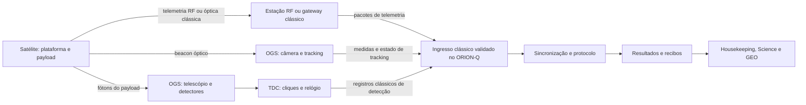

# ORION-Q 5.40.0 — auditoria de prontidão satelital

Data: 06/10/2026. Escopo: recepção na infraestrutura terrestre, contratos,
admissão de dispositivos, processamento, modelo físico, persistência e console
nativo. Análise solicitada após a entrega de Comunicadores/GEO.

**Parecer: NÃO APROVADO para integração com um satélite real nem para a
qualidade de simulação exigida neste pedido.** Existe uma demonstração funcional
com modelo físico reduzido, interfaces internas substituíveis e replay de
contagens. Faltam etapas de aquisição e modelos; há parâmetros cadastrados que
não alteram a simulação satelital. Os testes de funcionamento anteriores não
estabelecem qualificação aeroespacial ou segurança QKD.

Esta auditoria não alterou código, configurações operacionais ou executáveis.
Foram criados somente relatório e evidências isoladas. A atuação física continua
bloqueada. Nenhuma OGS, RF, laser, detector ou TDC real foi conectado. A origem
de todos os dados usados nas sondagens é simulada; converter a origem de um
capture para `measurement_file` serve exclusivamente ao teste de replay.

## O que existe e onde termina

O cadastro distingue tipo físico e função lógica, persiste em SQLite, admite
estações ópticas e satélites e exige os dois canais associados. O runtime faz
validação de vínculo, sequência, relógio, timeout e limites de mensagens; deriva
métricas de contagens e publica resultados depois do recibo clássico simulado.
O GEO recebe posição, órbita, estações e transmissões do backend. Isso comprova
uma integração de software com o modelo atual.

No ramo satelital, uma chamada local gera simultaneamente contagens e geometria
em um único `Acquisition.raw`. O processamento recebe coincidências e erros já
agregados. Não há três entradas independentes de housekeeping, tracking e TDC,
nem uma implementação de recepção RF/OGS. `ReadOnlyQueueSource` é uma fila em
memória, não um servidor. `MeasurementFileSource` exige JSONL e identificadores
dos comandos internos; não é um leitor genérico de capturas de um instrumento.

O servidor HTTP existente é um dashboard local de assurance. Sua lista de POSTs
não contém aquisição satelital; não foram encontrados servidores/adaptadores
gRPC, MQTT ou WebSocket para essa finalidade no código de produção examinado.
As strings de interface/adaptador no cadastro não implementam um transporte.
Ativar uma conexão cadastrada como física é recusado em
[communicators.py](../../src/quantum_autopilot/control_plane/communicators.py),
linha 388, e em
[registry.py](../../src/quantum_autopilot/quantum_protocols/registry.py), linha 48.
A recusa é correta enquanto não houver um driver validado; não deve ser removida
para fazer a demonstração parecer uma integração física.

O caminho necessário para dados reais deve preservar a seguinte distinção:

O backend recebe registros clássicos das medições de fótons; TCP, UDP ou uma API
não transportam o estado quântico recebido pelo telescópio. O gateway RF pode
estar em outra instalação. Decodificação CCSDS pode ocorrer na estação ou em um
adaptador, conforme o contrato da missão; não é necessário impor que toda OGS
receba RF nem que todo satélite use CCSDS. A separação lógica e a proveniência
devem continuar explícitas quando os canais compartilham infraestrutura óptica.
Esse desenho é o critério de comparação, **não uma descrição de componentes já
implementados**.

## Correções das premissas científicas

As fontes foram consultadas em 06/10/2026. Parâmetros abaixo pertencem aos
experimentos indicados e não foram convertidos em defaults universais.

| Premissa | Comparação e consequência para o ORION-Q |
|---|---|
| Separação controle/payload | Correta como separação de funções, dados e portas. Não exige caminhos ópticos fisicamente distintos: Jinan-1 multiplexa comunicação clássica de 812 nm e payload de 850 nm, compartilhando fibra/óptica. A autenticação clássica e a identificação das medições continuam necessárias. [Li et al., v1 de 2024](https://arxiv.org/html/2408.10994v1). |
| 532 nm de beacon e 850 nm de payload | Exemplos dependentes da missão. Em Yin 2017, os pares são de aproximadamente 810 nm e 850 nm é usado para sincronização. A figura enviada de Han é de **uplink**, com sinal quântico de 780 nm enviado pela OGS. [Yin et al.](https://arxiv.org/pdf/1707.01339), [Han et al.](https://arxiv.org/pdf/1912.06317). |
| Órbita, TLE e vetores de estado | TLE contém elementos médios associados a um propagador, não diretamente XYZ/VXYZ. SGP4 e as conversões de referencial/tempo precisam ser apropriados à entrada. O propagador atual é Kepler de dois corpos e recusa TLE. Nem SGP4 sozinho garante precisão de apontamento óptico: é necessária efeméride e calibração com precisão suficiente para a missão. [Vallado et al., 2006](https://celestrak.org/publications/AIAA/2006-6753/). |
| Máscara de 10° | Em Yin 2017, tracking começa a 5° e medição a 10°. Trata-se de uma decisão experimental, não de uma fronteira atmosférica universal. Deve ser configurável por estação e compatível com horizonte, clima, APT e protocolo. [Yin et al.](https://arxiv.org/pdf/1707.01339). |
| Point-ahead | Depende da velocidade relativa **transversal**, do tempo de propagação e da referência adotada. A referência que usa beacon recebido e aponta para a posição futura inclui dois tempos de voo, com aproximação `2 v_transversal/c`; referenciar a posição simultânea tem outra convenção. Não usar o módulo da velocidade orbital como velocidade radial. [Han et al.](https://arxiv.org/pdf/1912.06317). |
| Doppler em GHz | Para a portadora óptica, `delta_f ≈ -v_radial/lambda`. Recessão de 7,5 km/s a 850 nm resulta em −8,824 GHz. O mesmo movimento muda a repetição de 100 MHz em aproximadamente 2,5 kHz: deslocamento da portadora, deriva do relógio e frequência de pulsos são métricas diferentes. Nem todo filtro de vários nm exige sintonia dinâmica por esse deslocamento. [Wang et al., 2021](https://doi.org/10.1364/OE.433631), [Han et al.](https://arxiv.org/pdf/1912.06317); valor de 8,824 GHz calculado nesta auditoria. |
| Jitter e dark counts | Jitter muda a distribuição de chegada e a aceitação na janela. Uma janela maior admite mais ruído e coincidências acidentais; isso não aumenta por si a taxa física de dark counts do detector. É necessário distinguir largura FWHM, sigma, resolução do TDC e erro entre relógios. [Wang et al.](https://doi.org/10.1364/OE.433631). |
| Telemetria versus ciência | Saúde, atitude e estado de equipamentos têm origem própria e ajudam a avaliar a qualidade das medidas científicas. Contagens científicas não substituem esses pacotes. A infraestrutura terrestre pode encaminhar dados em tempo real ou em lotes. [NASA/GSFC, página atualizada em 2018](https://imagine.gsfc.nasa.gov/observatories/data/data_ground.html). |
| TF-QKD e PLOB | TF usa interferência de campos preparados em dois extremos e medição central; não equivale a BB84 downlink ou a distribuição de pares BBM92. A comparação `sqrt(eta)` exige a mesma definição de recursos e de transmissividade; uma rede de dois braços não viola a capacidade de um único canal direto. [Lucamarini et al., 2018](https://arxiv.org/abs/1811.06826), [Pirandola et al., 2017](https://www.nature.com/articles/ncomms15043). |
| Purificação e memória | São complementos de uma arquitetura de entrelaçamento com recursos e heralding, não uma garantia de alcance ou de taxa. Um tempo de coerência e um decaimento escalar hipotéticos não qualificam uma memória real. O driver satelital atual não compõe memória/purificação com a distribuição; o registro recusa essa composição. [Briegel et al., 1998](https://journals.aps.org/prl/abstract/10.1103/PhysRevLett.81.5932); `registry.py`, linha 25. |
| Segurança da fonte | O estudo de Miller é uma análise de dados e de um ataque potencial por distinguibilidade temporal em fontes de múltiplos lasers. Não é evidência de invasão operacional do ORION-Q ou de todos os satélites. QBER baixo não exclui canais laterais. [Miller, preprint de 10/05/2025](https://arxiv.org/abs/2505.06532). |

Comparação de cenários experimentais:

| Referência e maturidade | Parâmetros de comparação | Limite da comparação atual |
|---|---|---|
| Liao et al., Nature 549, 2017; downlink DV-QKD experimental | BB84 com chamariz; aproximadamente 500 km de altitude; laser a 848,6 nm/100 MHz; jitter de sincronização 0,529 ns e janela de 2 ns; OGS de 1 m. [Artigo dos autores](https://arxiv.org/pdf/1707.00542). | ORION-Q não implementa esse driver satelital BB84 por pulso/intensidade. Não comparar sua taxa BBM92 diretamente com os resultados deste protocolo. |
| Yin et al., Science 356, 2017; distribuição experimental de entrelaçamento | Fonte aproximadamente 5,9 milhões de pares/s; perda conjunta dos dois downlinks de 64–82 dB, e não teto universal de 75 dB; coincidências médias de 1,1 Hz; jitter 0,77 ns/janela 2,5 ns. [Artigo dos autores](https://arxiv.org/pdf/1707.01339). | Seria uma referência adequada ao driver de pares, mas faltam trajetória/captura, detector, compensação e convenção de divergência compatíveis. O Rio simulado não é uma reprodução do experimento chinês. |
| Li et al., arXiv:2408.10994 **v1**, 20/08/2024; relato experimental Jinan-1 | Fonte BB84 de laser único a 625 MHz; OGS de 280 mm; sincronização FWHM aproximadamente 100 ps; janela de 800 ps. [Versão fornecida](https://arxiv.org/html/2408.10994v1). | Não misturar taxa de pulsos com taxa de pares. A v1 fornecida foi consultada explicitamente; os resultados pertencem à missão, não a uma qualificação do simulador. |
| Wang et al., Optics Express 29, 2021; sincronização experimental | Recupera frequência, compensa deriva Doppler e estima offset a partir de fótons recebidos. [DOI](https://doi.org/10.1364/OE.433631). | ORION-Q verifica um offset declarado e copia um residual configurado; não executa a recuperação a partir de eventos TDC. |
| Sidhu et al., npj Quantum Information 8, 2022; análise/modelo com efeitos finitos | Passes curtos limitam tamanho de bloco; a incerteza estatística altera a chave extraível. [Publicação](https://www.nature.com/articles/s41534-022-00525-3). | O orçamento assintótico atual não foi validado como limite inferior finito/componível. |
| Marulanda Acosta et al., NJP 26, 2024; modelo de AO com dados experimentais de turbulência | O acoplamento e suas estatísticas dependem da turbulência, telescópio e correção de frente de onda. [Manuscrito dos autores](https://arxiv.org/abs/2111.06747). | Não há perfil de `C_n²`, frente de onda, residual AO ou estatística de fading no ramo atual. |
| Cheng et al., NJP 27, 023011, publicado em 07/02/2025; estudo teórico de uplink CV-QKD | Otimiza parâmetros orbitais/ópticos; inclui turbulência/apontamento e discute limitações. [PDF do artigo](https://inspirehep.net/files/2aa27d22df490be158e665d8905b67fb). | A fonte `adac83` fornecida trata de **CV-QKD uplink**, não é uma validação de BBM92 ou do driver ORION-Q. |

A referência correta da revisão é **Lu, Cao, Peng e Pan**, *Micius quantum
experiments in space*, Rev. Mod. Phys. 94, 035001, publicada em 06/07/2022.
[Registro da APS](https://journals.aps.org/rmp/abstract/10.1103/RevModPhys.94.035001).

## Matriz de prontidão de ponta a ponta

`Parcial` significa capacidade reduzida existente, sem cumprir todo o requisito.
`Ausente` significa que o caminho de produção examinado não implementa a etapa.

| Etapa/requisito | Estado | Evidência e diferença em relação ao aceite |
|---|---|---|
| Identificação satélite/OGS e função lógica | Implementado | Cadastro versionado, tipo satélite distinto de role. |
| Par obrigatório clássico/quântico | Implementado no simulador | IDs, associação, habilitação, validação e recusas; S29/S30/S36. |
| Recepção de housekeeping por RF/laser clássico | Ausente | Nenhum ingresso externo ou decoder/gateway mission-specific disponível. |
| Ingresso API gRPC/MQTT/WebSocket | Ausente | Dashboard HTTP local não contém essas rotas; `dashboard_api.py:1224`. |
| Formato de telemetria CCSDS/ICD | Ausente | Falta contrato de plataforma, APID/campos, unidades, tempo e qualidade quando aplicável. CCSDS framing sozinho não define o conteúdo da missão. |
| Tracking por beacon e medidas de apontamento | Parcial | Flag e jitter de apontamento entram na perda; faltam observações APT, estado de lock, aquisição e perda de lock. |
| Fótons → detectores → cliques → TDC | Parcial | Fonte gera coincidências agregadas; não há cadeia de cliques individuais. S22/S23. |
| Tempo em ps, clock ID, época e rollover TDC | Ausente | `observed_at_s`/offset de bloco não substituem esses campos. Timestamps de instrumentos podem ser relativos; requer alinhamento explícito. [Documentação Swabian](https://www.swabianinstruments.com/knowledge/base/api--measurements/assigning-absolute-utc-timestamps-to-time-tags/). |
| Sincronização/frequência/offset estimados | Parcial | Tolerância de offset, latência e tempo de voo modelados; sincronização de cliques não executada. |
| Coincidence matching e sifting observacionais | Ausente | Recebe `coincidences`/`errors`; `sifted = coincidences // 2`. Não recebe escolhas de base para executar seleção. |
| BBM92 satelital de dois downlinks | Parcial | Contagens + hipótese de simetria de erro; estimativa não certificada. |
| BB84 satelital com chamariz | Ausente | Não há emissão por intensidade/base, anúncio, decoy estimation e pós-processamento satelitais correspondentes. |
| TF satelital | Ausente | SNS-TF reduzido é outro driver; satélite com esse driver é recusado. |
| Reconciliação, verificação e privacy amplification reais | Ausente | Calcula custos/orçamento, não corrige bits nem destila material de chave. |
| Análise de chave finita/autenticação clássica | Ausente | `certified_secret_bits=0` explicitamente; hashes não autenticam um emissor remoto. |
| Órbita circular/Kepler e época | Implementado como aproximação | Terra esférica e rotação aproximada; não inclui perturbações. |
| TLE/SGP4 ou efemérides mission-specific | Ausente | Recusa explícita de TLE. S20 confirma o limite. |
| XYZ/VXYZ e qualidade/frescor das efemérides | Parcial | GEO expõe ECEF calculado; falta vetor de velocidade publicado e estado de validade/frescor de telemetria independente. |
| Azimute/elevação e máscara local | Parcial | Elevação/range disponíveis; azimute não retornado. Máscara é configurável. |
| Point-ahead e geometria retardada | Ausente | Não calcula PAA ou orientação APT da linha de visada. |
| Doppler óptico | Parcial | Shift de velocidade radial com sinal/unidade corretos; correção ideal exata + residual fixo. S17/S18. |
| Disponibilidade e janelas da passagem | Parcial, com falha | Visibilidade/nuvens funcionam, mas janela que termina dentro do bloco não reduz emissão/contagens. S40. |
| Difração, abertura e perda atmosférica média | Implementado como aproximação | Gaussian beam + Beer/airmass simplificados. S06/S07/S08. |
| Perda de inserção/extra no ramo satelital | Falha | Valores aceitos não afetam o resultado. S10/S11. |
| Turbulência `C_n²` e AO | Ausente | Perfil, scintillation, wandering, acoplamento e banda/residual AO não implementados. |
| Polarização antes/depois da compensação | Ausente no ramo satelital | QBER intrínseco fixado por parâmetro; não integra atitude/óptica ao compensador SO(3) existente. S14. |
| Eficiência de detectores | Implementado parcialmente | Eficiências multiplicam probabilidade; não há dead time/saturação/afterpulsing por detector. S05. |
| Jitter na janela e dark counts | Falha/parcial | Jitter/dark_probability são ignorados pelo ramo; accidentals usa background agregado e janela. S09/S13/S16. |
| Mensagens, timeout, replay e recursos | Implementado no simulador | Recibos causais modelados; não comprova entrega em uma rede IP externa. |
| Simulação e arquivo no mesmo runtime | Implementado para agregados | S32 valida replay satelital. Não representa equivalência com uma entrada TDC/OGS real ainda inexistente. |
| Persistência e rastreabilidade | Implementado | SQLite, registros de aquisição e cadeia SHA256; S26/S27. |
| GEO/órbita/transmissões do backend | Implementado como visualização de modelo | Linhas exigem bloco de emissão recebido e visibilidade atual; posição procede do modelo configurado. Não é rastreamento físico. |
| Interface Housekeeping/Science separada | Parcial | Globo/JSON/cadastro e QBER/orçamento disponíveis; faltam grupos completos com unidades, qualidade, perdas dB e frescor. |
| Validação contra captura independente de missão | Ausente | Testes disponíveis usam o próprio simulador/arquivos de replay, não um dataset físico independente. |

## Achados acionáveis

Prioridade P1 bloqueia o aceite pedido. P2 precisa ser resolvida para monitoramento
e qualificação científica completos. São achados da auditoria; as correções
descritas nesta seção **não foram implementadas nesta análise**.

| ID/prioridade | Local do código | Causa e impacto | Correção necessária |
|---|---|---|---|
| F01 / P1 | `sources.py:211`, `sources.py:236`, `dashboard_api.py:1224`, `runtime.py:296` | Arquivo command-bound e fila interna são as únicas entradas; nenhum adaptador externo de plataforma/OGS/TDC. Não é possível declarar recepção de um satélite real. | Definir ICD de missão e implementar ingresso autenticado/read-only, adaptadores e tratamento de reconexão, fragmentação, duplicatas, perdas e filas. Se CCSDS vier já decodificado, validar o formato do gateway e sua proveniência. |
| F02 / P1 | `contracts.py:116`, `sources.py:167`, `protocols.py:232` | Um bloco reúne geometria e contagens; não há eventos distintos de telemetria, tracking e detecção. Sifting e coincidências são recebidos ou aproximados, não reconstruídos do TDC. | Contratos distintos com IDs de dispositivo, relógio, época, tempo de observação/recepção, qualidade e sessão; implementar matching/sifting conforme o protocolo. A simulação deve emitir os mesmos eventos. |
| F03 / P1 | `communicators.py:43`, `sources.py:84`, `sources.py:167` | Jitter cadastrado é calculado em uma variável usada por outros ramos, mas não pelo satélite. 50 ps → 1.000.000 ps não muda nenhum raw count. | Aplicar distribuição temporal e janela/correlação à detecção; validar tolerâncias entre clocks. Enquanto não suportado, recusar/exibir explicitamente parâmetro sem efeito. |
| F04 / P1 | `communicators.py:42`, `sources.py:83`, `physics.py:96` | `insertion_loss_db` e `extra_loss_db` não entram em `satellite_optics`; +12 dB da degradação também é ignorado nesse ramo. | Construir orçamento por braço/dispositivo em unidades claras, aplicar cada componente uma única vez, testar sensibilidade e expor dB total/componentes. |
| F05 / P1 | `runtime.py:238`, `sources.py:185` | O runtime valida `background_cps`, mas o satélite lê `background_rate_hz` com default 100. Mudar o parâmetro validado para 10⁷ não altera ruído. `dark_probability` também não entra no ramo. | Unificar contrato/nomenclatura, separar dark counts de fundo óptico por detector e validar o parâmetro efetivamente usado. |
| F06 / P1 | `sources.py:175`, `sources.py:179`, `sources.py:181` | Geometria/janela são avaliadas só no início; em 10 s com janela [0,1] são contabilizados os mesmos 50 milhões de pares e 1.809 coincidências do bloco completo. | Segmentar blocos nos limites de janela/visibilidade/estado APT e integrar taxas ao longo do tempo causal; testar cruzamento de limiar e recuperação. |
| F07 / P1 | `orbits.py:50`, `orbits.py:108`, `engine.py:663` | Posição e disponibilidade são calculadas dos elementos cadastrados. Não há aquisição independente, validade, idade ou fusão de efemérides/atitude/estado real. | Implementar fonte orbital adequada, referenciais/tempo e qualidade; distinguir órbita prevista, medida e extrapolada, com TTL e invalidação. A origem do arquivo de contagens não deve ser usada como prova da origem da órbita. |
| F08 / P1 | `protocols.py:250`, `runtime.py:508` | Eventos chamados pós-processamento descrevem etapas do orçamento; não são execução de reconciliação/PA. Não há análise finita/componível/autenticação de protocolo. | Implementar ou integrar processamento validado conforme BBM92/decoy BB84 escolhido, com parâmetros de segurança, amostragem, correção, verificação, abort e PA. Manter chave certificada zero até qualificação. |
| F09 / P2 | `sources.py:187`, `physics.py:96`, `orbits.py:93` | QBER óptico é escalar configurado; Doppler é compensado idealmente; azimute, PAA, VXYZ, turbulência/AO e loop APT não existem nesse driver. | Modelar/receber orientação, calibrar polarização e residual, dinâmica de tracking/sintonia, perfis atmosféricos e instrumentos. Não aplicar ganhos garantidos de AO ou compensação. |
| F10 / P2 | `node_window.py:165`, `technology_panel.py:96`, `orbit_globe.py:210` | Interface mostra QBER/orçamento e geometria em JSON/globo, mas não o monitor de engenharia/ciência completo pedido. | Dois grupos de monitoramento com origem/tempo/qualidade/unidades; campos indisponíveis explicitamente, filtros e loss budget, source state, antes/depois de compensação e taxas com janela de estimação. |
| F11 / P2 | Suite modular e relatórios anteriores | Replay do próprio gerador comprova compatibilidade, não acurácia física. Não existe comparação independente da trajetória, perdas, deteções e chave finita. | Dataset de missão autorizado, benchmark independente, curvas/intervalos de incerteza e tolerâncias de aceitação documentadas antes do teste. |

Os arquivos abreviados da tabela ficam em
`src/quantum_autopilot/quantum_protocols/`, exceto
`control_plane/communicators.py`, `network_engine/engine.py`,
`qkd/dashboard_api.py` e os widgets em `console/widgets/`.

O fato de `protocol_processed` anteceder `classical_transmitted` no journal
significa que o processo já tem o bloco agregado quando modela o envio. Isso
pode representar pré-processamento local de uma estação, mas o código não
estabelece uma aquisição OGS→backend independente nesse trecho. S33 confirma
que resultados públicos aguardam o recibo. Portanto, não se conclui que exista
transmissão quântica/classical real, nem que a arquitetura esteja pronta para
fusão de múltiplas fontes assíncronas.

## Casos de uso executados nesta auditoria

S01–S39 estão em `outputs/satellite_readiness_audit_20261006/probes.json`;
S40 em `window-probe.json`. A tabela detalhada dos primeiros 39 casos, com
expectativas e valores completos, está em `probes-table.md`.

`Verificado` significa que a expectativa daquela sondagem foi observada, não
aprovação do requisito satelital inteiro. Casos que demonstram um limite são
identificados como tal. São **40 sondagens: 29 verificadas e 11 reprovadas**.

| Caso | Exercício | Resultado | Evidência |
|---|---|---|---|
| S01 | Satélite nominal sobre estações do Rio, bloco 10 s | Verificado | 1.809 coincidências; métricas derivadas das contagens. |
| S02 | Repetir mesma semente/configuração/comando | Verificado | Aquisições idênticas. |
| S03 | Nuvens bloqueiam enlace | Verificado | Zero coincidências. |
| S04 | Apontamento desligado | Verificado | Zero coincidências. |
| S05 | Eficiência detector zero | Verificado | Zero coincidências de sinal no caso nominal. |
| S06 | Abertura de 1 m → 0,1 m | Verificado | Transmissividade diminui. |
| S07 | Profundidade óptica zenital 0,2 → 2 | Verificado | Atenuação atmosférica aumenta. |
| S08 | Jitter angular 2 → 20 µrad | Verificado | Perda de apontamento aumenta. |
| S09 | Jitter temporal → 1 µs | **Reprovado** | Raw inteiro continua idêntico; janela nominal 1 ns. |
| S10 | Perda de inserção → 100 dB | **Reprovado** | Mesmas 1.809 coincidências e geometria/transmissão. |
| S11 | Perda extra → 100 dB | **Reprovado** | Raw inteiro idêntico. |
| S12 | `background_cps` → 10⁷ | **Reprovado** | Contagens de fundo/erro não mudam. |
| S13 | `dark_probability` → 0,1 | **Reprovado** | Raw inteiro idêntico. |
| S14 | Erro de polarização → π/4 | **Reprovado** | Não altera erro satelital. |
| S15 | Cenário degraded, perda documentada +12 dB | **Reprovado** | Transmissões não mudam; o erro escalar aumenta. |
| S16 | `background_rate_hz` → 10⁷ | Verificado | Este nome interno aumenta accidentals; confirma divergência S12. |
| S17 | Doppler com recessão de 7,5 km/s a 850 nm | Verificado | −8,823529 GHz, conforme primeira ordem. |
| S18 | Compensação Doppler habilitada | Limite confirmado | Cancelamento ideal + residual fixo 5 MHz. Não é loop medido. |
| S19 | Elevação 9°, máscara configurada 10° | Verificado | Indisponível; transmissão zero. |
| S20 | Entrada orbital identificada como TLE | Limite confirmado | Recusa: TLE exige SGP4. |
| S21 | Solicitar azimute, vetor velocidade e point-ahead | **Reprovado** | Campos não retornados pela geometria operacional. |
| S22 | Alimentar cliques TDC/bases sem contagens prontas | **Reprovado** | Adaptador exige `emitted_pairs`; não deriva coincidências de cliques. |
| S23 | Acrescentar listas TDC vazias a contagens positivas | **Reprovado** | Listas ignoradas; resultado segue com 1.809 coincidências. Não há suporte TDC. |
| S24 | Verificar rótulo e material de chave | Verificado | Certificadas 0; status `not_certified`. |
| S25 | QBER aproximadamente 0,5 | Verificado | Orçamento condicional zero. |
| S26 | Aquisição → runtime → SQLite → snapshot | Verificado | Observações recebidas e métricas persistidas. |
| S27 | Verificar cadeia de recibos | Verificado | Todos os hashes/vínculos conferem; atuação física false. |
| S28 | UFRJ/BSC com LEO de 500 km e duas visadas | Verificado | Sem coincidência simultânea artificial. Não cobre relay confiável sequencial. |
| S29 | Desabilitar canal clássico do satélite | Verificado | Nenhuma observação admitida. |
| S30 | Desabilitar canal quântico do satélite | Verificado | Nenhuma observação admitida. |
| S31 | Remover fonte de aquisição | Verificado | Sem QBER/sucesso científico. |
| S32 | Replay satelital JSONL da fonte simulada | Verificado | Mesmas métricas, contadores e tipos de evento. Captura sintética. |
| S33 | Comparar envio/recepção/publicação | Verificado | Métricas só publicadas após recibo clássico modelado. |
| S34 | Inspecionar ordem de processamento | Limite confirmado | Processamento local dos agregados precede envio clássico modelado. |
| S35 | Reutilizar sequência de aquisição | Verificado | Recusa `replay`. |
| S36 | Associação clássica incorreta | Verificado | Recusa `wrong_channel`. |
| S37 | Offset declarado 1 s | Verificado | Recusa `unsynchronized`. |
| S38 | Observação anterior ao comando | Verificado | Recusa `causality`. |
| S39 | Exceder capacidade da fila read-only | Verificado | `backpressure`; `physical_validated=false`. Sem transporte externo. |
| S40 | Janela [0,1] dentro de bloco [0,10] s | **Reprovado** | 50.000.000 pares e 1.809 coincidências, idênticos à janela aberta. |

As sondagens variam um parâmetro por vez, com a mesma semente, eliminando a
variabilidade aleatória como explicação para resultados idênticos. Resultados
positivos verificam comportamentos específicos; não representam um ajuste do
modelo a dados Micius. O resultado nominal do Rio não pode ser comparado
numericamente com taxa de outra missão sem igualar geometria, protocolo,
fonte e convenções de perda/apertura/divergência.

## Regressão, executável e preservação

Os resultados finais de execução e a verificação SHA256 são registrados em
`outputs/satellite_readiness_audit_20261006/validation-summary.json` e
`preservation.json`. Esse diretório contém XMLs, logs, scripts de sondagem,
capturas JSONL, SQLite e capturas do autoteste nativo. Consulte esses resultados
para a contagem final da regressão e do autoteste desta auditoria.

| Verificação final | Resultado e alcance |
|---|---|
| Regressão de cinco arquivos de testes modular/observações/runtime/Comunicadores/console | **87 aprovados**, 0 falhas/erros/skips; 473,450 s no XML final. |
| Autoteste do executável entregue | **36 verificações principais aprovadas** em Qt offscreen, com estado isolado. |
| Diagnóstico modular incluído no executável | **12 verificações aprovadas**, incluindo contagens satelitais, Doppler e recibos. |
| Diagnóstico Comunicadores/GEO incluído no executável | **18 verificações aprovadas**, incluindo posição dinâmica, seleção do globo e associação de canais. |
| Sondagens de prontidão científica/operacional | **29 expectativas verificadas e 11 reprovadas**, em 40 casos. O processo de auditoria terminou normalmente e registrou as reprovações; não foram convertidas em testes aprovados. |
| Inspeção visual | Capturas `communicators-geo/orbit-form.png` e `orbit-globe.png` examinadas: formulário e globo carregam, origem simulada/limite orbital explícitos; não exibem os grupos completos de housekeeping/science solicitados. |
| Preservação | Comparação SHA256 dos **1.097 arquivos existentes** inventariados antes da auditoria e do executável 5.40.0. O resultado está em `preservation.json`; relatório de auditoria e outputs são novos. |

A primeira tentativa pytest teve 25 passes e 62 erros de **setup** porque o
diretório temporário padrão do Windows não era acessível à execução. Ela foi
preservada em `regression.xml`/`regression.log`. Uma nova tentativa usa um
`--basetemp` novo dentro da pasta de auditoria, sem alteração de testes ou do
produto. Não classificar esses erros de ambiente como defeitos de física.

O executável auditado é:

`release/windows/5.40.0-native-20261006-171729/ORION-Q/ORION-Q.exe`

SHA256 antes da auditoria:
`d9a05abb5acae0294e036c2a1df34b76fcef6aee77edff66fd1526b44219195a`.
Não foi gerado ou substituído um executável nesta análise. O autoteste foi
executado com estado isolado e Qt offscreen; isso exercita widgets e integração
no binário, mas não qualifica a GPU/monitor de outro computador ou instrumentação.

## Critérios objetivos que ainda precisam ser satisfeitos

| Ordem | Entrega verificável | Critério de aceite |
|---|---|---|
| 1 | Contrato da missão/OGS/TDC | Identificadores, interfaces, unidades, referencial, escala/época de tempo, clocks, canais, segurança, qualidade/frescor e protocolo de payload definidos. Escolher BBM92 ou BB84/decoy de forma explícita. |
| 2 | Entradas clássicas separadas | Telemetria de engenharia, observações APT e cliques TDC independentes chegam por adaptadores autenticados/read-only; captura/replay e simulador usam os mesmos contratos. |
| 3 | Modelo sensível aos parâmetros | Resolver F03–F06: jitter, perdas, fundo/dark e janelas alteram contagens de forma coerente; parâmetros sem suporte devem ser recusados ou claramente declarados sem efeito. |
| 4 | Órbita e apontamento | Fonte apropriada ao dado (TLE/SGP4 ou efemérides), velocidade, az/el/PAA, tempos de voo, máscaras e dados de lock; comparação independente com tolerâncias em posição/apontamento/tempo. |
| 5 | Science derivada de eventos | Coincidence matching, sifting por base/intensidade, estatística de QBER e avaliação de fundo a partir das observações; abort quando faltar dado, relógio ou autenticação. |
| 6 | Processamento QKD | Reconciliação/verification/PA ou integração de engine validada; estimativa finita com hipóteses e epsilon, sem promover orçamento assintótico a chave segura. Não registrar segredos em journal genérico. |
| 7 | UI de engenharia/ciência | Dois grupos com valores, unidades, origem, tempo/frescor/qualidade e estado operacional; perdas dB e parâmetros sem observação identificados. GEO representa a mesma fonte orbital do processamento. |
| 8 | Qualificação independente | Benchmark com captura física autorizada e dados de referência; testes de perda/reordenação/replay/clock drift/falhas de tracking/pass boundary; validação de carga da API e do TDC. Hardware-in-the-loop antes de declarar adaptação física validada. |

O simulador pode ser qualificado antes de disponibilizar hardware, desde que
existam contratos observacionais e benchmarks independentes. A prontidão para
um satélite específico exige seu ICD, autorização/capturas da missão e teste do
gateway/instrumento. Não foi fornecida essa evidência externa nesta auditoria.

## Registro de fontes e acesso

As referências nos parágrafos e tabelas apontam para fontes primárias ou seus
manuscritos. Nenhum texto completo de artigo foi incorporado ao relatório.

| Fonte fornecida/adicional | Consulta e uso |
|---|---|
| Lucamarini 2018 / Nature, DOI `10.1038/s41586-018-0066-6` | Manuscrito dos autores `1811.06826` consultado; princípio TF e escopo da comparação de taxa. |
| Yin 2017 / Science, DOI `10.1126/science.aan3211` | Manuscrito `1707.01339` consultado; parâmetros de dois downlinks, fonte, timing e perdas. |
| Lu/Cao/Peng/Pan 2022 / RMP | Registro APS e resumo dos autores consultados; bibliografia corrigida, sem inferir hardware implementado. |
| Briegel et al. 1998 / PRL | Registro/resumo APS consultado; papel de repetição e purificação, sem atribuir um tempo universal de memória. |
| Figura ResearchGate sobre uplink | Identificada como Han et al., Optics Express 26, 17044 (2018); comparação baseada no manuscrito primário `1912.06317`. |
| ResearchGate: Satellite-to-ground QKD | Identificado como Liao et al., Nature 549, 43–47 (2017); comparação baseada em `1707.00542`. |
| ResearchGate: Synchronization using quantum photons | Identificado como Wang et al., DOI `10.1364/OE.433631`, publicado em 30/08/2021; texto do artigo disponibilizado e registro Optica consultados. |
| [NASA/GSFC](https://imagine.gsfc.nasa.gov/observatories/data/data_ground.html) | Consultado; distinção housekeeping/science e etapas terrestres. Não é ICD de satélite quântico. |
| [Taoglas](https://www.taoglas.com/blogs/how-does-satellite-communication-work/) | Página acessada; contexto comercial de comunicação. Não usada como validação de parâmetros quânticos. |
| [Lens](https://lens.tech/resources/from-space-to-screen-how-satellite-data-gets-to-you/) | Página acessada; contexto de entrega de imagens. Não usada como modelo óptico/QKD. |
| [Natural Resources Canada](https://natural-resources.canada.ca/maps-tools-publications/satellite-elevation-air-photos/tutorial-satellite-data-reception) | Ferramenta não recuperou o conteúdo desta URL. Não utilizada para fundamentar conclusão técnica. |
| [The Quantum Insider, 03/06/2025](https://thequantuminsider.com/2025/06/03/study-finds-security-flaw-in-worlds-first-quantum-satellite/) | Usada para localizar a fonte primária Miller `2505.06532`; conclusão técnica atribuída ao estudo, com suas hipóteses. |
| IOP `10.1088/1367-2630/adac83` | URL do publisher indisponível na ferramenta; PDF do artigo recuperado via INSPIRE. CV-QKD uplink teórico, publicado 07/02/2025. |
| [ScienceDirect `S3050491026000129`](https://www.sciencedirect.com/science/article/pii/S3050491026000129) | HTTP 403; conteúdo e metadados confiáveis não recuperados. Não foram inventados título, parâmetros ou conclusões. |
| arXiv `2408.10994v1` | Versão de 20/08/2024 consultada; distinção protocolos, multiplexação e parâmetros Jinan-1. |
| [Vallado/CelesTrak 2006](https://celestrak.org/publications/AIAA/2006-6753/) | Fonte técnica do propagador e testes de referência SGP4. O ORION-Q não implementa esse propagador. |
| [NASA/JPL F Prime: CCSDS](https://fprime.jpl.nasa.gov/devel/docs/reference/system-functional/ccsds-protocol/) | Documentação oficial consultada; framing, APID, sequência e camadas CCSDS. Não atribui conteúdo científico universal a pacotes. |
| [Swabian: raw time tags](https://www.swabianinstruments.com/static/documentation/TimeTagger/InDepthGuides/RawTimeTagStreamAccess.html) | Manual consultado para distinguir leitura de cliques, arquivo nativo, buffer e processamento do contrato agregado ORION-Q. Nenhum instrumento Swabian foi utilizado. |
| [Swabian: timestamps UTC](https://www.swabianinstruments.com/knowledge/base/api--measurements/assigning-absolute-utc-timestamps-to-time-tags/) | Documentação consultada sobre origem relativa e alinhamento de tempo. Não assumir que timestamp em ps equivale a precisão/calibração em ps. |
| Sidhu et al. 2022 | Estudo de efeitos finitos consultado como critério de avaliação; não foi executado SatQuMA nem ajustado um modelo à missão. |
| Marulanda Acosta et al. 2024 | Manuscrito consultado para requisitos de AO/turbulência. Não há implementação correspondente no ramo satelital atual. |

**Decisão de aceite:** conservar a versão atual como demonstração de modelo
reduzido com limites identificados. Não marcar “satélite real pronto”,
“compensação física validada” ou “simulação satelital qualificada” até resolver
os impeditivos e executar os critérios acima.
